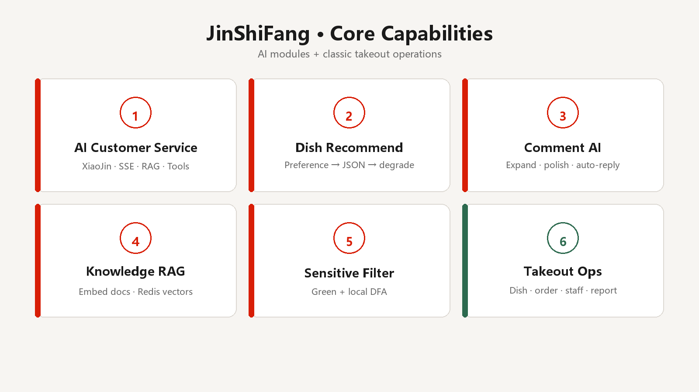
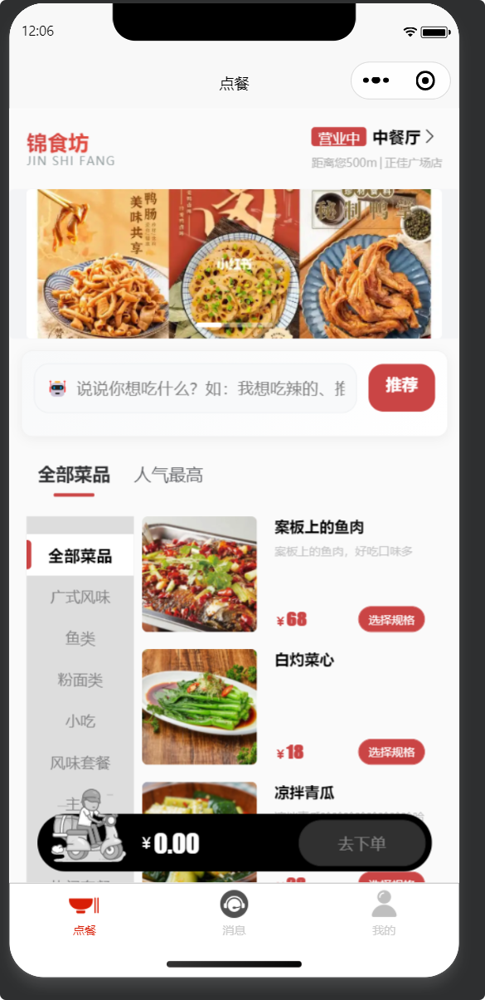
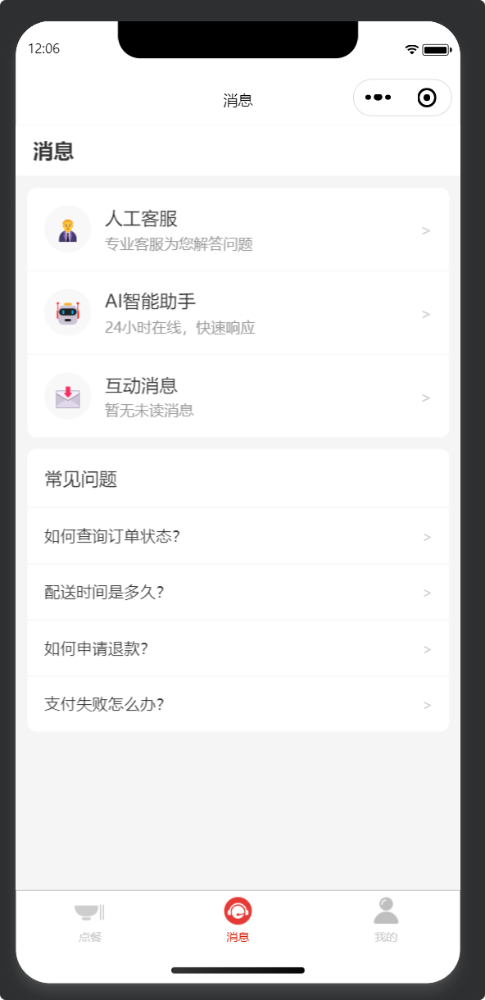
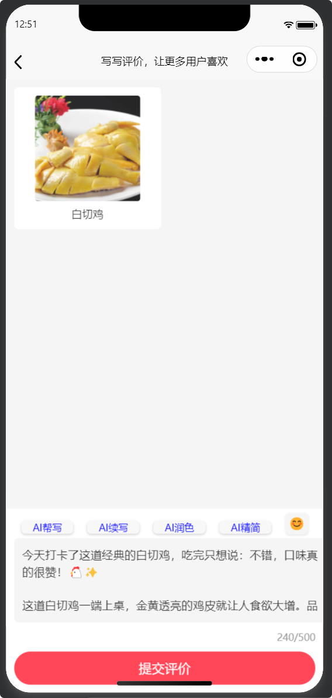
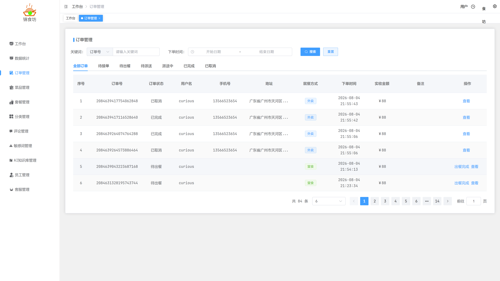
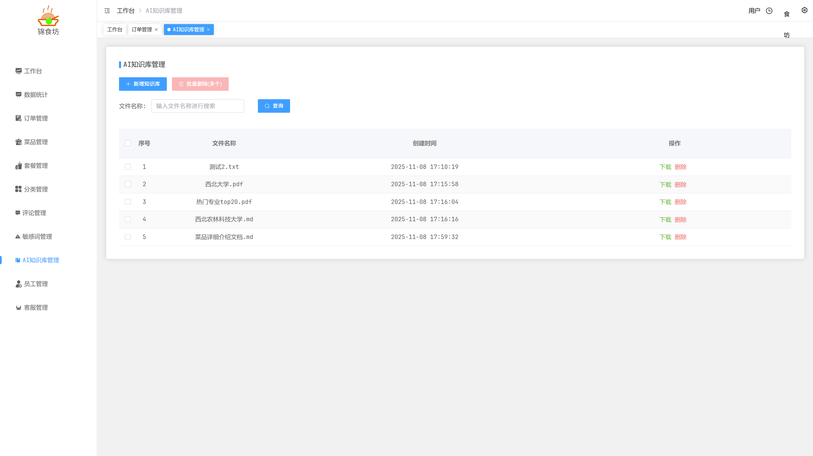
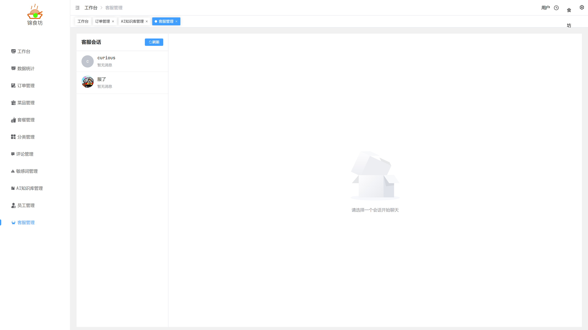
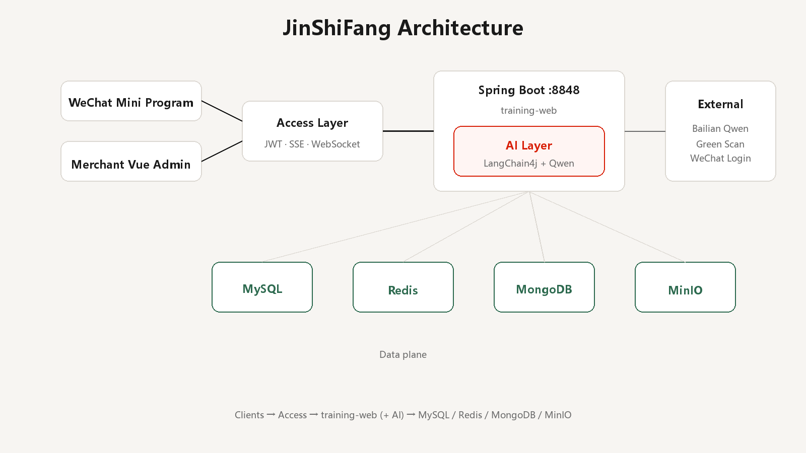
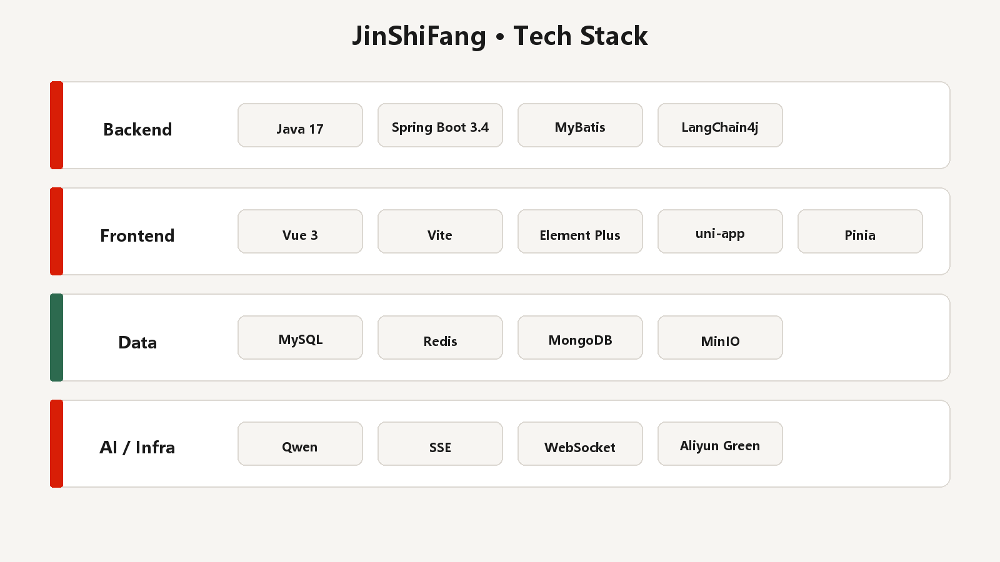
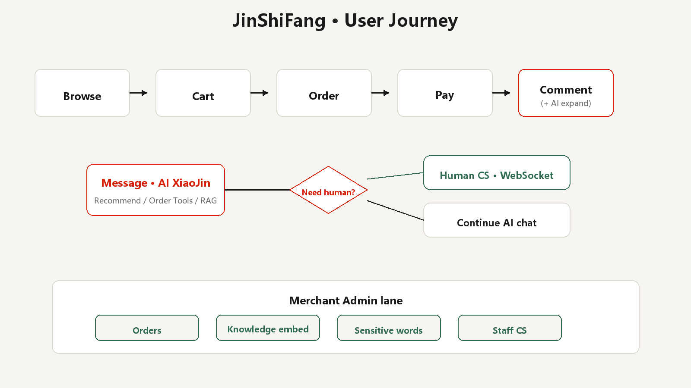

<div align="center">

# 锦食坊 · sky-ai

*AI-enhanced takeout platform with intelligent assistant XiaoJin*

基于苍穹外卖深度重构的培训 / 毕业设计项目：**三端完整可跑**（后端 · 商家端 · 微信小程序），含完整外卖点餐履约链路 + LangChain4j / 通义千问五大 AI 模块（智能客服、菜品推荐、评论扩写、知识库 RAG、敏感词过滤）。


[](code/web/training-web)
[](code/web/training-web)
[](code/vue/training-vue3-main)
[](code/uniapp/training-uniapp-master)
[](docs/苍穹外卖文档/_conv/AI模块设计.md)

[为什么](#为什么需要锦食坊) · [功能](#功能) · [Preview](#preview) · [演示](#演示--showcase) · [快速开始](#快速开始) · [架构](#架构) · [技术栈](#技术栈) · [测试](#测试) · [主链路](#用户主链路) · [目录](#目录结构) · [路线图](#路线图) · [文档](#文档)

</div>

---

> [!TIP]
> `docs/苍穹外卖文档/` 里的论文和开题报告是 2023 年传统版「满香宜」，没有 AI 功能。实现细节以 `code/` 源码 + [`AI模块设计.md`](docs/苍穹外卖文档/_conv/AI模块设计.md) + 根 [`CONTEXT.md`](CONTEXT.md) 为准。

| 端 | 代码路径 | 默认端口 |
| --- | --- | --- |
| 后端 API | `code/web/training-web` | **8848** |
| 商家管理端 | `code/vue/training-vue3-main` | **9527**（proxy `/dev-api` → 8848） |
| 用户小程序 | `code/uniapp/training-uniapp-master` | 编译至微信开发者工具 |

## 为什么需要锦食坊

校园和培训场景里的外卖系统，往往止步于「能下单」：

- 客服只能人工值班，夜间咨询没人管
- 推荐靠静态列表，说不清「为什么推荐这道菜」
- 评论短、运营难沉淀；内容安全缺少可配置的词库
- 毕设论文和代码脱节，接手的人找不到单一事实源——本仓以 [`CONTEXT.md`](CONTEXT.md) 为单一事实源

锦食坊的解法：

| 组件 | 职责 |
| --- | --- |
| 传统外卖内核 | 分类 / 菜品 / 套餐 / 购物车 / 订单履约 / 堂食取餐 / 员工与报表 |
| AI 客服「小锦」 | 7×24 流式多轮对话 + Redis 会话记忆（窗口 20 条 / TTL 6h）+ RAG 知识检索；推荐和查单走业务 Tools |
| 推荐与评论 AI | 自然语言偏好推荐（语义理解 + 规则降级）；评论帮写 / 续写 / 润色 / 精简 + 异步自动回复 |
| 知识库 / 敏感词 | 商家文档上传后自动向量化；阿里云 Green + 本地 DFA 双重内容审核 |
| 人工兜底 | AI 超范围时转人工客服（WebSocket 实时通道） |

```text
User (WeChat Mini Program) ──JWT authentication──┐
Merchant Admin (Vue3) ───────JWT token───────────┼──► Spring Boot :8848
                                                  ├── MySQL / Redis / MongoDB / MinIO
                                                  └── Bailian Qwen · Green · WeChat
```

小程序请求头带 `authentication`，商家端带 `token`，均走 JWT 校验。

---

## 功能



| 领域 | 能力 | 包含内容 | 主要入口 |
| --- | --- | --- | --- |
| 外卖 | 点餐履约 | 分类浏览、菜品/套餐、购物车、外卖/堂食切换、支付与订单状态流转 | `code/uniapp/.../pages/index` · `.../order` |
| 外卖 | 商家运营 | 工作台数据看板、订单管理、菜品/套餐/分类管理、员工权限、统计报表导出 | `code/vue/.../src/views/*` |
| AI | 智能客服 | SSE 流式输出、Redis 记忆窗口 20 条、RAG 检索增强、Dish/Order Tools、转人工兜底 | `ConsultantService` · `pages/message/ai-assistant` |
| AI | 菜品推荐 | 偏好语义理解 + 关键词/热度双降级；浏览行为上报采集（当前不参与排序） | `/client/ai-assistant/recommend` |
| AI | 评论助手 | 帮写 / 续写 / 润色 / 精简四种模式；发评后 AI 异步自动回复 | `/client/ai-comment/expand` |
| AI | 知识库 | 文档解析（PDF/TXT/Word）、文本切块 300 字符 / 100 重叠、`local` 内存向量 / `do` Redis Stack、`minScore=0.6` 相似度过滤 | `/store/knowledgeBase/embed` |
| 安全 | 敏感词 | 阿里云 Green 云审核 + 本地 DFA 词典双重过滤；商家端 CRUD 即时生效 | `/sensitive` · `views/sensitive` |

边界说明：天气为提示词口语能力，无实时 Weather Tool；`item_views` 仅采集上报，不参与推荐排序；部分客服页硬编码 `localhost:8848`，改后端主机需同步前端。

领域术语、Agent 门禁与分端 CONTEXT 见文末 [文档](#文档)。

---

## Preview

本仓库是可运行的三端完整产品，不单独维护资产 Gallery Preview 站。

本地预览 README 渲染效果：

```bash
# 仓库根目录执行
python -m http.server 8091
# 浏览器访问 http://127.0.0.1:8091/preview-readme.html
```

> 必须通过 HTTP 打开；`file://` 协议无法 `fetch` README 内容。

---

## 演示 / Showcase

### 推荐演示路径

1. 按 [快速开始](#快速开始) 执行 `deploy\local\up-native.ps1` 起中间件，再启后端 `:8848` → 商家端 `:9527` 登录 `admin` / `123456`
2. 商家端上传菜品图 / 知识库文档；维护敏感词库
3. 小程序点餐加购 → 下单支付 → 评价页体验 AI 四模式扩写
4. 消息页进入「小锦」→ 输入「想吃辣的」→ 查看推荐卡片 → 必要时转人工客服

### Showcase — 用户小程序

| 点餐首页 | 消息中心 | 评论 AI 扩写 |
| :---: | :---: | :---: |
| [](assets/images/readme/showcase-weapp-order.png) | [](assets/images/readme/showcase-weapp-ai.png) | [](assets/images/readme/showcase-weapp-comment.png) |
| 分类 · 菜品 · AI 推荐 · 购物车 | 人工客服 · AI 助手 · 互动消息 | 帮写 / 续写 / 润色 / 精简 |

### Showcase — 商家管理端

| 订单管理 | AI 知识库管理 | 人工客服 |
| :---: | :---: | :---: |
| [](assets/images/readme/showcase-admin-order.png) | [](assets/images/readme/showcase-admin-kb.png) | [](assets/images/readme/showcase-admin-cs.png) |
| 订单流转 · 外卖/堂食 · 分页搜索 | 文档上传 · 向量化 · RAG | WebSocket 会话 · AI 转人工 |

截图路径：`assets/images/readme/showcase-*.png`（小程序为微信开发者工具真机截取，商家端为 Playwright 自动截取）。

---

## 快速开始

### 环境要求

| 项目 | 版本 / 说明 |
| --- | --- |
| JDK | 17 |
| Node | ≥ 18（商家端与小程序编译） |
| Maven | 系统 Maven（项目无 mvnw） |
| 中间件 | 本机原生：MySQL80 · Redis · MongoDB · MinIO（详见 [`deploy/local/README.md`](deploy/local/README.md)） |
| 云服务 | 阿里云百炼（大模型）· 内容安全 Green · 微信小程序 |

历史 VM 凭据见 gitignore 文件 `docs/虚拟机各个镜像账号密码及下载地址.txt`；**当前默认 `local` profile 不依赖预配虚拟机**。

### 环境变量

部署前在系统或 IDE 中配置以下变量（**只写名称，勿提交明文值**；完整说明见 [`CONTEXT.md`](CONTEXT.md)）：

| 变量名 | 用途 |
| --- | --- |
| `ALIBABA_CLOUD_ACCESS_KEY_ID` / `ALIBABA_CLOUD_ACCESS_KEY_SECRET` | OSS、内容安全 Green |
| `ALIBABA_CLOUD_BAILIAN_ACCESS_KEY` | 百炼大模型 |
| `Wechat_APP_ID` / `Wechat_SECRET` | 小程序登录 |

### 中间件启动

```powershell
# 仓库根目录；确认 MySQL80 服务已 Running
powershell -File deploy\local\up-native.ps1
```

停止 Redis / MongoDB / MinIO（不停 MySQL80）：`powershell -File deploy\local\down-native.ps1`

### 后端启动

```bash
cd code/web/training-web
# 先导入 sql/cq_take_out.sql 到本机 MySQL
mvn -pl training-server -am spring-boot:run -DskipTests "-Dspring-boot.run.profiles=local"
# 服务地址：http://localhost:8848
```

### 商家端启动

```bash
cd code/vue/training-vue3-main
npm install
npm run dev
# 访问地址：http://localhost:9527
# 开发代理：/dev-api → http://localhost:8848
```

### 小程序编译

```bash
cd code/uniapp/training-uniapp-master
npm install
npm run dev:mp-weixin
# 编译产物：dist/dev/mp-weixin
# 微信开发者工具导入该目录即可运行
```

部署成功后要在商家端重新上传 `assets/images/dishes/` 中的 28 张菜品图。部署步骤截图见 `assets/images/deploy/`，文字说明见 `docs/readme.txt`。

> **local 环境注意**
>
> - 向量库为 `InMemoryEmbeddingStore`，**后端重启后需在商家端重新 embed 知识库**。
> - 部分客服页硬编码 `localhost:8848`，改后端主机需同步前端。

---

## 架构



| 层级 | 职责 | 主要实现 |
| --- | --- | --- |
| Clients | 用户点餐 / 商家运营 | `training-uniapp-master`（微信小程序）· `training-vue3-main`（Vue3 管理端） |
| Access | JWT 双头认证、SSE 流式、WebSocket、RESTful | `authentication` / `token` 头 · `/ws/customer-service/**` |
| Application | 外卖业务逻辑 + AI 编排 | `training-server`（32 个 REST Controller：`/client` · `/store` · `/upload` · `/sensitive`）· `LangChain4jConfiguration` |
| Data | 关系数据 / 文档 / 缓存向量 / 对象存储 | MySQL 18 表 · MongoDB 评论文档 · Redis · MinIO |
| External | 大模型与内容审核、微信登录 | 阿里云百炼 Qwen · Green · WeChat |

### 设计原则

1. Code over legacy thesis：「满香宜」论文仅作历史参考，不作现行 API 真相源。
2. AI with tools + RAG：推荐 / 查单走业务 Tools；知识问答靠向量检索，降低模型幻觉。
3. Degrade gracefully：大模型调用失败时自动降级为关键词规则 / 模板 / 固定文案，保证核心功能可用。
4. Human in the loop：AI 客服超范围时转人工；付款与履约仍走传统业务订单流。
5. Secrets stay out：虚拟机密码、API Key、`application-dev.yml` 等敏感信息不入库。

---

## 技术栈



| 层级 | 技术选型 |
| --- | --- |
| Backend | Java 17 · Spring Boot 3.4.5 · MyBatis · LangChain4j 1.10.0-beta18 |
| Merchant Admin | Vue 3 · TypeScript · Vite 5 · Element Plus · Pinia · ECharts |
| Mini Program | uni-app · Vue 3 · uview-plus · Pinia（`pinia-plugin-unistorage` 持久化） |
| Data | MySQL 8.0 · Redis · MongoDB · MinIO |
| AI | 通义千问 `qwen-plus-latest`（对话）· `text-embedding-v4`（向量嵌入） |

---

## 测试

后端 [`training-server/src/test`](code/web/training-web/training-server/src/test) 分四层，约 65+ 用例：

| 层级 | 说明 |
| --- | --- |
| `base/` | 集成测试基类（MockMvc · token 工具） |
| `integration/` | 真实中间件接口集成（`@ActiveProfiles("local")`） |
| `ai/` | 真实调用百炼的 AI 接口 |
| `mock/` | JWT 拦截与参数边界 |

```bash
cd code/web/training-web
mvn test -pl training-server -am   # 需先起本机中间件
```

商家端：`npm run build:prod`（含 vue-tsc）+ lint 三件套；小程序：`npm run type-check`。两端无独立单元测试脚本，以构建与静态检查为门禁。

---

## 用户主链路



```text
用户侧：
浏览菜品 → 加购 → 下单支付 → 评价（AI 扩写辅助）
           ↘ 消息中心 → AI 小锦对话 ⇄ Tools/RAG → 转人工客服（可选）

商家侧：
订单履约 · 知识库上传 · 敏感词维护 · 人工客服
```

---

## 目录结构

```text
sky-ai/
├── AGENTS.md · CONTEXT.md · CONTEXT-MAP.md · LANGUAGES.md · README.md
├── preview-readme.html · preview-readme.css · preview-readme.js
├── .cursor/rules/                 # Windows 路径 / Shell 纪律 / 输出格式 / commit-history
├── code/
│   ├── web/training-web/          # 后端 Spring Boot（端口 8848）
│   ├── vue/training-vue3-main/    # 商家管理端（端口 9527）
│   └── uniapp/training-uniapp-master/  # 用户小程序（编译至微信开发者工具）
├── deploy/local/                  # 本机中间件脚本（up-native.ps1 / README）
├── docs/
│   ├── agents/ · adr/ · contexts/ · outputs/
│   ├── 苍穹外卖文档/              # 毕设母版（「满香宜」传统版）+ AI 补充稿
│   └── readme.txt
└── assets/
    ├── backup/                    # 上游源码压缩包（gitignore，不入库）
    └── images/{dishes,deploy,readme}/  # 菜品图 / 部署截图 / README 配图
```

---

## 路线图

> **受众**：作者与 Agent 的内部里程碑 / 待办，不是给外部访客看的产品宣传板。进度以本表 + `docs/outputs/handoff/` 为准；对外叙事看上文功能与 Showcase。

| 状态 | 事项 | 备注 |
| --- | --- | --- |
| ✅ | 三端可跑 + `local` 本机中间件 | `deploy/local`；profile `local` |
| ✅ | project-init 治理骨架 | `CONTEXT` / `AGENTS` / `LANGUAGES` / ADR / outputs |
| ✅ | AI 叙事与代码对齐 | `_conv/AI模块设计.md`；已知边界写进 CONTEXT |
| ✅ | README / 配图 / Showcase 骨架 | 说明图 + 真机截图已落盘，后续只修漂移 |
| ⬜ | 首个业务 theme | PRD Gate 批准前不写功能代码 |
| ⬜ | `AI模块设计.md` 实测占位补齐 | 截图「待补充」、测试结果「待验证」 |
| ⬜ | 演示债清理 | 客服页硬编码 `localhost`；`local` 向量重启需重 embed |
| ⬜ | 后端工作区脏改动确认 | `code/web/training-web` 若有未提交修改，先判定再入库 |

---

## 文档

推荐阅读顺序：`README` → `CONTEXT` → `AGENTS` → 分端 `docs/contexts/*` → `code/`。

| 文档 | 说明 |
| --- | --- |
| [CONTEXT.md](CONTEXT.md) · [CONTEXT-MAP.md](CONTEXT-MAP.md) | 领域事实与硬约束单一事实源 · 分端索引 |
| [docs/contexts/api/CONTEXT.md](docs/contexts/api/CONTEXT.md) | 后端 API 分端 CONTEXT |
| [docs/contexts/admin/CONTEXT.md](docs/contexts/admin/CONTEXT.md) | 商家管理端分端 CONTEXT |
| [docs/contexts/weapp/CONTEXT.md](docs/contexts/weapp/CONTEXT.md) | 用户小程序分端 CONTEXT |
| [AGENTS.md](AGENTS.md) · [LANGUAGES.md](LANGUAGES.md) | Agent 硬约束、任务流门禁 · 共享用词规范 |
| [deploy/local/README.md](deploy/local/README.md) | 本机中间件启动与 `local` profile 说明 |
| [docs/adr/](docs/adr/) | 架构决策记录 |
| [docs/README.md](docs/README.md) | docs 目录资产索引与维护说明 |
| [AI模块设计.md](docs/苍穹外卖文档/_conv/AI模块设计.md) | AI 功能论文补充稿（需求 / 总体设计 / 详细设计 / 测试） |
| [readme-diagram-brief.md](docs/outputs/prd/readme-diagrams/readme-diagram-brief.md) | README 配图设计契约 |
| [readme-image-prompts.md](docs/outputs/prd/readme-diagrams/readme-image-prompts.md) | 配图生成 Prompt 记录 |
| [assets/README.md](assets/README.md) | 媒体资产目录约定与迁移说明 |
| [assets/images/readme/](assets/images/readme/) | README 配图与 Showcase 截图 |

---

## License / 说明

本项目用于培训与毕业设计用途。上游苍穹外卖与第三方依赖遵循各自许可证。请勿提交 API Key、虚拟机密码、微信 Secret 等敏感信息。
