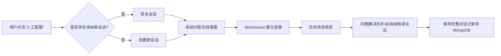
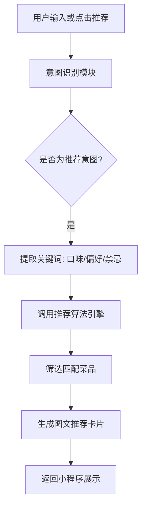
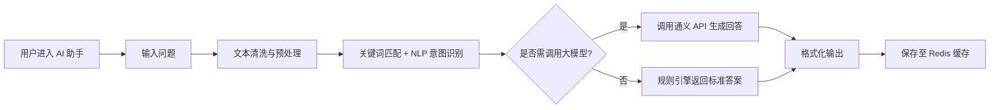
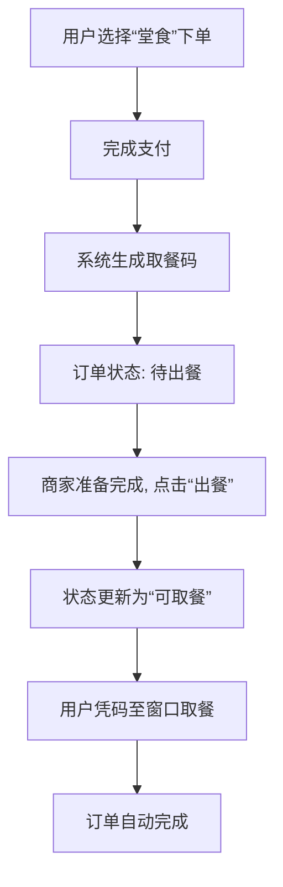

# 🍽️ 苍穹外卖服务平台重构项目

> **项目定位**：基于原有系统的前端重构与功能升级，打造集“智能交互 + 高效服务 +
> 个性化体验”于一体的现代化餐饮服务平台。

本项目以用户体验为核心，重构前端架构，拓展多项智能化模块，新增 **人工客服、AI 智
能助手、AI 菜品推荐、商品详情页、AI 扩写评论、堂食功能** 等关键能力。未来将持续
迭代，构建完整的“用户-商家-骑手”服务闭环，推动平台向智能化、数据化、生态化方向发
展。

---

node >= 18 npm install npm run dev

## 🛠️ 技术架构

### 🔧 后端技术栈（Spring Boot）

| 类别       | 技术选型                                        |
| ---------- | ----------------------------------------------- |
| 核心框架   | Spring Boot 3.4.5 + MyBatis + Spring Cache |
| 大模型集成 | LangChain4j + 通义千问（Qwen）大模型            |
| 数据库     | MySQL（业务数据） + MongoDB（非结构化数据）     |
| 缓存       | Redis（会话缓存、热点数据、对话记录）           |
| 安全认证   | JWT（无状态认证） + Token 自动刷新机制          |

> ✅ **优势**：高并发支持、模块解耦、缓存加速、安全可靠。

---

### 💻 前端技术栈

#### 🎨 管理端（Vue 3）

| 类别       | 技术方案                                |
| ---------- | --------------------------------------- |
| 开发框架   | Vue 3 + TypeScript + Vite（极速构建）   |
| UI 组件库  | Element Plus（企业级组件支持）          |
| 状态管理   | Pinia（轻量、类型安全）                 |
| 图表可视化 | ECharts（动态数据看板）                 |
| 样式方案   | UnoCSS（原子化 CSS） + SCSS（主题定制） |

#### 📱 小程序端（uni-app）

| 类别      | 技术方案                                 |
| --------- | ---------------------------------------- |
| 开发框架  | uni-app + Vue 3 + TypeScript（跨端统一） |
| UI 组件库 | uView Plus（移动端优化组件）             |
| 状态管理  | Pinia + unistorage（本地持久化存储）     |
| 样式方案  | UnoCSS + SCSS（响应式 + 主题灵活）       |

> ✅ **优势**：跨平台兼容、开发效率高、类型安全、样式统一。

---

## 🌟 新增核心功能模块

---

### 1. 💬 人工客服系统

实现用户与客服人员的**实时、高效、可追溯**沟通，提升复杂问题处理能力。

#### ✅ 核心特性

- **会话管理**：支持创建、恢复、关闭会话，避免重复沟通
- **WebSocket 实时通信**：低延迟双向消息推送，保障交互流畅
- **消息持久化**：对话记录完整保存至数据库，支持审计与回溯
- **服务类型区分**：明确标识 AI 助手与人工客服，提升服务透明度

#### 🔄 业务流程图

---

### 2. 🧠 AI 智能推荐菜品

基于用户行为与语义理解的**智能推荐引擎**，让点餐更“懂你”。

#### ✅ 核心特性

- **多维度算法**：融合菜品热度、用户历史订单、用户输入内容
- **自然语言理解**：支持“来点不辣的清淡菜”“适合减肥的主食”等口语化查询
- **个性化输出**：结合用户画像动态调整推荐策略

#### 🔄 推荐流程

> 🔍 **技术支撑**：LangChain4j + 通义大模型语义解析 + 协同过滤算法

---

### 3. 🤖 AI 智能助手

集成通义千问大模型，提供**7×24 小时智能客服**，覆盖常见问题与复杂场景。

#### ✅ 核心特性

- **智能意图识别**：自动分类用户问题（订单查询、菜品咨询、通用问答）
- **上下文记忆**：支持多轮对话，理解上下文语义
- **API 调用能力**：对接订单、菜品、用户系统，实现数据驱动回复
- **对话缓存**：会话记录缓存至 Redis，TTL=1 天，兼顾性能与隐私

#### 🔄 交互流程

---

### 4. 🍜 堂食功能

为到店用户提供**无接触点餐 + 取餐码核销**的便捷服务流程。

#### ✅ 核心特性

- **堂食选项**：下单时可选择“堂食”服务类型
- **取餐码生成**：支付成功后自动生成唯一取餐码（6 位数字）
- **状态同步**：商家端可标记“已出餐”，自动更新订单状态
- **用户提醒**：通过小程序消息通知用户取餐

#### 🔄 业务流程

---

### 5. 📄 商品详情页

提供**沉浸式商品展示体验**，支持图文详情、用户评价、商家推荐等。

#### ✅ 核心功能

- **高清图文展示**：菜品图片、价格、规格、描述
- **用户评论模块**：展示最新的用户文字评价
- **跳转评论页**：点击“查看更多评价”进入独立评论页
- **商家推荐区**：展示同商家热销/搭配菜品，提升转化

#### 🎯 设计目标

> 提升商品信息透明度，增强用户信任感与购买决策效率。

---

### 6. ✍️ 评论模块（含 AI 扩写）

在订单完成后开放评价入口，支持用户撰写评价，并提供 **AI 智能扩写建议**。

#### ✅ 核心特性

- **评价入口**：历史订单中点击“去评价”
- **评分系统**： 文字输入
- **AI 扩写功能**：用户输入简短评价（如“好吃”），AI 自动生成丰富描述（如“口感细
  腻，酱汁浓郁，回味无穷”）
- **内容审核**：AI 敏感词过滤

#### 🔄 评价流程

> 💡 **价值**：提升评论质量与数量，反哺推荐系统与运营分析。

---

## 🚀 未来发展规划

| 规划方向         | 目标与举措                                                            |
| ---------------- | --------------------------------------------------------------------- |
| **骑手端拓展**   | 开发独立骑手 App，支持接单、导航、状态上报、收入统计，完善配送闭环    |
| **推荐算法升级** | 引入协同过滤、深度学习模型（如 DeepFM），提升推荐精准度与多样性       |
| **功能持续优化** | 优化现有模块性能，提升系统稳定性、响应速度与容错能力                  |
| **数据中台建设** | 构建可视化数据看板（ECharts），支持订单、用户、菜品、客服等多维度分析 |
| **AI 能力深化**  | 探索语音交互、图像识别（菜品拍照识别）、智能营销话术生成等新场景      |

---

> 📌 **项目备注**：
>
> - 已实现前后端完全分离，接口标准化（RESTful + Swagger）
> - 所有 AI 功能均支持降级机制，保障系统稳定性

---

🎉 **愿景**：  
**用技术重塑餐饮体验，让每一次点餐都更智能、更贴心、更高效。**

---

✨ **让科技赋能餐饮，打造智慧、高效、贴心的服务体验！**

---
