- 目录
- [第一章 前言](#_Toc120284276)
    - [1.1 课题研究背景及其意义](#_Toc120284277)
- [第二章 系统需求分析](#_Toc120284278)
    - [2.1 功能需求分析](#_Toc120284279)
    - [2.2 非功能需求分析](#_Toc120284280)
        - [2.2.1 性能需求](#_Toc120284281)
        - [2.2.2 硬件环境](#_Toc120284282)
        - [2.2.3 软件环境](#_Toc120284283)
- [第三章 系统设计](#_Toc120284284)
    - [3.1 系统架构设计](#_Toc120284285)
    - [3.2 系统功能模块设计](#_Toc120284286)
    - [3.3 人机页面](#_Toc120284287)
    - [3.4 数据库设计](#_Toc120284288)
        - [3.4.1 数据库概念结构设计](#_Toc120284289)
        - [3.4.2 数据库表结构设计](#_Toc120284290)
- [第四章 详细设计](#_Toc120284291)
    - [4.1 员工管理模块](#_Toc120284292)
        - [4.1.1 员工管理主界面](#_Toc120284293)
        - [4.1.2 添加员工信息](#_Toc120284294)
        - [4.1.3 修改员工信息](#_Toc120284295)
        - [4.1.4 启用、禁用员工账号](#_Toc120284296)
    - [4.2 分类管理模块](#_Toc120284297)
        - [4.2.1 分类管理主界面](#_Toc120284298)
        - [4.2.2 新增分类信息](#_Toc120284299)
        - [4.2.3 修改分类信息](#_Toc120284300)
        - [4.2.4 删除分类信息](#_Toc120284301)
    - [4.3 菜品管理模块](#_Toc120284302)
        - [4.3.1 菜品管理主界面](#_Toc120284303)
        - [4.3.2 新增菜品信息](#_Toc120284304)
        - [4.3.3 修改菜品信息](#_Toc120284305)
        - [4.3.4 删除菜品信息](#_Toc120284306)
        - [4.3.5 停售、起售菜品](#_Toc120284307)
    - [4.4 套餐管理模块](#_Toc120284308)
        - [4.4.1 套餐管理主界面](#_Toc120284309)
        - [4.4.2 新增套餐信息](#_Toc120284310)
        - [4.4.3 修改套餐信息](#_Toc120284311)
        - [4.4.4 删除套餐信息](#_Toc120284312)
        - [4.4.5 停售、起售套餐](#_Toc120284313)
    - [4.5 订单明细模块](#_Toc120284314)
        - [4.5.1 订单明细主界面](#_Toc120284315)
        - [4.5.2 查看订单信息](#_Toc120284316)
        - [4.5.3 派送，完成订单](#_Toc120284317)
- [第五章 系统测试](#_Toc120284318)
    - [5.1 测试方法](#_Toc120284319)
    - [5.2 部分功能测试](#_Toc120284320)
        - [5.2.1 登录功能测试](#_Toc120284321)
        - [5.2.2 员工管理测试](#_Toc120284322)
        - [5.2.3 套餐管理测试](#_Toc120284323)
        - [5.2.4 安全性测试](#_Toc120284324)
- 第六章 绪论
- [参考文献](#_Toc120284326)

# 前言

## 1.1 课题研究背景及其意义

随着国民经济的迅猛增长，人民消费水平的持续增长推动了整个餐饮行业的成长。近年来餐饮行业的成长非常快速，以前的运营方式已经跟不上顾客的需求了。特别是学生已经上班族这类人群，忙碌的学习或是工作令他们不得不更加注重时间的节约。而今人们不仅对食物的种类及口味愈加挑剔，也对如何便捷快速地完成订餐提出了要求。外卖这一行业由此应运而生，旨在节约人们的用餐时间，提供高效率的服务。与此同时，众多传统行业搭上了这趟高速行驶的列车，以全新的面貌展示在世人面前，使得电子商务在近几年经历着突飞猛进的发展。传统的购物方式也在向着互联网方向发展，作为服务业支柱的餐饮业也不例外。

餐饮行业现在已经是服务性行业的代表，最近几年来我们国家的餐饮业之间的竞争愈为激烈。怎么样提供更加好的的服务，怎么样能够吸引更多的消费者，怎么样能够很好地利用网络对消费者的账户信息进行管理，怎么样能够保证员工的工作效率是当前所有企业领导人都需要去面对和解决的问题。餐饮行业是一个服务性的行业，顾客首先是第一位，需要给顾客一种舒服的感受。其次提高自身的管理水平，能够在最短的时间内规范各种业务各种操作也是非常有必要的，这样才能够大大地增加顾客的回头率。

传统餐饮企业的日常运作还是靠人工管理。从原材料入库到客人点单，再到结账基本上由人工完成记录。这样做不仅耗费人力资源而且容易导致记录丢失或重复等错误，造成管理水平低下。而此次的外卖配送平台系统不能提高管理系统，还能给管理者提供一个企业运作的信息平台，同时帮助提升企业的形象及增强竞争力。使用餐饮管理系统能将餐饮企业业务管理和人员管理信息化，使企业从原材料进货到客人消费都由计算机管理并记录，可随时掌握餐厅客人点单，挂账等情况，并能尽可能的降低使用者的劳动强度，同时提高工作质量和效率。大多数此行业的运营者可以因此得利，与此同时，消费者订餐也变得更加方便。

# 系统需求分析

## 2.1 功能需求分析

基于外卖配送平台系统共有顾客，员工，管理员3个角色，管理员端一共可以分为五大模块，分别为员工管理，分类管理，菜品管理，套餐管理，订单管理。其用例图如图2-1所示。

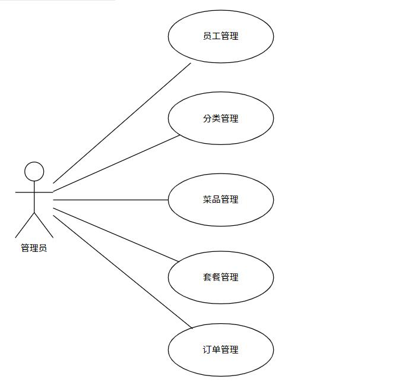  
图2-1 管理员用例图

每个模块的主要的功能分别如下：

1. 员工管理：

管理员可以在系统后台对员工信息进行管理，可以查询所有的用户的信息，也可以根据关键字进行模糊查询，也可以添加用户和修改用户信息，管理员还能禁用员工的权限，被管理员禁用的用户就不能在登录系统了。用例图如图2-2所示：

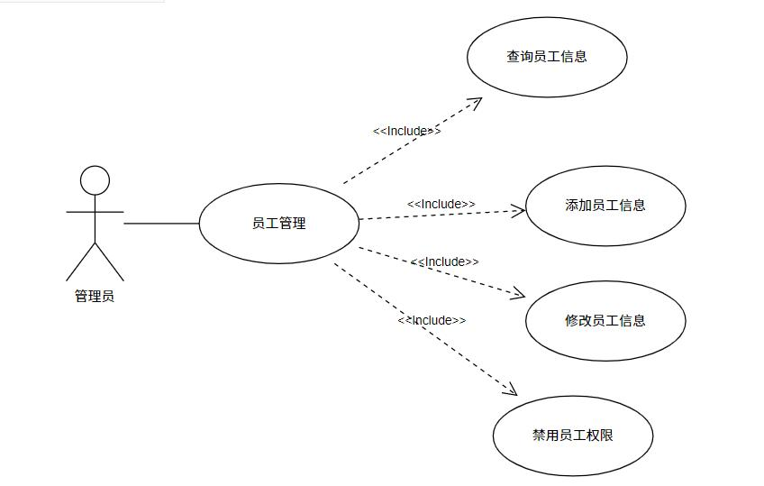  
图2-2 员工管理用例图

2. 分类管理：

管理员将所有分类信息查询出来，分页展示到分类管理的主页面。另外管理员可以添加菜品和套餐的分类信息，也可以修改和删除菜品和套餐的分类信息，用例图如图2-3所示：

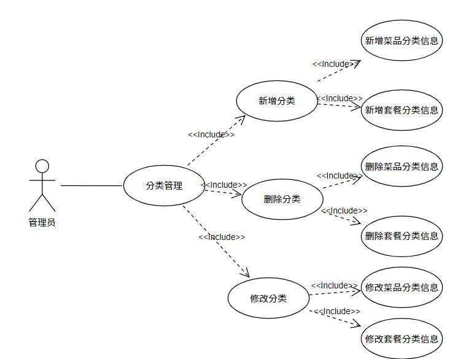  
图2-3分类管理用例图

3. 菜品管理：

在菜品主页面中管理员会将所有的菜品信息查询出来并分页展示出来，管理员还可以对菜品信息进行增，删，改操作，除此之外还可以根据关键字对菜品进行模糊查询，方便管理员找到要操作的菜品信息。另外管理员还可以更改菜品的状态，控制该菜品是处于停售状态还是售卖状态。管理员还可以对菜品进行批量操作，用例图如2-4所示：

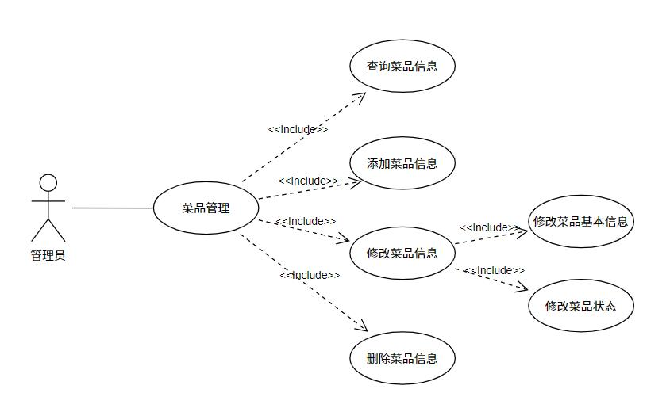  
图2-4菜品管理用例图

4. 套餐管理：

在套餐管理主页面中管理员会将所有的套餐信息查询出来并分页展示出来，管理员还可以对套餐信息进行增，删，改操作，除此之外还可以根据关键字对套餐进行模糊查询，方便管理员找到要操作的套餐信息。另外管理员还可以更改套餐的状态，控制该套餐是处于停售状态还是售卖状态。管理员还可以对套餐进行批量操作，用例图如2-5所示：

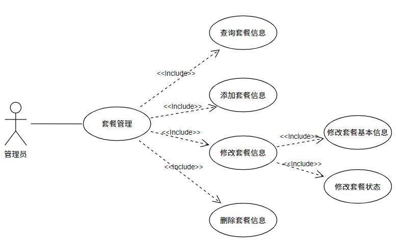  
图2-5 套餐管理用例图

5．订单管理：

管理员会将所有的订单信息查询出来并分页展示到订单管理页面，此外管理员还可以根据订单号，以及开始日期以及结束日期快速查询订单信息，另外管理员还可以查询订单的详细信息以及修改订单的状态。用例图如图2-6所示：

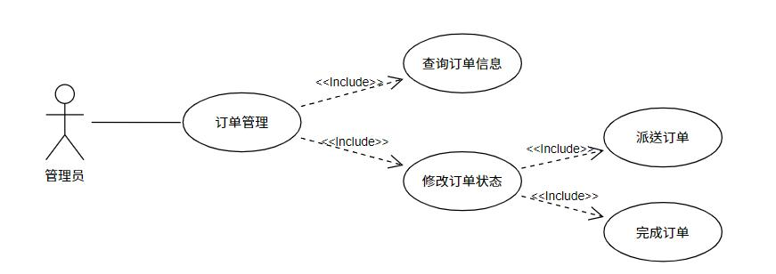  
图2-6 订单管理用例图

## 2.2 非功能需求分析

### 2.2.1 性能需求

外卖配送平台-管理员端，前端页面比较简单，安全性也比较高，能够流畅运用，适用于大多的操作系统。开发软件版本：Java语言，数据库运行工具、能够在后台存放大量的数据，且存放数据比较安全。基于过程管理，提高管理效果。并发度1000使得外卖配送平台在性能上都得到了大大提升，以下是性能处理方面。

（1）并发度：1000（Tomcat）

（2）响应时间：5s

（3）事务处理：2分钟

（4）可扩展性：基于接口的MVC架构

（5）安全性：基于角色的权限管理

### 2.2.2 硬件环境

处理器： Intel(R) Core(TM) i5-10210U CPU @ 1.60GHz   2.11 GHz

内存容量：8G

硬盘容量：1T

### 2.2.3 软件环境

操作系统版本：Windows 10

系统软件：IntelliJ IDEA、Visul Studio Code

数据库管理系统：DataGrip、MySQL、Redis、RESP

网络：100Mbps的无线网络

# 系统设计

基于SpringBoot外卖系统共有后台系统管理员、后台系统普通员工和前端用户3个角色。

后台系统管理员功能模块：登录后台系统，拥有后台系统中的所有操作权限。

后台系统普通员工：登录后台管理系统，分类管理、对菜品、套餐、订单等进行管理。

前端用户：登录前端页面，可以浏览菜品、添加购物车、设置地址、在线下单个人信息页面查看订单等操作。

### **3.1.2系统用例图**

根据系统参与者的功能我们设计出系统用例图，其用例图如下图3.1所示。

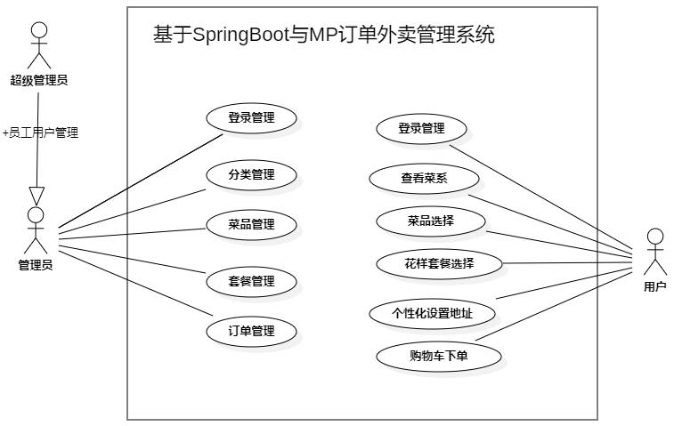  
图3.1订单管理系统用例图

每个模块主要功能分别如下：

其中因超级管理员拥有所有权限，故后台管理端以其为例。

1. 用户管理：此功能模块包含了对普通员工的新增、修改、删除。当添加用户完成时可以选择保存或者保存并继续添加，当对某一员工修改信息时会回显数据库保存信息，并且可以对普通员工进行状态修改，可以选择是否禁用启用此用户，用例图如下图3.2所示。

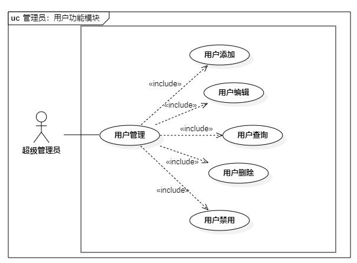  
图3.2用户管理用例图

2. 分类管理：在分类管理中，我们有两大分类，其一为菜品分类，二为套餐分类，而分类管理中的排序功能，为分类的种类进行排序，设置排序为升序排序，1最大，越是近1，则在移动端用户页面显示的时候，自动的分类就会越在上面。而1则为默认显示的首页，若多个分类为1，则以最后更新时间为准；在修改时会访问数据库，拿到保存的数据回显到页面上，用例图如下图3.3所示。

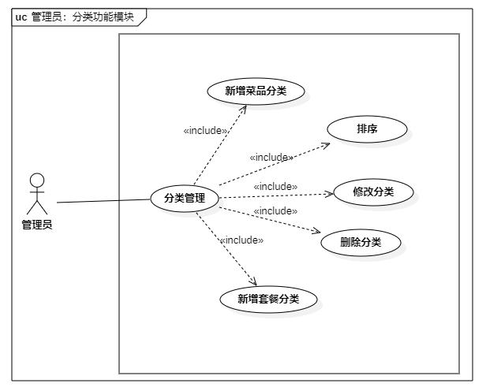  
图3.3分类管理用例图

3. 菜品管理：菜品管理有着传统的CRUD,但是有所不同的是，在新增时会根据菜品分类进行在本分类下进行添加，分类不同菜品不同，同时在菜品中可以通过对此菜品的文件上传下载在本地，同时在页面中还有在移动端用户处显示；同时在进行菜品的新增修改时可以选择个性化口味；而批量删除则可以通过对菜品进行多选进行删除，而进行删除的菜品需要首先将菜品进行停售，也即“status=0”后才能删除；起售停售菜品就是改变菜品当前状态，用例图如下图3.3所示。

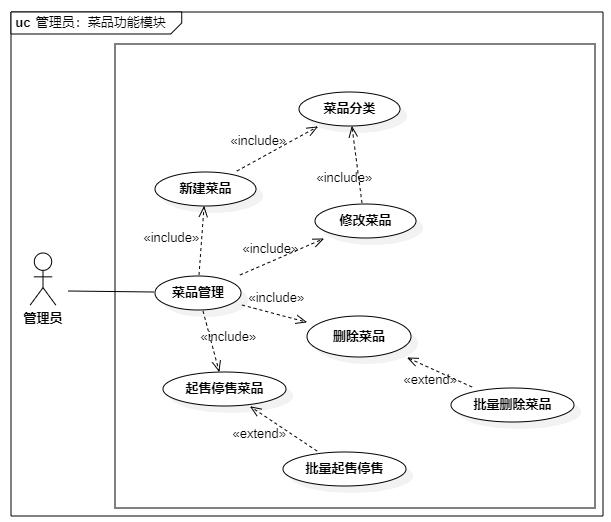  
图3.4菜品管理用例图

现以删除菜品为例模拟次功能模块的事件流，在删除菜品中有一个重要的关联条件为菜品是可以添加到套餐中的，即若想要删除菜品在某一正在售卖的套餐中，我们是无法对其进行删除的，否则会抛异常，套餐不完整也就没用，所以删除菜品用例规约表如下表3.1所示。

表3.1 删除菜品规约表

<table><tr><td>
用例名称：
</td><td>
删除菜品
</td></tr><tr><td>
用例ID：
</td><td>
UC1001
</td></tr><tr><td>
角色：
</td><td>
后台系统管理员
</td></tr><tr><td>
前置条件：
</td><td>
管理员角色已登录、新增菜品同时此菜品状态为起售
</td></tr><tr><td>
基本事件流：
</td><td><ol><li>管理员在本事件流中可以选择首先停止销售此菜品，此时菜品状态被修改为“停售”，即“status=0”</li><li>之后所以根据需求删除或批量删除想要删除的菜品。 </li></ol>
3. 删除了菜品后，用户在移动端时在是浏览不到此菜品的，当然在停售状态下的菜品也无法浏览。
</td></tr><tr><td>
扩展事件流：
</td><td><ol><li>若此菜品在某一套餐中，将无法被删除，只有当要删除的菜品关联的套餐没有在售卖，才可以被删除。</li><li>如果认为此菜品在当前不可销售，却又不忍彻底删除则可以选择“停售”，当想要重新起售此菜品时可选择“起售”。</li><li>可以批量删除不想要销售的菜品。 </li></ol></td></tr><tr><td>
后置条件：
</td><td>
删除菜品，将更新过的菜品数据或套餐数据保存到数据库中
</td></tr></table>

1. 套餐管理：套餐管理与菜品管理相似，只是多了一个嵌套关系，就是套餐

包含不止一个菜品。在新增套餐中首先需要已有的套餐分类进行选择，之后在新增菜品时，可以通过已有菜品分类进行模糊查询搜索并可以批量添加；而进行删除的菜品需要首先将菜品进行停售，也即“status=0”后才能删除。在修改套餐中可以自主对套餐中的菜品进行删除，用例图如下图3.5所示。

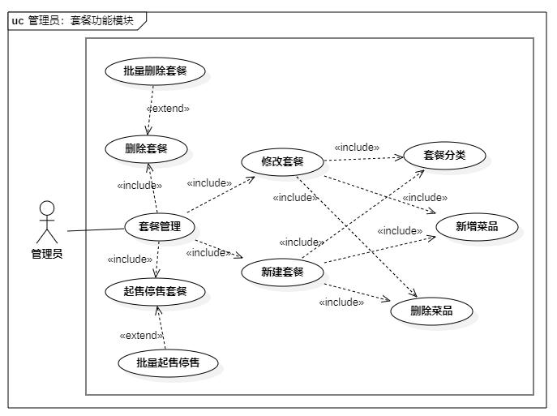  
图3.5套餐管理用例图

在添加套餐的时候，我们首先要选择已有的套餐分类，在此套餐分类下，我们添加一些我们各式菜品，当你想要添加菜品时，可以直接在搜索框中进行模糊查询进行添加，当添加后觉得不是很合理也可以直接进行删除菜品，当然觉得不够也可以点击“+”“-”进行个性化数量选择，之后上传文件下载到服务器显示，保存即可，所以新增套餐规约表如下表3.2所示

表3.2 新增套餐规约表

<table><tr><td>
用例名称：
</td><td>
新增套餐
</td></tr><tr><td>
用例ID：
</td><td>
UC1002
</td></tr><tr><td>
角色：
</td><td>
后台系统管理员
</td></tr><tr><td>
前置条件：
</td><td>
管理员角色已登录，添加的菜品起售中
</td></tr><tr><td>
基本事件流：
</td><td><ol><li>管理员在本事件流中点击“新增套餐”，跳转添加套餐页面。</li><li>选择已有套餐分类，编辑套餐名称价格。 </li></ol>
3. 点击“添加菜品”，可以直接搜索栏搜索要添加的菜品，或者直接点击菜品分类去搜索，之后对菜品进行数量选择。
</td></tr><tr><td>
扩展事件流：
</td><td><ol><li>如果不想要添加某一菜品，也可以直接选择“删除菜品”。</li><li>可以批量删除不想要添加的菜品。 </li></ol></td></tr><tr><td>
后置条件：
</td><td>
新增套餐，将更新过的套餐数据保存到数据库中
</td></tr></table>

5.订单管理：当用户选择菜品或套餐购入购物车后，在管理后端的订单管理中会显示当前的“订单明细”，管理员可以手动操作订单是否完成，订单状态会由“正在派送”更改为“已派送”，也可以查看订单的详细信息，用例图如下图3.6所示。

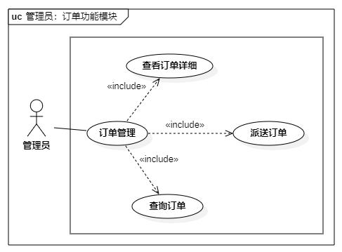  
图3.6订单管理用例图

6.地址簿管理：开发移动端时，当用户购入菜品后下单要填写收货地址，添加收货地址并且可以给此地址打上一个标签，表示其属性，并且可以设置地址是否为默认地址，如果地址为默认地址则，此账户下一次下单后直接以此地址作为收货地址，同时可以去个人主页的地址管理可以查询指定用户的所有地址并可以对地址的CRUD，用例图如下图3.7所示。

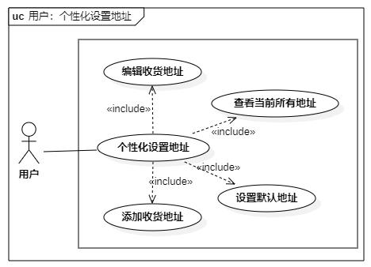  
图3.7地址簿管理用例图

7. 购物车管理：当用户想要选择菜品或者是套餐时，就可以点击“+”购入购物车，想要什么就添加什么，也可以点击购物车一栏查看购物车的选择，不想要的点击“—”，也可以直接选择清空购物车，用例图如下图3.8所示。

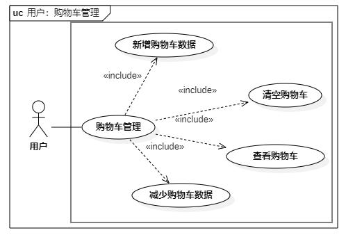  
图3.8地址簿管理用例图

## 3.1 系统架构设计

本系统采用了前后端分离的方式，在后端框架中我们可将其看成三层结构Web服务层、业务逻辑服务层和持久层，前端则是用Vue搭建的HTML页面，前后端通过Axios封装的Ajax技术跨域传值，数据则用Json格式封装，在这里前后端分离架构图如图3-1所示。

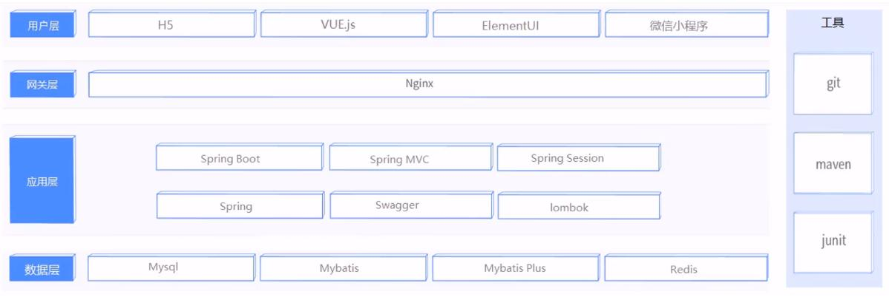  
图3-1 前后端分离架构图

## 3.2 系统功能模块设计

外卖配送平台系统是由移动前台端，系统后台管理员端两个模块相互结合而成。外卖配送平台系统管理员端功能图如图所示3-2：

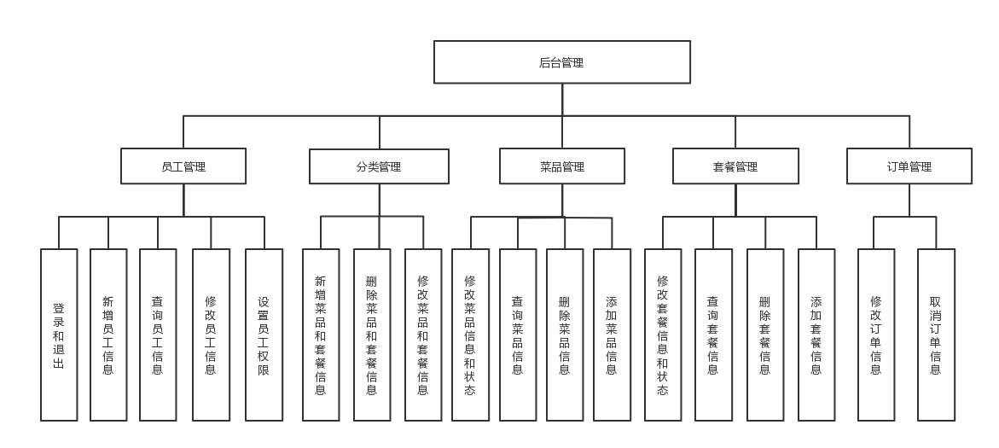  
图3-2 外卖配送平台系统后端功能图

## 3.3 人机页面

系统主要包括管理员、员工、用户3个角色，根据不同角色的功能设计界面，管理员端设计界面如表3.1所示。

表3.1管理员端设计界面表

<table><tr><td>
角色
</td><td>
描述（界面显示）
</td><td>
窗体名（程序中用到）
</td></tr><tr><td rowspan="10">
管理员
</td><td>
员工管理
</td><td>
employee.html
</td></tr><tr><td>
添加员工
</td><td>
add..html
</td></tr><tr><td>
分类管理
</td><td>
category.html
</td></tr><tr><td>
套餐管理
</td><td>
combol.html
</td></tr><tr><td>
 新建套餐
</td><td>
add.html
</td></tr><tr><td>
菜品管理
</td><td>
food.html
</td></tr><tr><td>
新建菜品
</td><td>
add.html
</td></tr><tr><td>
订单明细
</td><td>
orders.html
</td></tr><tr><td>
登录
</td><td>
login.html
</td></tr><tr><td>
退出
</td><td>
logout.html
</td></tr><tr><td>
外卖配送平台系统管理端
</td><td>
主界面
</td><td>
index.tml
</td></tr></table>

## 3.4 数据库设计

### 3.4.1 数据库概念结构设计

通过上述对基于外卖配送平台系统管理-管理员端的设计与实现，可以得出实现该系统需要使用的数据实体，从而得知该系统的类图如图3-3所示。

图3-3系统类图

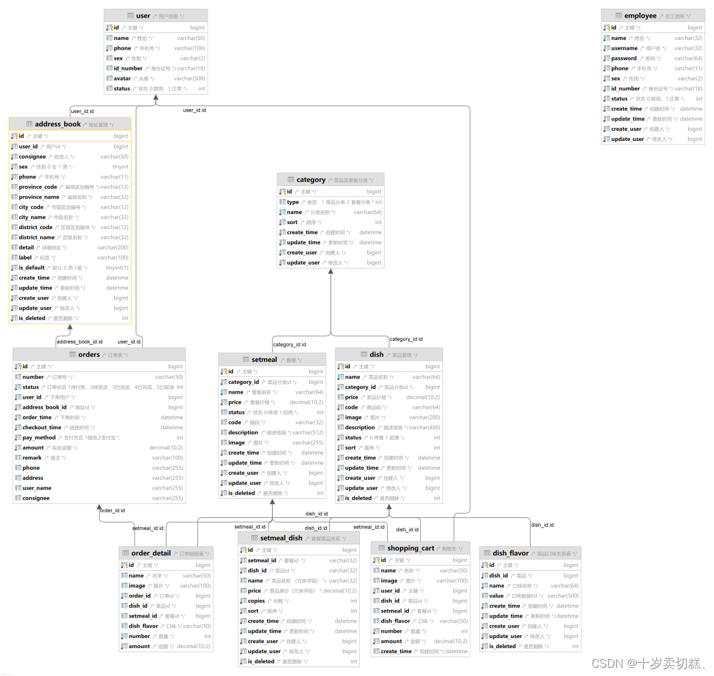

### **3.4.1 数据库概念结构设计**

通过上述对基于外卖配送平台系统管理-管理员端的设计与实现，可以得出实现该系统需要使用的数据实体，从而得知各个实体属性图如下图5.6所示。

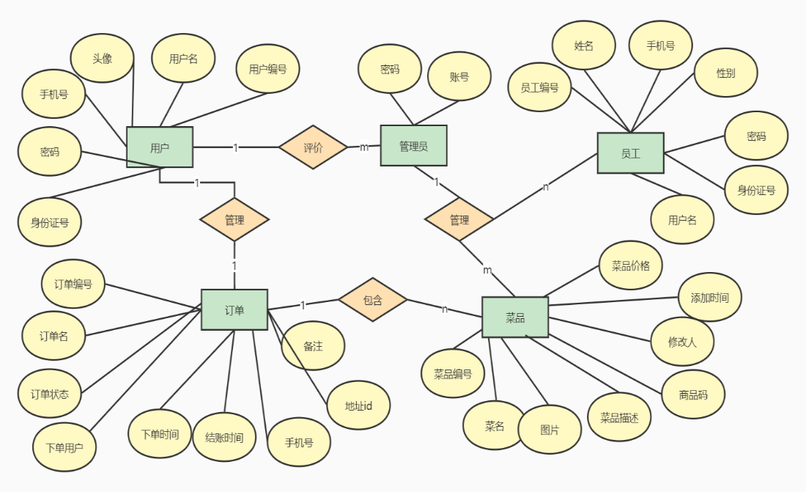  
图5.6 用户下单实体图

我们抽象出系统的实体，并设计部分E-R图，如下。

用户信息（用户编号、姓名、手机号、性别、身份证号、头像、状态）如图5.

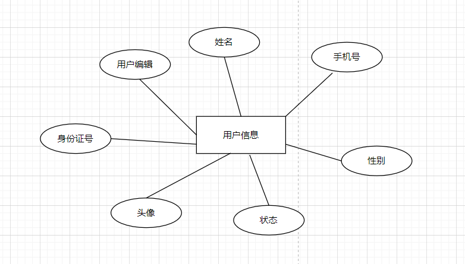  
图5.7用户信息实体图

菜品信息（菜品编号、菜品名称、菜品分类id、菜品价格、商品码、图片、描述信息、状态、顺序、创建时间、更新时间、创建人、修改人）如图5.8

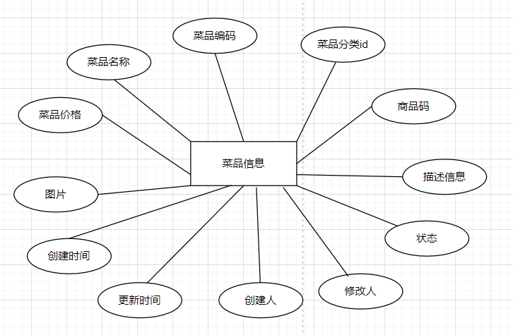  
图5.8菜品信息实体图

订单信息（订单编号、订单名、订单状态、下单用户、地址id、下单时间、结账时间、支付方式、实收金额、备注、手机号）如图5.9

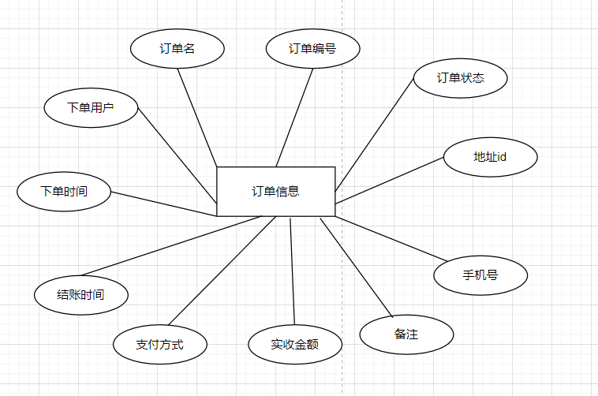  
图5.9订单信息实体图

套餐信息（编号、菜品分类id、套餐名称、套餐价格、状态、编码、描述信息、图片、创建时间、更新时间、创建人、修改人）如图5.10

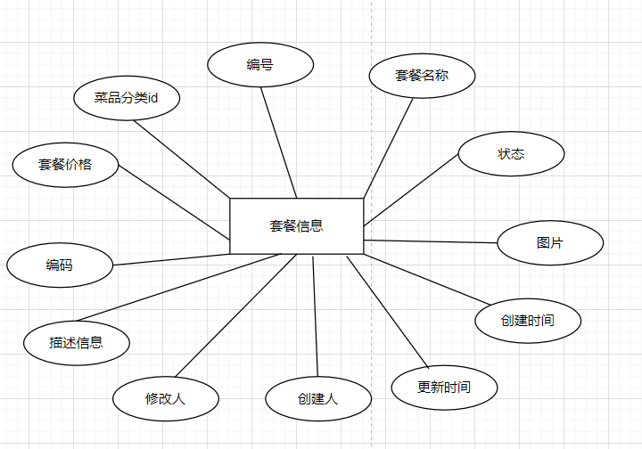  
图5.10套餐信息实体图

菜品与套餐分类信息（编号、类型、分类名称、顺序、创建时间、更新时间、创建人、修改人）如图5.11

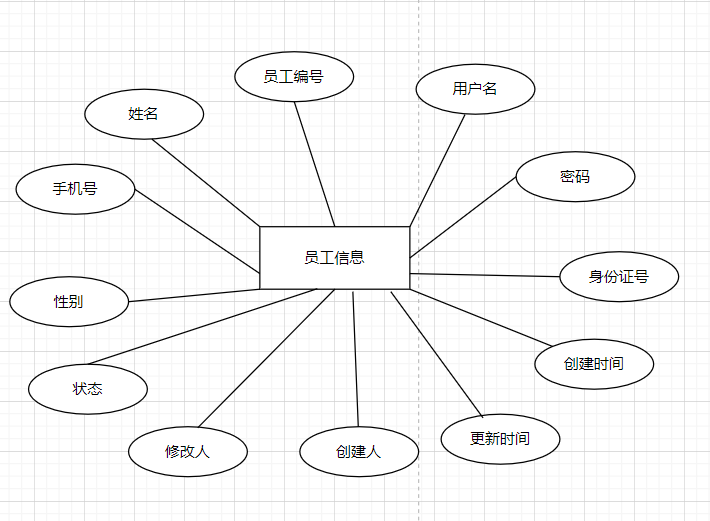  
图5.11菜品与套餐分类信息

员工信息（员工编号、姓名、用户名、密码、手机号、性别、身份证号、状态、创建时间、更改时间、创建人、修改人）如图5.12

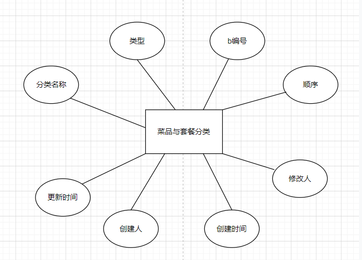  
图5.12员工信息实体图

地址信息（编号、用户id、收货人、性别、手机号、省级区划编号、省级名称、市级区划编号、市级名称、区级区划编号、区级名称、详细地址、标签）如图5.13

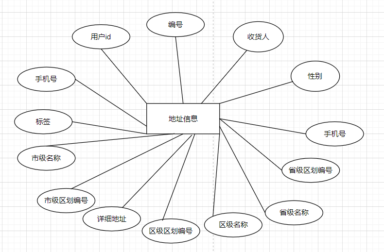  
图5.13地址信息实体图

菜品口味信息（编号、菜品、口味名称、口味数据list、创建时间、更新时间、创建人、修改人）如图5.14

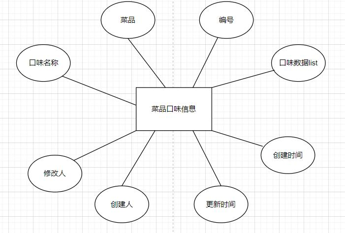  
图5.14菜品口味信息实体图

订单明细（编号、名字、图片、订单id、菜品id、套餐id、口味、数量、金额）如图5.15

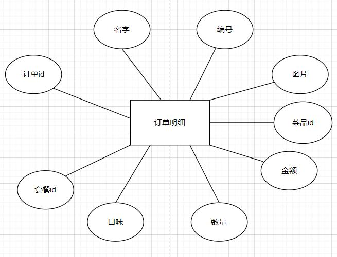  
图5.15订单明细实体图

套餐菜品关系信息（编号、套餐id、菜品id、菜品名称、菜品原价、份数、创建时间、修改时间）如图5.16

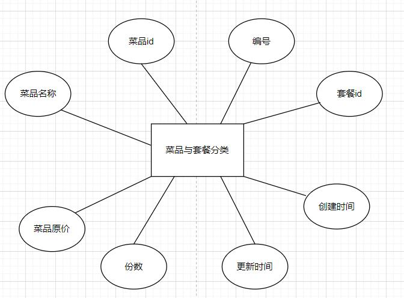  
图5.16套餐菜品信息实体图

购物车信息（编号、名称、图片、用户id、菜品id、套餐id、口味、数量、金额、创建时间）如图5.17

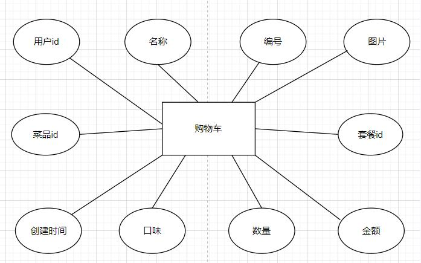  
图5.17购物车信息实体图

### 3.4.2 数据库表结构设计

根据数据库概念结构设计中的实体及属性描述、以及数据库的规范化理论，设计管理员信息表、分类信息表、菜品管理信息表、菜品口味关系表、员工信息表、订单信息表、订单明细表、套餐信息表、套餐菜品关系表、购物车信息表和用户信息表、表3-2至表3-12是各个数据库表的逻辑结构。

表3-2 管理员信息表

<table><tr><td>
字段名
</td><td>
列类型与长度
</td><td>
描述
</td><td>
备注
</td></tr><tr><td>
num
</td><td>
varchar(255)
</td><td>
工号
</td><td>
主键
</td></tr><tr><td>
name
</td><td>
varchar(32)
</td><td>
姓名
</td><td>
非空
</td></tr><tr><td>
username
</td><td>
varchar(32)
</td><td>
姓名
</td><td>
非空
</td></tr><tr><td>
password
</td><td>
varchar(64)
</td><td>
密码
</td><td>
非空
</td></tr></table>
  
表3-3 分类信息表

<table><tr><td>
字段名
</td><td>
列类型与长度
</td><td>
描述
</td><td>
备注
</td></tr><tr><td>
id
</td><td>
bigint(20)
</td><td>
编号
</td><td>
主键
</td></tr><tr><td>
type
</td><td>
int(11)
</td><td>
类型
</td><td>
非空
</td></tr><tr><td>
name
</td><td>
varchar(64)
</td><td>
分类名称
</td><td>
非空
</td></tr><tr><td>
sotr
</td><td>
int(11)
</td><td>
顺序
</td><td>
非空
</td></tr><tr><td>
Create_time
</td><td>
datetime
</td><td>
创建时间
</td><td>
非空
</td></tr><tr><td>
Update_time
</td><td>
datetime
</td><td>
更新时间
</td><td>
非空
</td></tr><tr><td>
Create_user
</td><td>
 bigint(20)
</td><td>
创建人
</td><td>
非空
</td></tr><tr><td>
Update_user
</td><td>
 bigint(20)
</td><td>
修改人
</td><td>
非空
</td></tr></table>
  
表3-4 菜品管理信息表

<table><tr><td>
字段名
</td><td>
列类型与长度
</td><td>
描述
</td><td>
备注
</td></tr><tr><td>
id
</td><td>
bigint(20)
</td><td>
编号
</td><td>
主键
</td></tr><tr><td>
name
</td><td>
varchar(64)
</td><td>
菜品名称
</td><td>
非空
</td></tr><tr><td>
category_id
</td><td>
bigint(20)
</td><td>
菜品分类id
</td><td>
非空
</td></tr><tr><td>
price
</td><td>
decimal(10,2)
</td><td>
菜品价格
</td><td>
非空
</td></tr><tr><td>
code
</td><td>
varchar(64)
</td><td>
商品码
</td><td>
非空
</td></tr><tr><td>
image
</td><td>
varchar(200)
</td><td>
图片
</td><td>
非空
</td></tr><tr><td>
description
</td><td>
 varchar(400)
</td><td>
描述信息
</td><td>
非空
</td></tr><tr><td>
status
</td><td>
 int(11)
</td><td>
0 停售 1 起售
</td><td>
非空
</td></tr><tr><td>
sort
</td><td>
int(11)
</td><td>
顺序
</td><td>
非空
</td></tr><tr><td>
Create_time
</td><td>
datetime
</td><td>
创建时间
</td><td>
非空
</td></tr><tr><td>
Update_time
</td><td>
datetime
</td><td>
更新时间
</td><td>
非空
</td></tr><tr><td>
Create_user
</td><td>
 bigint(20)
</td><td>
创建人
</td><td>
非空
</td></tr><tr><td>
Update_user
</td><td>
 bigint(20)
</td><td>
修改人
</td><td>
非空
</td></tr><tr><td>
is_deleted
</td><td>
int(11)
</td><td>
是否删除
</td><td>
非空
</td></tr></table>
  
表3-5 菜品口味关系表

<table><tr><td>
字段名
</td><td>
列类型与长度
</td><td>
描述
</td><td>
备注
</td></tr><tr><td>
id
</td><td>
bigint(20)
</td><td>
编号
</td><td>
主键
</td></tr><tr><td>
dish_id
</td><td>
bigint(20)
</td><td>
菜品
</td><td>
非空
</td></tr><tr><td>
name
</td><td>
varchar(64)
</td><td>
口味名称
</td><td>
非空
</td></tr><tr><td>
value
</td><td>
varchar(500)
</td><td>
口味数据list
</td><td>
非空
</td></tr><tr><td>
Create_time
</td><td>
datetime
</td><td>
创建时间
</td><td>
非空
</td></tr><tr><td>
Update_time
</td><td>
datetime
</td><td>
更新时间
</td><td>
非空
</td></tr><tr><td>
Create_user
</td><td>
 bigint(20)
</td><td>
创建人
</td><td>
非空
</td></tr><tr><td>
Update_user
</td><td>
 bigint(20)
</td><td>
修改人
</td><td>
非空
</td></tr><tr><td>
is_deleted
</td><td>
int(11)
</td><td>
是否删除
</td><td>
非空
</td></tr></table>
  
表3-6 员工信息表

<table><tr><td>
字段名
</td><td>
列类型与长度
</td><td>
描述
</td><td>
备注
</td></tr><tr><td>
id
</td><td>
bigint(20)
</td><td>
编号
</td><td>
主键
</td></tr><tr><td>
name
</td><td>
varchar(32)
</td><td>
姓名
</td><td>
非空
</td></tr><tr><td>
username
</td><td>
varchar(32)
</td><td>
姓名
</td><td>
非空
</td></tr><tr><td>
password
</td><td>
varchar(64)
</td><td>
密码
</td><td>
非空
</td></tr><tr><td>
phone
</td><td>
 varchar(11)
</td><td>
手机号
</td><td>
非空
</td></tr><tr><td>
sex
</td><td>
varchar(2)
</td><td>
性别
</td><td>
非空
</td></tr><tr><td>
id_number
</td><td>
varchar(18)
</td><td>
身份证号
</td><td>
非空
</td></tr><tr><td>
status
</td><td>
int(11)
</td><td>
状态0:禁用1:正常
</td><td>
非空
</td></tr><tr><td>
Create_time
</td><td>
datetime
</td><td>
创建时间
</td><td>
非空
</td></tr><tr><td>
Update_time
</td><td>
datetime
</td><td>
更新时间
</td><td>
非空
</td></tr><tr><td>
Create_user
</td><td>
 bigint(20)
</td><td>
创建人
</td><td>
非空
</td></tr><tr><td>
Update_user
</td><td>
 bigint(20)
</td><td>
修改人
</td><td>
非空
</td></tr></table>
  
表3-7 订单信息表

<table><tr><td>
字段名
</td><td>
列类型与长度
</td><td>
描述
</td><td>
备注
</td></tr><tr><td>
id
</td><td>
bigint(20)
</td><td>
编号
</td><td>
主键
</td></tr><tr><td>
number
</td><td>
varchar(50)
</td><td>
订单号
</td><td>
非空
</td></tr><tr><td>
status
</td><td>
int(11)
</td><td>
订单状态 1待付款，2待派送，3已派送，4已完成，5已取消
</td><td>
非空
</td></tr><tr><td>
user_id
</td><td>
 bigint(20)
</td><td>
下单用户
</td><td>
非空
</td></tr><tr><td>
address_book_id
</td><td>
bigint(20)
</td><td>
地址id
</td><td>
非空
</td></tr><tr><td>
order_time
</td><td>
datetime 
</td><td>
下单时间
</td><td>
非空
</td></tr><tr><td>
checkout_time
</td><td>
datetime
</td><td>
结账时间
</td><td>
非空
</td></tr><tr><td>
pay_method
</td><td>
int(11)
</td><td>
支付方式 1微信,2支付宝
</td><td>
非空
</td></tr><tr><td>
amount
</td><td>
varchar(255)
</td><td>
实收金额
</td><td>
非空
</td></tr><tr><td>
remark
</td><td>
varchar(255)
</td><td>
备注
</td><td>
非空
</td></tr><tr><td>
phone
</td><td>
 varchar(11) 
</td><td>
电话
</td><td>
非空
</td></tr><tr><td>
address
</td><td>
varchar(255)
</td><td>
地址
</td><td>
非空
</td></tr><tr><td>
user_name
</td><td>
varchar(32)
</td><td>
用户名
</td><td>
非空
</td></tr><tr><td>
consignee
</td><td>
varchar(50) 
</td><td>
收货人
</td><td>
非空
</td></tr></table>
  
表3-8 订单明细表

<table><tr><td>
字段名
</td><td>
列类型与长度
</td><td>
描述
</td><td>
备注
</td></tr><tr><td>
id
</td><td>
 bigint(20)
</td><td>
编号
</td><td>
主键
</td></tr><tr><td>
name
</td><td>
varchar(50)
</td><td>
名字
</td><td>
非空
</td></tr><tr><td>
image
</td><td>
varchar(100)
</td><td>
图片
</td><td>
非空
</td></tr><tr><td>
order_id
</td><td>
bigint(20)
</td><td>
订单id
</td><td>
非空
</td></tr><tr><td>
dish_id
</td><td>
bigint(20)
</td><td>
菜品id
</td><td>
非空
</td></tr><tr><td>
setmeal_id
</td><td>
bigint(20)
</td><td>
套餐id
</td><td>
非空
</td></tr><tr><td>
dish_flavor
</td><td>
varchar(50)
</td><td>
口味
</td><td>
非空
</td></tr><tr><td>
number
</td><td>
 int(11)
</td><td>
数量
</td><td>
非空
</td></tr><tr><td>
amount
</td><td>
decimal(10,2)
</td><td>
金额
</td><td>
非空
</td></tr></table>
  
表3-9 套餐信息表

<table><tr><td>
字段名
</td><td>
列类型与长度
</td><td>
描述
</td><td>
备注
</td></tr><tr><td>
id
</td><td>
bigint(20)
</td><td>
编号
</td><td>
主键
</td></tr><tr><td>
category_id
</td><td>
bigint(20)
</td><td>
菜品分类id
</td><td>
非空
</td></tr><tr><td>
name
</td><td>
varchar(64
</td><td>
套餐名称
</td><td>
非空
</td></tr><tr><td>
price
</td><td>
decimal(10,2)
</td><td>
套餐价格
</td><td>
非空
</td></tr><tr><td>
status
</td><td>
 int(11)
</td><td>
状态0 停售 1 起售
</td><td>
非空
</td></tr><tr><td>
code
</td><td>
 varchar(32)
</td><td>
编码
</td><td>
非空
</td></tr><tr><td>
description
</td><td>
 varchar(512)
</td><td>
描述信息
</td><td>
非空
</td></tr><tr><td>
image
</td><td>
varchar(255)
</td><td>
图片
</td><td>
非空
</td></tr><tr><td>
Create_time
</td><td>
datetime
</td><td>
创建时间
</td><td>
非空
</td></tr><tr><td>
Update_time
</td><td>
datetime
</td><td>
更新时间
</td><td>
非空
</td></tr><tr><td>
Create_user
</td><td>
 bigint(20)
</td><td>
创建人
</td><td>
非空
</td></tr><tr><td>
Update_user
</td><td>
 bigint(20)
</td><td>
修改人
</td><td>
非空
</td></tr><tr><td>
is_deleted
</td><td>
 int(11)
</td><td>
是否删除
</td><td>
非空
</td></tr></table>
  
表3-10 套餐菜品关系表

<table><tr><td>
字段名
</td><td>
列类型与长度
</td><td>
描述
</td><td>
备注
</td></tr><tr><td>
id
</td><td>
bigint(20)
</td><td>
编号
</td><td>
主键
</td></tr><tr><td>
setmeal_id
</td><td>
varchar(32)
</td><td>
'套餐id
</td><td>
非空
</td></tr><tr><td>
dish_id
</td><td>
varchar(32)
</td><td>
菜品id
</td><td>
非空
</td></tr><tr><td>
name
</td><td>
 varchar(32)
</td><td>
菜品名称 
</td><td>
非空
</td></tr><tr><td>
price
</td><td>
decimal(10,2)
</td><td>
菜品原价
</td><td>
非空
</td></tr><tr><td>
copies
</td><td>
 int(11)
</td><td>
份数
</td><td>
非空
</td></tr><tr><td>
sort
</td><td>
int(11)
</td><td>
排序
</td><td>
非空
</td></tr><tr><td>
Create_time
</td><td>
datetime
</td><td>
创建时间
</td><td>
非空
</td></tr><tr><td>
Update_time
</td><td>
datetime
</td><td>
更新时间
</td><td>
非空
</td></tr><tr><td>
Create_user
</td><td>
 bigint(20)
</td><td>
创建人
</td><td>
非空
</td></tr><tr><td>
Update_user
</td><td>
 bigint(20)
</td><td>
修改人
</td><td>
非空
</td></tr><tr><td>
is_deleted
</td><td>
 int(11)
</td><td>
是否删除
</td><td>
非空
</td></tr></table>
  
表3-11 购物车信息表

<table><tr><td>
字段名
</td><td>
列类型与长度
</td><td>
描述
</td><td>
备注
</td></tr><tr><td>
id
</td><td>
bigint(20)
</td><td>
编号
</td><td>
主键
</td></tr><tr><td>
name
</td><td>
 varchar(50)
</td><td>
名称
</td><td>
非空
</td></tr><tr><td>
image
</td><td>
varchar(100) 
</td><td>
图片
</td><td>
非空
</td></tr><tr><td>
user_id
</td><td>
bigint(20)
</td><td>
主键
</td><td>
非空
</td></tr><tr><td>
dish_id
</td><td>
bigint(20)
</td><td>
菜品id
</td><td>
非空
</td></tr><tr><td>
setmeal_id
</td><td>
bigint(20)
</td><td>
套餐id
</td><td>
非空
</td></tr><tr><td>
dish_flavor
</td><td>
 varchar(50)
</td><td>
口味
</td><td>
非空
</td></tr><tr><td>
number
</td><td>
int(11)
</td><td>
数量
</td><td>
非空
</td></tr><tr><td>
amount
</td><td>
 decimal(10,2)
</td><td>
金额
</td><td>
非空
</td></tr><tr><td>
create_time
</td><td>
datetime
</td><td>
创建时间
</td><td>
非空
</td></tr></table>
  
表3-12 用户信息表

<table><tr><td>
字段名
</td><td>
列类型与长度
</td><td>
描述
</td><td>
备注
</td></tr><tr><td>
id
</td><td>
bigint(20)
</td><td>
编号
</td><td>
主键
</td></tr><tr><td>
name
</td><td>
varchar(50)
</td><td>
姓名
</td><td>
非空
</td></tr><tr><td>
phone
</td><td>
 varchar(100)
</td><td>
手机号
</td><td>
非空
</td></tr><tr><td>
sex
</td><td>
varchar(2)
</td><td>
性别
</td><td>
非空
</td></tr><tr><td>
id_number
</td><td>
varchar(18)
</td><td>
身份证号
</td><td>
非空
</td></tr><tr><td>
avatar
</td><td>
varchar(500)
</td><td>
头像
</td><td>
非空
</td></tr><tr><td>
status
</td><td>
int(11)
</td><td>
状态0:禁用1:正常
</td><td>
非空
</td></tr></table>

# 详细设计

## 4.1 员工管理模块

### 4.1.1 员工管理主界面

员工管理模块包括员工的模糊查询、添加、修改、禁用等功能。员工管理的主界面如图4-1所示：

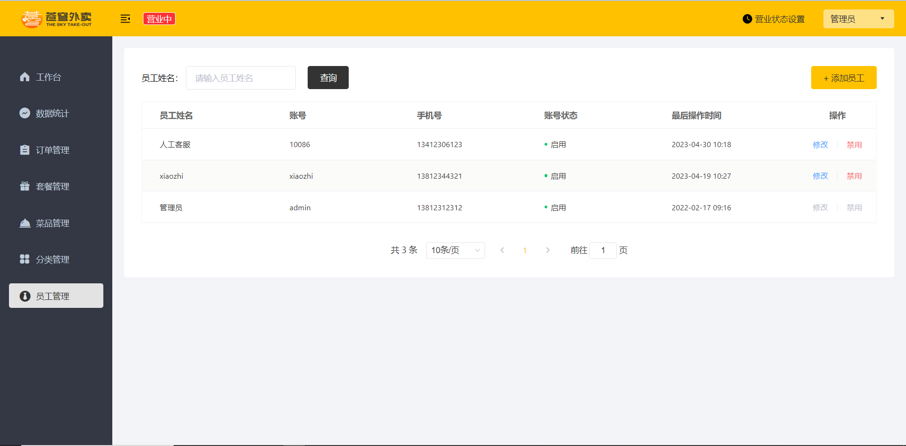  
图4-1用户管理主界面

员工的模糊查询功能的顺序图如图4-2所示：

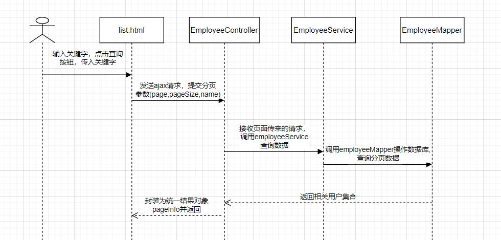  
图4-2用户模糊查询顺序图

（1）在list.html页面上，管理员通过点击输入框输入关键字，再点击查询按钮，就会触发点击事件返送Ajax请求，将关键字name,当前页数page以及每页的信息条数pageSize作为参数传入，调用EmployeeServlet中的page方法。

（2）EmployeeServlet拿到参数之后，首先将page,pageSize作为参数构造分页构造器，然后构造一个条件构造器queryWrapper，然后判断name是否为空，如果不为空，将name作为queryWrapper.like的参数添加过滤条件，最后将pageInfo,queryWapper作为参数调用EmployeeService的page方法。

（3）EmployeeService接收到参数之后，调用page方法将name拼接成数据库模糊查询所要求的字段格式（“%name%”）最后传到数据库查询Dao层的EmployeeMapper中进行数据库的操作。

（4）Dao层接收到传过来的参数后。把参数放入SQL语句中进行数据库的查询操作，然后将查询结果封装为商品信息集合返回给控制器，最后组装成返回结果类R返回给前端视图。

### 4.1.2 添加员工信息

添加员工界面如图4-3所示：

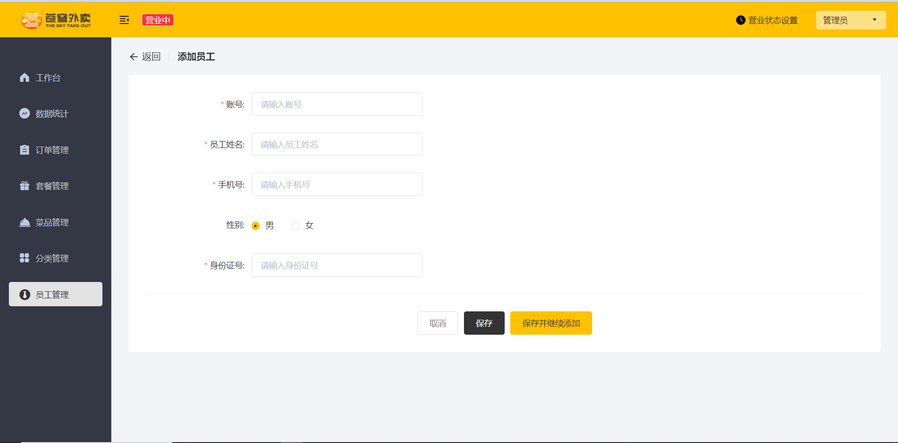  
图4-3 添加员工界面

添加员工功能的顺序图如图4-4所示：

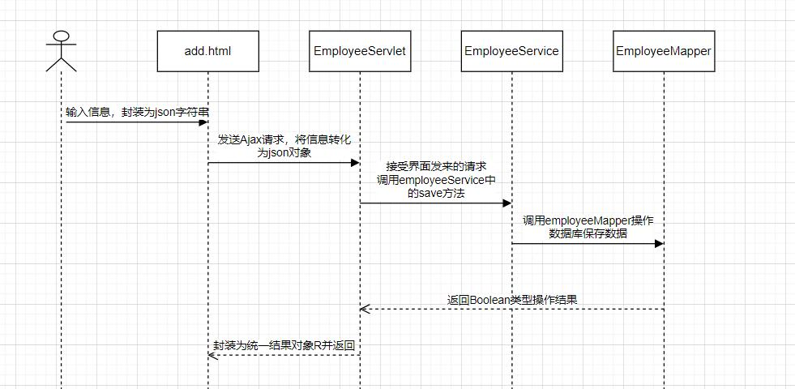  
图4-4 员工添加顺序图

1. 在add.html上，管理员通过输入账号，员工姓名，手机号，选择性别以及输入身份证号等信息，将一系列信息填写完整后点击保存按钮，会将信息封装为json对象，通过Ajax发送跨域请求，调用EmployeeController中的save()方法。
2. EmployeeController通过@RequestBody注解将接收到的json对象转为java对象，设置初始密码并进行md5加密，然后将java对象作为参数调用EmployeeService中的save方法。
3. EmployeeService接收到Java对象的参数后，传到数据库查询Dao层的EmployeeMapper中调用insert(obj)方法进行数据库的操作。
4. Dao层接收到传过来的参数后。把Java对象中的字段取出，放入SQL语句中进行数据库的插入，插入成功后返回Integer类型的值给控制器，如果为1则插入成功，否则将插入失败，最后控制器再将结果组装成R返回给前端视图。

### 4.1.3 修改员工信息

管理员可以点击用户管理主页面的右边操作栏编辑按钮修改员工信息，修改员工信息界面如图4-5所示。

  
图4-5 修改员工信息界面

修改员工信息顺序图如图4-6所示：

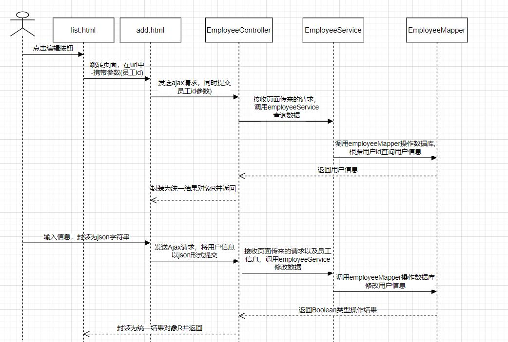  
图4-6修改员工信息顺序图

1. 在list.html上，管理员通过点击编辑按钮，跳转到add.html页面并在url中携带参数员工id，add.html在初始化时就会执行生命周期函数created并取出路径中的商品id发送Ajax跨域请求，调用EployeeController中的getById ()方法。
2. EployeeControlle接收员工id，将员工id作为参数调用EmployeeService中的getById()方法。
3. EmployeeService接收到参数之后，传到数据库查询的Dao层的EmployeeMapper中调用selectById()方法进行数据库的操作。
4. Dao层接收到传过来的参数后将用户id取出，放入SQL语句中进行数据库的查询，返回对应的用户信息到add.html中回显。
5. 数据回显之后，管理员可以对需要修改的信息进行填写，填写完之后点击保存按钮，之后页面会将用户信息封装为json对象，并发送Ajax请求调用EmployeeController中的update方法。
6. EmployeeController通过@RequestBody注解将接收到的json对象转为java对象，然后调用EmployeeService中的updateById(obj)方法。
7. employeeService接收到Java对象的参数后，传到数据库查询Dao层的EmployeeMapper中调用updateById(obj)方法进行数据库的操作。
8. Dao层接收到传过来的参数后。把Java对象中的字段取出，放入SQL语句中进行数据库的修改，修改成功后返回Integer类型的值给控制器，如果为1则修改成功，否则将修改失败，最后控制器再将结果组装成R返回给前端视图。

### 4.1.4 启用、禁用员工账号

管理员可以点击用户管理主页面的右边操作栏禁用（启用）按钮来禁用（启用）员工账号，被禁用的员工账号不能再登录该系统。禁用（启用）员工账号界面如图4-7所示。

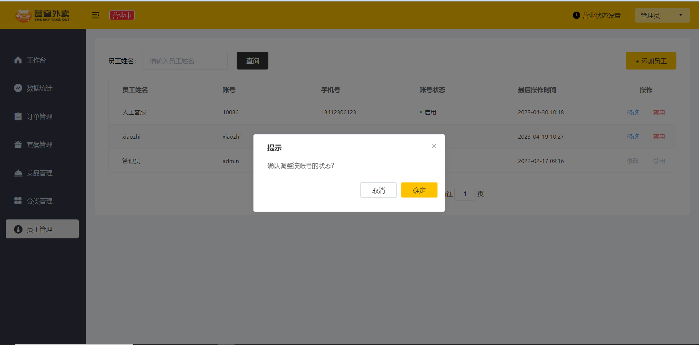  
图4-7 禁用（启用）员工账号界面

禁用（启用）员工账号顺序图如图4-6所示：

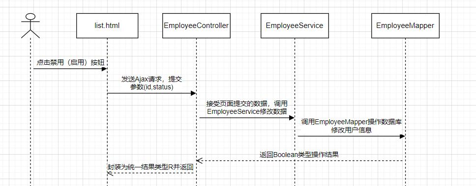  
图4-7禁用（启用）员工账号顺序图

1. 在add.html上，管理员通过点击禁用（启用）按钮将员工id以及员工状态status作为参数向Ajax发送跨域请求，调用EmployeeController中的update()方法。
2. EmployeeController接收页面发送过来的参数并封装为java对象，然后将java对象作为参数调用employeeService中的updateById(obj)方法。
3. EmployeeService接收到Java对象的参数后，传到数据库查询Dao层的EmployeeMapper中调用updateById(obj)方法进行数据库的操作。
4. Dao层接收到传过来的参数后。把Java对象中的字段取出，放入SQL语句中进行数据库的修改，修改成功后返回Integer类型的值给控制器，如果为1则修改成功，否则将修改失败，最后控制器再将结果组装成R返回给前端视图。

## 4.2 分类管理模块

### 4.2.1 分类管理主界面

分类管理模块包括添加菜品或者套餐分类，修改分类信息，删除分类信息。分类管理的主界面如图4-8所示：

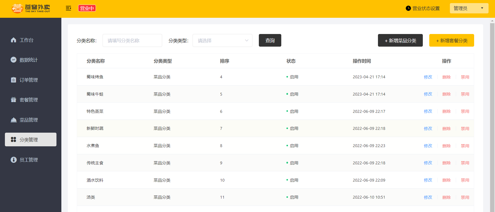  
图4-8 分类管理主界面

### 4.2.2 新增分类信息

管理员可以点击新增菜品分类或者新增套餐分类按钮来添加菜品分类或者套餐分类。新增分类界面如图4-9所示：

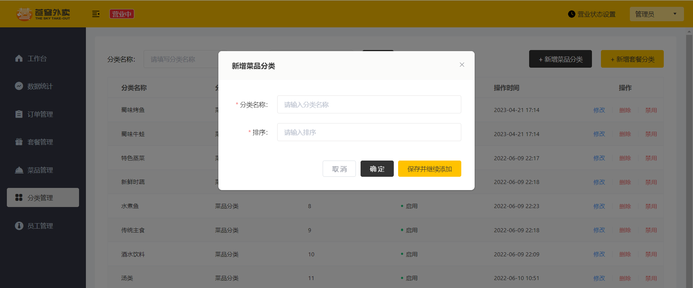  
图4-9 新增分类界面

新增分类信息顺序图如图4-10所示：

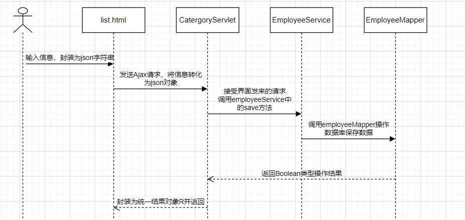  
图4-10 新增分类信息顺序图

1. 在list.html上，管理员通过输入分类名称以及顺序等信息，将一系列信息填写完整后点击保存按钮，会将信息封装为json对象，其中如果添加的是菜品信息json对象中的type的值是1，如果添加的是套餐信息json对象中的type的值是1，然后通过Ajax发送跨域请求，调用CategroyController中的save()方法。
2. CategroyController通过@RequestBody注解将接收到的json对象转为java对象，然后将java对象作为参数调用CategroyService中的save方法。
3. CategroyService接收到Java对象的参数后，传到数据库查询Dao层的CategroyMapper中调用insert(obj)方法进行数据库的操作。
4. Dao层接收到传过来的参数后。把Java对象中的字段取出，放入SQL语句中进行数据库的插入，插入成功后返回Integer类型的值给控制器，如果为1则插入成功，否则将插入失败，最后控制器再将结果组装成R返回给前端视图。

### 4.2.3 修改分类信息

管理员可以点击分类信息右侧操作中的修改按钮修改分类信息，管理员点击分类信息后就会触发list.html页面中的editHandle(scope.row)方面对分类信息进行回显。回显完数据之后管理员就可以对需要修改的信息进行填写，然后点击确定按钮就可以成功修改数据。修改分类信息界面如图4-11所示。

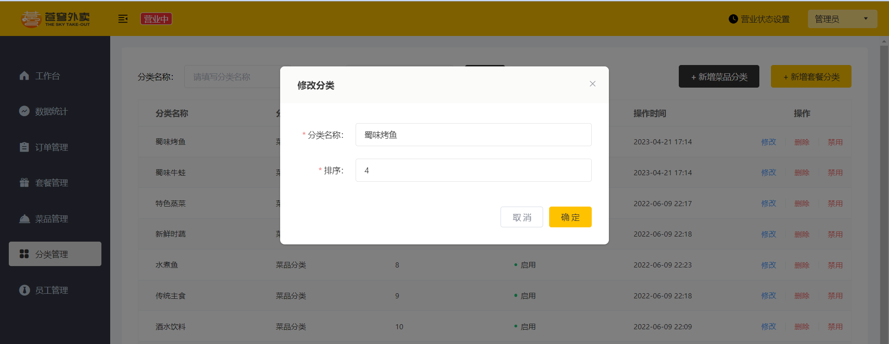

图4-11 修改分类信息页面

### 4.2.4 删除分类信息

管理员可以点击分类信息右侧操作中的删除按钮删除分类信息，删除分类界面如图4-12所示。

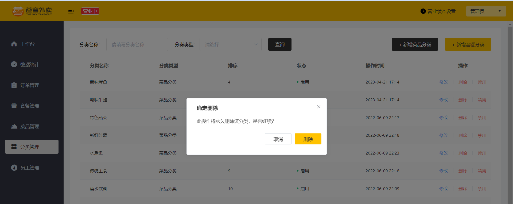  
图4-12 删除分类界面

删除分类顺序图如图4-13所示：

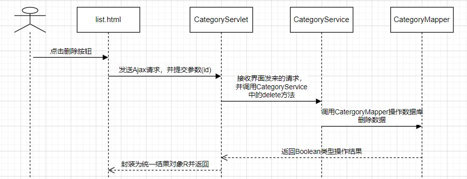  
图4-13 删除分类信息顺序图

1. 在list.html上，管理员通过点击删除按钮，发送A jax跨域请求提交分类id，调用CategroyController中的delete()方法。
2. CategroyController通过将接收的分类id作为参数调用CategroyService中的delete方法。
3. CategroyService接收到Java对象的参数后，传到数据库查询Dao层的DishMapper中调用count方法看返回的值是否大于0，如果大于0就说明该分类关联的有菜品，就抛出异常说明不能删除；如果不大于0就调用SetmealMappe中的count方法看返回的值是否大于0，如果大于0就说明该分类关联的有套餐，就抛出异常说明不能删除；如果不大于0就调用Category中的removeById(id)方法。
4. Dao层接收到传过来的参数后。把参数取出，放入SQL语句中进行数据库的删除，插入成功后返回Integer类型的值给控制器，如果为1则删除成功，否则将删除失败，最后控制器再将结果组装成R返回给前端视图。

## 4.3 菜品管理模块

### 4.3.1 菜品管理主界面

菜品管理模块包括菜品的模糊查询、添加、修改、删除、停售、起售等功能，管理员还可以进行批量操作，删除多条数据或者停售、起售多条数据。菜品管理的主界面如图4-14所示：

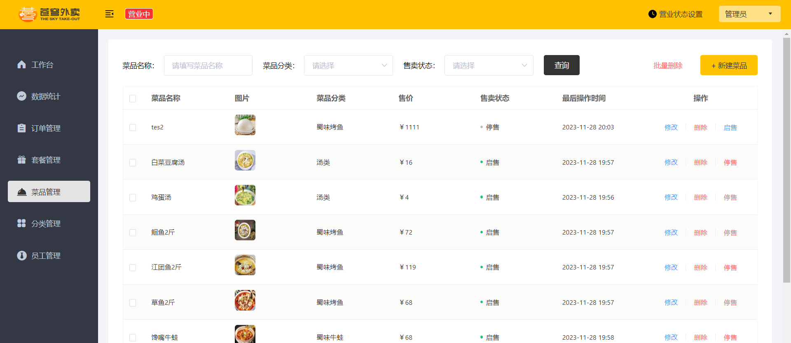  
图4-14 菜品管理主界面

菜品的模糊查询的顺序图如图4-15所示：

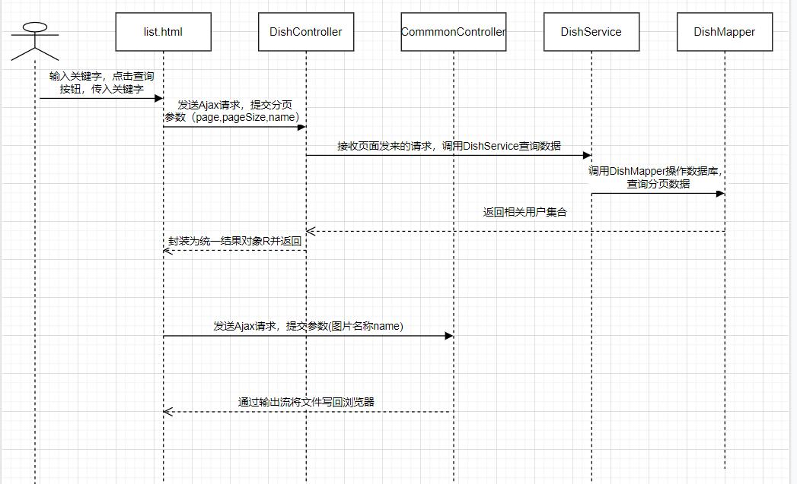  
图4-15 菜品模糊查询顺序图

（1）在list.html页面上，管理员通过点击输入框输入关键字，再点击查询按钮，就会出发点击事件发送Ajax请求，将关键字name,当前页数page以及每页的信息条数pageSize作为参数传入，调用DiahServlet中的page方法。

（2）DishServlet拿到参数之后，首先将page,pageSize作为参数构造分页构造器，然后构造一个条件构造器queryWrapper，然后判断name是否为空，如果不为空，将name作为queryWrapper.like的参数添加过滤条件，最后将pageInfo,queryWapper作为参数调用DishService的page方法。前端页面进行菜品所属分类展示时 需要的是菜品分类名称categoryName 而我们查询菜品表返回的数据只有菜品所属分类id 没有分类名，所以需要将每一个菜品dish对象中的数据封装到dishDto对象中，并且设置dishDto对象的categoryName属性即可实现前端的正常展示。重新构造一个泛型为DishDto的分页构造器dishDtoPage,然后从从pageInfo对象中获取当前页数据列表 records ,遍历records集合 将集合中的每一个dish对象中的数据赋值到DishDto对象中，并且为DishDto对象的categoryName属性赋值,在遍历records集合时，将每一个新创建出来的dishDto对象 存入到泛型为DishDto的List集合lsit中 ,这样就得到当前页要显示的数据集合了,将当前页数据集合list和总条数封装到dishDtoPage对象中返回即可

（3）DishService接收到参数之后，调用page方法将name拼接成数据库模糊查询所要求的字段格式（“%name%”）最后传到数据库查询Dao层的DishMapper中进行数据库的操作。

（4）Dao层接收到传过来的参数后。把参数放入SQL语句中进行数据库的查询操作，然后将查询结果封装为商品信息集合返回给控制器，最后组装成返回结果类R返回给前端视图。

### 4.3.2 新增菜品信息

管理员可以点击新建菜品按钮来新增菜品，新增菜品的界面如图4-16所示：

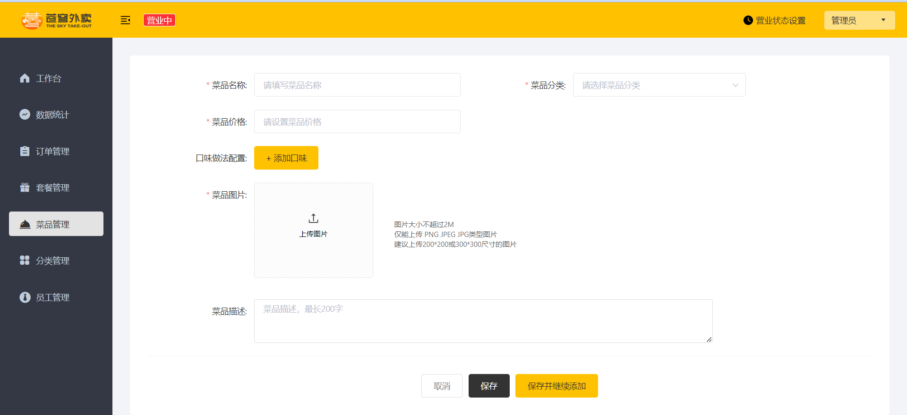  
图4-16 新增菜品界面

新增菜品顺序图如图4-17所示：

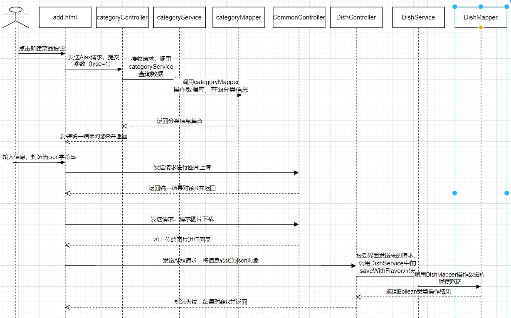  
图4-17 新增菜品顺序图

1. 管理员点击新建菜品，页面会将类型type封装为Category对象，然后将Category对象作为参数，发送一个Ajax请求，请求调用CategoryController中的list方法将菜品分类显示到下拉框中。
2. CategoryController接收到参数之后，首先取出type将type作为参数构造分页构造器，然后构造一个条件构造器queryWrapper，然后判断type是否为空，如果不为空，将type作为queryWrapper.eq的参数添加过滤条件，最后将queryWapper作为参数调用CategoryService的list方法。
3. CategoryService接收到参数之后，调用list方法将type拼接按条件查询所要求的格式，最后传到数据库查询Dao层的CategoryMapper中进行数据库的操作。
4. Dao层接收到传过来的参数后。把参数放入SQL语句中进行数据库的查询操作，然后将查询结果封装为商品信息集合返回给控制器，最后组装成返回结果类R返回给前端视图。
5. 管理员输入菜品信息点击上传图片，页面会发送一个请求调用CommonController中的upload方法将图片保存。
6. 图片保存之后，页面会在发一个请求调用CommonController中的download方法对图片进行下载并回显。
7. 管理员输入完菜品信息之后点击保存按钮，就会触发点击事件，将填写的信息封装为json对象，并发送Ajax请求调用DishController中的SaveWithFlavor(obj)方法。
8. DishController通过@RequestBody注解将json对象转换为java对象，调用DishController中的SaveWithFlavor(obj)方法，将该Java对象作为参数传入。
9. DishService接收到参数之后，首先调用调用Dao层的DishMapper中的save(obj)方法将商品信息对象传入进行数据库的操作。然后从对象中获取菜品id和菜品口味，然后遍历菜品口味集合，给每个口味对象设置菜品id，最后调用dishFlavorService中的saveBatch()方法调用调用Dao层的dishFlavorMapper中的saveBatch()方法将商品信息对象传入进行数据库的操作。
10. Dao层接收到传过来的参数后。把参数放入SQL语句中进行数据库的查询操作，然后将查询结果封装为商品信息集合返回给控制器，最后组装成返回结果类R返回给前端视图。

### 4.3.3 修改菜品信息

管理员可以点击菜品管理主页面的右边操作栏编辑按钮修改菜品信息，修改菜品信息界面如图4-18所示。

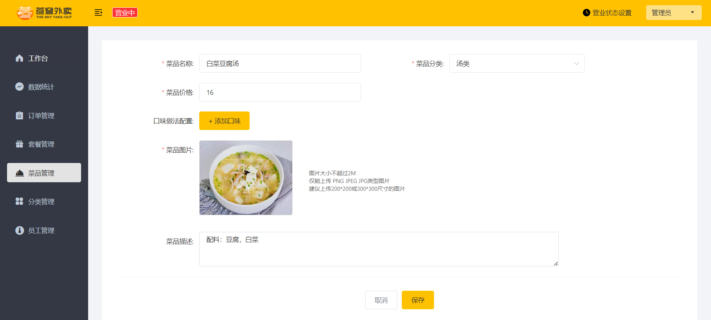  
图4-18修改菜品信息界面

修改菜品信息顺序图如图4-19所示：

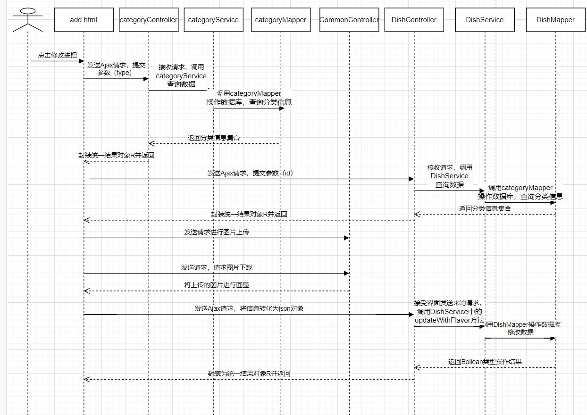  
图4-19 修改菜品信息顺序图

1. 管理员点击新建菜品，页面会将类型type封装为Category对象，然后将Category对象作为参数，发送一个Ajax请求，请求调用CategoryController中的list方法将菜品分类显示到下拉框中。
2. 页面将菜品id作为参数，发送Ajax请求，请求调用DishController中的get()方法。
3. DishControlle通过@PathVariable注解解析拿到菜品id，将菜品id作为参数调用DishService中的getById (id) 方法传到数据库查询的Dao层的DishMapper中调用selectById()方法进行数据库的操作来获取菜品基本信息。然后将获取到菜品基本信息封装到dish对象中，然后将dish对象中的信息拷贝到dishDto对象中，然后调用dishFlavorService中的list()方法，根据菜品id查询当前菜品所对应的口味信息，然后将口味信息设置在dishDto对象中，最后返回dishDto对象。
4. Dao层接收到传过来的参数后将用户id取出，放入SQL语句中进行数据库的查询，返回对应的菜品信息到add.html中回显。
5. 界面还会发送一个请求，请求调用CommonController中的download方法进行图片的回显。
6. 所有信息回显之后，管理员可以输入要修改的信息，输入完毕之后点击保存按钮，之后就会页面就会将菜品信息数据封装为json对象，并发送Ajax请求，请求调用DishController中的update方法。
7. DishController通过@RequestBody注解将接收到的json对象转为java对象，然后调用EmployeeService中的updateWithFlavor(obj)方法。
8. DishService接收到Java对象的参数后，首先将参数传到数据库查询Dao层的DishMapper中调用updateById(obj)方法进行数据库的操作。然后调用dishFlavorService中的remove()方法清理当前菜品的所有口味信息。然后再调用dishFlavorService中的saveBatch()方法添加当前提交过来的口味数据。
9. Dao层接收到传过来的参数后。把Java对象中的字段取出，放入SQL语句中进行数据库的修改，修改成功后返回Integer类型的值给控制器，如果为1则修改成功，否则将修改失败，最后控制器再将结果组装成R返回给前端视图

### 4.3.4 删除菜品信息

管理员可以点击菜品信息右侧操作中的删除按钮来删除单个菜品信息，也可以选中多个菜品，然后点击批量删除按钮来删除多个菜品信息。删除菜品信息界面如图4-20所示。

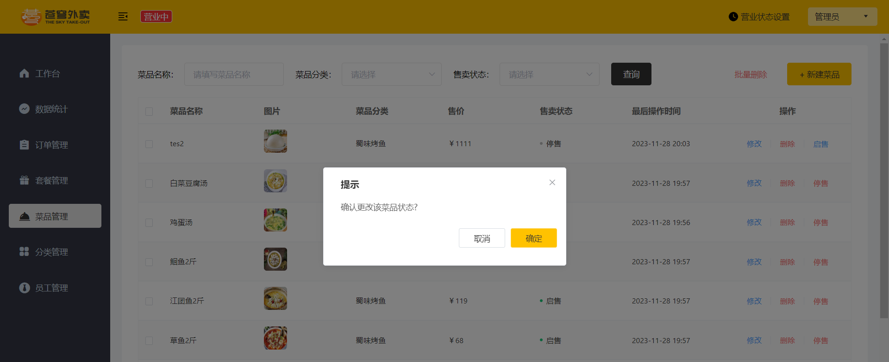  
图4-20 删除菜品信息界面

删除菜品信息顺序图如图4-21所示：

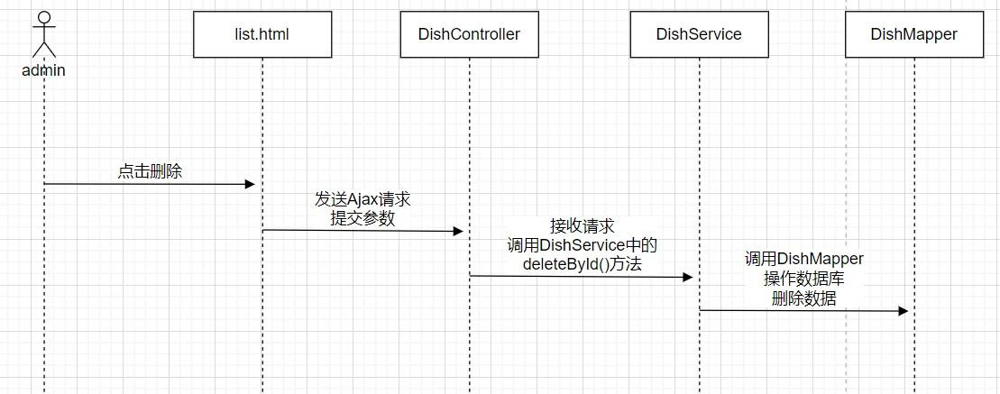  
图4-21 删除菜品信息用例图

1. 在list.html上，管理员通过点击删除按钮，发送Ajax跨域请求提交菜品id，调用DishController中的deleteById()方法。
2. DishController通过将接收的菜品id作为参数调用DishService中的deleteByIds()方法。
3. DishService接收到参数后，首先判断参数中是否含有“,”，如果不含“,”就说明是删除单个菜品信息，就直接将参数传到数据库查询Dao层的DishMapper中调用removeById(id)方法;如果含有“,”，就说明删除的是多个菜品信息，就调用split方法根据“,”将各个id分割出来，然后创建一个list集合，将分割出来的id都添加到list集合中，最后将list传到数据库查询Dao层的DishMapper中调用removeByIds(list)方法
4. Dao层接收到传过来的参数后。把参数取出，放入SQL语句中进行数据库的删除，插入成功后返回Integer类型的值给控制器，如果为1则删除成功，否则将删除失败，最后控制器再将结果组装成R返回给前端视图。

### 4.3.5 停售、起售菜品

管理员可以点击菜品信息右侧操作中的停售（起售）按钮来修改单个菜品的状态，也可以选中多个菜品，然后点击批量停售（起售）按钮来修改多个菜品的状态。处于停售状态的菜品不会在展示在移动端前台上。停售（起售）菜品信息界面如图4-22所示。

  
图4-22 停售（起售）菜品信息界面

停售（起售）菜品的顺序图如图4-23所示：

  
图4-23 停售（起售）菜品顺序图

1. 在list.html上，管理员通过点击删除按钮，发送Ajax跨域请求提交菜品id和菜品状态status，调用DishController中的updateStatus()方法。
2. DishController通过将接收的菜品id和菜品状态status作为参数调用DishService中的updateStatus()方法。
3. DishService接收到参数后，;就调用split方法根据“,”将各个id分割出来，然后创建一个list集合，将分割出来的id都添加到list集合中，最后将list传到数据库查询Dao层的DishMapper中调用updateStatus(list)方法
4. Dao层接收到传过来的参数后。把参数取出，放入SQL语句中进行数据库的修改，修改成功后返回Integer类型的值给控制器，如果为1则修改成功，否则将修改失败，最后控制器再将结果组装成R返回给前端视图。

## 4.4 套餐管理模块

### 4.4.1 套餐管理主界面

套餐管理模块包括套餐的模糊查询、添加、修改、删除、停售、起售等功能，管理员还可以进行批量操作，删除多条数据或者停售、起售多条数据。套餐管理的主界面如图4-24所示：

  
图4-24 套餐管理主界面

### 4.4.2 新增套餐信息

管理员可以点击新建菜品按钮来新增套餐，点击新建套餐按钮之后add.html页面会发送一个Ajax请求，请求调用CategoryController中的list方法将套餐分类显示到下拉框中，紧接着页面再次发送一个Ajax请求，求调用CategoryController中的list方法获取菜品分类数据并显示到添加菜品窗口中。然后页面第三次发送一个Ajax请求，请求调用DishController中的list方法根据菜品分类根据菜品分类查询对应的菜品数据并展示到添加菜品窗口中。管理员输入套餐信息点击上传图片，页面会发送一个请求调用CommonController中的upload方法将图片保存。图片保存之后，页面会在发一个请求调用CommonController中的download方法对图片进行下载并回显。最后管理员点击保存按钮，页面发送一个Ajax请求，请求调用setmealController中的save方法保存数据。新增套餐的界面如图4-25所示：

  
图4-25 新增套餐信息界面

### 4.4.3 修改套餐信息

管理员可以点击套餐管理主页面的右边操作栏编辑按钮修改套餐信息，修改套餐信息界面如图4-26所示。

  
图4-26 修改套餐信息界面

### 4.4.4 删除套餐信息

管理员可以点击套餐信息右侧操作中的删除按钮来删除单个套餐信息，也可以选中多个套餐，然后点击批量删除按钮来删除多个套餐信息。如果套餐处于售卖状态（status为1），则不能删除。删除套餐信息界面如图4-27所示。

  
图4-27 删除套餐信息界面

### 4.4.5 停售、起售套餐

管理员可以点击套餐信息右侧操作中的停售（起售）按钮来修改单个套餐的状态，也可以选中多个套餐，然后点击批量停售（起售）按钮来修改多个套餐的状态。处于停售状态（status为0）的菜品不会在展示在移动端前台上，处于售卖状态（status为1）的菜品不会被删除。停售（起售）套餐信息界面如图4-28所示。

  
图4-28 停售（起售）套餐信息界面

## 4.5 订单管理模块

### 4.5.1 订单管理主界面

在订单明细模块有模糊查询，查看订单，派送订单，完成订单等功能。订单明细主界面如图4-29所示。

  
图4-29 订单明细主界面

订单模糊查询顺序图如图4-30所示。

  
图4-30 订单模糊查询顺序图

1. 在list.html页面上，管理员通过点击输入框输入订单号，开始日期，结束日期，再点击查询按钮，就会触发点击事件返送Ajax请求，将关键字number,开始日期beginTime，结束日期endTime，当前页数page以及每页的信息条数pageSize作为参数传入，调用OrederServlet中的getOrders方法。CategroyController通过将接收的分类id作为参数调用CategroyService中的delete方法。
2. OrderServlet拿到参数之后，首先将page,pageSize作为参数构造分页构造器，然后构造一个条件构造器queryWrapper，然后分别判断number，beginTime,endTime是否为空，如果不为空，分别将number，beginTime,endTime作为queryWrapper.like，queryWrapper.ge, queryWrapper.eq的参数添加过滤条件，最后将pageInfo,queryWapper作为参数调用OrderService的page方法。
3. OrderService接收到参数之后，调用page方法将name,beginTime,endTime拼接成数据库模糊查询所要求的字段格式最后传到数据库查询Dao层的OrderMapper中进行数据库的操作。
4. Dao层接收到传过来的参数后。把参数放入SQL语句中进行数据库的查询操作，然后将查询结果封装为商品信息集合返回给控制器，最后组装成返回结果类R返回给前端视图

### 4.5.2 查看订单信息

管理员点击订单右边操作栏中的查看按钮，可以查看订单详细信息。查看订单详细信息界面如图4-31所示。

  
图4-31 查看订单详细信息界面

### 4.5.3 派送，完成订单

管理员点击订单右边操作栏中的派送（完成）按钮，可以修改订单的状态。修改订单状态界面如图4-32所示。

  
图4-32 修改订单状态界面

派送、完成顺序图如图4-32所示：

  
图4-32 派送、完成顺序图

1. 在list.html上，管理员通过点击派送（完成）按钮将员工id以及员工状态status封装为json对象向Ajax发送跨域请求，调用OrderController中的updatestatus()方法。
2. OrderController接收页面发送过来的参数并封装为Map对象，然后将Map对象作为参数调用OrderService中的updateStatus()方法。
3. OrderService接收到Map对象的参数后，传到数据库查询Dao层的OrderMapper中调用getById(id)方法进行数据库的操作来获取订单的相关信息封装在orders对象中，然后给该对象的status设置为页面穿过来的status的值，然后传到数据库查询Dao层的OrderMapper中调用updateById(id)方法进行数据库的操作
4. Dao层接收到传过来的参数后。把Java对象中的字段取出，放入SQL语句中进行数据库的修改，修改成功后返回Integer类型的值给控制器，如果为1则修改成功，否则将修改失败，最后控制器再将结果组装成R返回给前端视图。

## 4.6移动端购物车业务开发

### **4.6.1添加购物车数据**

移动端用户可以将菜品或者套餐添加到购物车。对于菜品来说，如果设置了口味信息，则需要选择规格后才能加入购物车;对于套餐来说，可以直接点击“+”将当前套餐加入购物车。在购物车中可以修改菜品和套餐的数量也可以清空购物车。购物车具体流程如下图4-33所示。

  
图4-33购物车具体流程

其实添加菜品套餐到购物车中与之前的添加功能模块都相似，所以就不再详细说明，在这里描述一下开发过程吧。

（1）当我们点击“加入购物车”或者“+”按钮时，页面会发送ajax请求，请求Controller服务端，Controller层首先设置用户id，指定当前哪一个用户的购物车数据。并且获取当前购物车中的菜品id,套餐id。

（2）之后调用ShoppingCartService层的getOne方法查询当前菜品或套餐是否在购物车中，进行判断，如果存在，number+1,Service层调用updateById更新购物车中的菜品数据；如果不存在就添加到购物车中，默认设置number=1，然后调用Service层的save方法保存数据到购物车字符串中。

（3）返回R类型，菜品套餐成功购入购物车。

操作购物车时前端页面与服务端交互过程如下图4-34所示。

  
图4-34购物车时前端页面与服务端交互过程

### **4.6.2 减少或清空购物车数据**

（1）减少购物车数据

当移动端用户将菜品或者套餐添加到购物车，发现有些菜品又突然不是很想要了，或者觉得物低所值，那我们就可以通过购物车来减少其中的数据。在购物车中可以修改菜品和套餐的数量。这里与上述增加数据基本一致，不同的有几点。第一点：当查看购物车发现菜品或套餐的数量number=1时，我们想要减少数据时，则直接调用ShoppingCartService层的remove方法，清空该数据；如果该数据number>1,则用户每点击“-”按钮一次，number-1，之后Service层调用updateById更新购物车中的菜品数据，最终返回R类型，更新购物车中数据。

（2）清空购物车数据

清空购物车数据更是简单，当我们点进购物车后，右上角有一个“清空”，当我们点击“清空”后，页面发送请求，服务端接收Json数据，然后调用ShoppingCartService层的remove方法，直接将购物车清空，返回R类型，成功执行。

### **4.6.3新建地址**

地址簿，指的是移动端消费者用户的地址信息，用户登录成功后可以维护自己的地址信息。同一个用户可以有多个地址信息，但是只能有一个默认地址。如下图4-35所示。

  
图4-35 收货地址页面展示

新建地址尤为简单，我们简要说一下。首先通过获取当前CurrentIdId，将其赋给当前地址用户Id，输入完信息，封装成Json字符串，发送ajax请求给服务端，然后服务端调用AddressBookService的save方法，保存当前地址信息，返回R类型。

### **4.6.4设置默认地址**

相对于新建地址，设置默认地址的逻辑长一些。首先是获取当前CurrentId与AddressBook的UserId比较相等，之后设置AddressBook的默认条件getIsDefault为0，调用AddressBookService的update方法构造更新条件。更新后设置AddressBook的IsDefault为1，之后调用AddressBookService的updateById方法更新当前地址为默认地址，返回R类型。

### **4.6.5 下单**

移动端用户将菜品或者套餐加入购物车后，就可以点击购物车中的“去结算”按钮，当我们点击结算后就会出现下图，而点击“去支付”按钮后就完成了下单的操作，如下图4-36所示。

  
图4-36 下单页面展示

那其实下单的代码逻辑实现也不是很难，主要是用户下单业务对应的数据表为orders表和order\_detail表:orders:订单表、order\_detail:订单明细表这两个表之间的操作。具体逻辑如下图4-37所示。

  
图4-37 下单代码逻辑

详细描述一遍就是，首先当用户在购物车中点击“去结算”按钮后，页面会跳转到订单确认页面，在这个页面，发送ajax请求，服务端获取当前CurrentId并且AddressBook的UserId比较相等，相等即获取当前用户的默认地址；同时将购物车的使用用户Id与当前用户比较，相等即获取当前登陆用户的购物车数据，并显示在下单页面中。之后在订单确认页面点击“去支付”按钮，发送ajax请求，服务端接收到数据，调用OrderService层的submit方法，提交订单，返回R类型，完成下单操作。

# 系统测试

## 5.1 测试方法

每一个系统在开发整个过程中，都需要对系统不断地测试和修改，测试在每个项目的开发过程中都是必不可少的一个阶段，通过这些测试我们可以发现系统存在的不足从而不断地完善并优化系统。系统的问题和不足之处都会通过测试得以显现，方便以后系统使用过程的运行和维护。无论是代码编写错误还是遗忘的代码问题都会被清楚的发现，进而改进和优化。无论是项目还是机器，在使用过程中都用进行不断的测试，测试伴随着开发到完成的整个过程，测试-调试-测试是整个项目开发的过程。

## 5.2 部分功能测试

### **5.2.1 登录功能测试**

测试流程：

以管理员（admin 用户）、身份从登录界面登录，测试系统的登录功能，以及管理员用户是否成功建立连接。

管理员登录测试结果如表5.1。

表 5.1 测试结果表一

<table><tr><td>
测试用例

（用户名、密码）
</td><td>
预期结果
</td><td>
测试结果
</td></tr><tr><td>
（“”，“”）
</td><td>
用户名不能为空
</td><td>
提示：输入用户名
</td></tr><tr><td>
（“admin”，“”）
</td><td>
密码不能为空
</td><td>
提示：输入密码
</td></tr><tr><td>
（“admin”，“123456”）
</td><td>
密码错误
</td><td>
提示：输入正确密码
</td></tr><tr><td>
（“admin”，“123123”）
</td><td>
登录成功
</td><td>
登录成功，跳转到员工管理页面
</td></tr></table>

### 5.2.2 员工管理测试

测试流程：

以管理员（admin 用户）从登录界面登录管理员，测试系统的员工管理功能，测试结果如表 5.2。

表5.2 测试结果表二

<table><tr><td>
测试用例

（名称、价格、库存、描述，图标，分类、状态）
</td><td>
预期结果
</td><td>
测试结果
</td></tr><tr><td>
添加用户

（zhangsan、张三、16638980885、男，412721200010213366）
</td><td>
添加成功，返回员工列表显示员工的信息。
</td><td>
添加成功，返回员工列表显示员工的信息
</td></tr><tr><td>
添加用户

（“”、张三、16638980885、男，412721200010213366）
</td><td>
添加失败
</td><td>
提示框“请输入账号”
</td></tr><tr><td>
禁用员工

（id:1591235383657455618,status:0）
</td><td>
禁用成功，该用户不能在登录系统
</td><td>
禁用成功，客户端中该用户操作栏中“禁用”按钮变为“启用”按钮
</td></tr><tr><td>
修改员工

（“张三”修改为“李四”）
</td><td>
修改成功
</td><td>
员工姓名“张三”改为“李四”
</td></tr><tr><td>
修改员工

（“412721200010213366”修改为“412721200”）
</td><td>
修改失败
</td><td>
提示框“身份证号不正确”
</td></tr></table>

### 5.2.3 套餐管理测试

测试流程：

以超级管理员（admin 用户）从登录界面登录管理员，测试系统的套餐管理功能，测试结果如表 5.3。

表5.3 测试结果表三

<table><tr><td>
测试用例

（名称、价格、库存、描述，图标，分类、状态）
</td><td>
预期结果
</td><td>
测试结果
</td></tr><tr><td>
添加套餐

（“精品四人餐”、“四人餐”、“254”，菜品两道，图片一张，“好吃划算”）
</td><td>
添加成功，返回套餐列表显示套餐的信息。
</td><td>
添加成功，返回套餐列表显示套餐的信息。
</td></tr><tr><td>
添加用户

（“”、“四人餐”、“254”，菜品两道，图片一张，“好吃划算”）
</td><td>
添加失败
</td><td>
提示框“请输入套餐名称”
</td></tr><tr><td>
删除套餐

(ids:1594972446119768066
</td><td>
删除失败
</td><td>
删除失败，弹出提示框显示“套餐正在售卖中，不能删除”
</td></tr><tr><td>
修改员工

（“精品四人餐”修改为“超值四人餐”）
</td><td>
修改成功
</td><td>
套餐名称“精品四人餐”改为“超值四人餐”
</td></tr></table>

### 5.2.4 安全测试

测试流程：

测试管理员，员工的登录安全性，再测试不是本系统用户是否能登录成功，测试系统的安全性。管理员，员工登录测试结果如表5.4。

表5.4 测试结果表四

<table><tr><td>
测试用例

（学号/工号、用户名、密码）
</td><td>
测试结果
</td></tr><tr><td>
管理员登录

（admin、123456）
</td><td>
登录成功，跳转到员工管理主页
</td></tr><tr><td>
管理员登录

（admin、123456）
</td><td>
登录失败，提示“登录失败”
</td></tr><tr><td>
员工登录

（lisi，123456）
</td><td>
登录失败，提示“员工账号已被禁用”
</td></tr><tr><td>
员工登录

（xiaoming，123456）
</td><td>
登录成功，跳转到员工主页
</td></tr><tr><td>
员工登录

（xiao，12345678）
</td><td>
登录失败，提示“登录失败”
</td></tr><tr><td>
非本系统用户登录

(xiaohao，123456)
</td><td>
登录失败，提示“登录失败”
</td></tr></table>

# 绪论

外卖配送平台：它包括管理员模块的员工信息管理，分类信息管理，菜品信息管理，套餐信息管理以及订单明细五大模块。管理员添加菜品和套餐、修改菜品和套餐、禁售菜品和套餐、删除菜品和套餐，可以控制菜品和套餐在前台页面的展示，从而控制菜品和套餐的销售，同时设置了分类管理，将菜品和套餐都进行了分类，菜品和套餐信息在前台页面展示的时候都会按分类展示，方便顾客找到自己喜欢吃的菜品，提高用户的使用体验。

基于员工信息的管理，员工信息管理的功能包括添加员工、修改员工、员工账号的启用、员工账号的禁用、员工的模糊查询等功能。

基于分类信息的管理。分类信息管理的功能包括添加分类、修改分类、删除分类等功能。

基于菜品和套餐信息的管理。菜品和套餐信息管理的功能包括添加菜品和套餐、修改菜品和套餐、删除菜品以及套餐，起售（禁售）菜品和套餐等功能。

基于订单信息的管理。订单信息管理的功能包括查看、派送订单、完成订单和订单的模糊查询等功能。

根据了解Redis数据读写速度非常快，因为它是基于内存操作的，单线程避免了多个线程直接的来回切换，底层采用了Hash算法，而且Redis是用C语言编写的，是最“接近”操作系统的语言，所以执行速度相对较快。我们利用Redis的这些特行，将商品信息和商品分类信息存储到Redis中，极大的提高了系统的性能，使客户得到了更好的使用体验。

在整个开发和测试过程中，通过该平台的正常运行，加强了平台的功能与评测，并对部分功能进行了优化，提高了平台使用效果。该平台可用于多种人群和各种餐饮行业的商家，商家可以自定义菜品来进行运营。也可以发布到云平台，具有较强的应用性。

# 参考文献

[1]杨开振. Java EE互联网轻量级框架整合开发[M]. 北京：电子工业出版社，2017.

[2]赵学龙，赵铭洲，陆鹏，李昱辉，衷宜. 基于过程化管理的课程教学探索与实践[J]. 软件导刊，2020,19(12): 104-107.

[3]缪志国. 基于教育信息化2.0的智慧校园建设及教学过程可视化管理[J]. 教育界， 2020(42): 24-26.

[4]孙华. [关于对高校课程过程考核改革的思考—以西安交通工程学院为例](https://kns.cnki.net/kcms/detail/detail.aspx?filename=ZKSD202011094&dbcode=CJFQ&dbname=CJFDTEMP&v=8xuaP9Q5TFsBnTSP3YIAFI6shB-a6Z87e3EW7wx-ZUjFddWolqeIM7fWp3ILSXyJ)[J]. 智库时代. 2020(11): 21-24.

[5][基于JavaScript的网页特效及实例](https://kns.cnki.net/kcms/detail/detail.aspx?filename=DLXZ200603011&dbcode=CJFQ&dbname=cjfd2006&v=iZuarHeLGJwWJA4JoypV8Lqik8l1y7kL5idhSIIkpcrjaBvClYM19c9i6gOMgacb)[J]. 郑蓉, 徐丽珍, 徐秋芬. 电脑学习. 2006.

[6]徐英慧，刘梅彦，周淑一. 计算机基础课程实验教学过程化管理策略研究[J]. 计算机教育， 2020(04): 163-166.

[7]李俊. 高校教育教学改革研究项目过程化管理研究[J]. 福建茶叶，2020,42(01): 133.

[8]刘向阳，朱根，王庆飞. 《JavaWeb应用开发技术》课程教学改革探索[J]. 福建电脑，2013,29（03）：77-78.

[9]传智播客高教产品研发部. Java Web程序开发入门[M]. 北京:清华大学出版社，2015.

[10]姚素红. 基于Java的Web应用系统开发模式[J]. 江苏工程职业技术学院学报，2018,18(01):6-9.

[11]张雪敏. 浅议MVC设计模式在JavaWeb中的作用[J]. 科技风，2018(22): 58-59.

[12]刘震林,喻春梅. 基于MVC模式的JAVA Web开发与实践应用研究[J]. 网络安全技术与应用，2021(01): 57-58.

[13]刘正，张书锋，赵鹤鸣. MVC模式下多层分布式软件系统架构设计[J]. 现代电子技术，2018, 41(07): 135-139+146.

[14]陆丽. MVC设计模式在JavaWeb开发中的应用研究[J]. 信息通信，2020(04): 104-106.

[15]朱明. 基于协同过滤的教学资源推荐研究[D]．北京：北京交通大学，2017.

[16]梁艳玲. 基于HTML5的Web前端开发技术研究[J]. 电子技术与软件工程，2020(24): 44-45.

[17]肖睿，喻晓路，朱微，张超，戴立坤. Java Web应用设计及实战[M]. 人民邮电出版社：大数据开发实战系列，201801.238.

[18] Arun Gupfta. Java EE 7 Essentials[M]. O’Reilly Media,2018.

[19]Yu Chih Chiang, Hon Wing Kai, Wang Biing Feng [Improved data structures for the orthogonal range successor problem](https://schlr.cnki.net//Detail/index/SJESLAST/SJES17A836CC49C485407E1F811607D06470)[J]. Computational Geometry, 2011, 44.

[20]]Minh-Triet Tran, Lap Q. Trieu, Huy Q. Tran [Document representation and classification with Twitter-based document embedding, adversarial domain-adaptation, and query expansion](https://schlr.cnki.net//Detail/index/SSJDLAST/SSJD4E2FFFC26AF05ECE7D38355CAA328029)[J]. Journal of Heuristics, 2019.