本科毕业论文（设计）

外卖订餐系统的设计与实现

Design and Implementation of Takeaway Ordering System

<table><tr><td colspan="3">
所 属  学 院
</td><td colspan="2">
 信息工程学院  ___________
</td></tr><tr><td colspan="3">
专        业
</td><td colspan="2">
   计算机科学与技术           _____
</td></tr><tr><td colspan="3">
班        级
</td><td colspan="2">
    xxxxxxxxxx      

       ____
</td></tr><tr><td colspan="3">
姓        名
</td><td colspan="2">
        xxxx          
</td></tr><tr><td colspan="3">
学        号
</td><td colspan="2">
     000000000000       ___
</td></tr><tr><td colspan="5"></td></tr><tr><td colspan="3">
指导教师单位
</td><td colspan="2">
   xxxxxxxxx        _____
</td></tr><tr><td colspan="3">
指导教师姓名
</td><td colspan="2">
        xxxxxx          __
</td></tr><tr><td colspan="3">
指导教师职称
</td><td colspan="2">
         xxxxxxx             
</td></tr><tr><td>
<strong>完成日期</strong>
</td><td colspan="2">
<strong> 年 5 月 10 日</strong>
</td></tr></table>

外卖订餐系统的设计与实现

**摘要**

当前高速发展的经济模式下，人们的工作和生活压力都很大，根本没有时间去下厨，在哪里下厨变成了一个问题，于是，在家里下厨的传统习惯逐渐地变成了无法完成的事情。以往，人们都是通过订购电话来进行订餐，但是，随着近年来的发展，订购电话已经不能满足更多的订购人员的需求，其缺点也逐渐显现出来[1]。正是由于上述各种因素，改变了传统的以电话、当面为基础的餐饮配送模式，成为一种更加便捷、快速的、以互联网为基础的外卖网上订购模式，成为了该系统的设计目的。

首先对项目进行了需求分析，系统角色可分为管理员和用户，管理员可以管理员工信息、分类管理、导出分类信息数据表格、菜品信息管理、套餐信息管理、订单明细查询、订单管理、导出订单明细数据表格、修改个人信息等。用户可以查看菜品信息、查看菜品详情、选择菜品规格、管理购物车、收货地址管理、修改个人信息、查看订单信息、下单支付等。然后外卖订餐系统根据需求分析进行系统功能模块设计和数据库设计。最后详细描述了外卖订餐系统各个功能模块是如何实现的。

本毕业设计管理系统使用HTML 5、AJAX、JavaScript、Vue、Element-UI框架等技术实现前端；使用Spring、Spring MVC、Spring Boot、MyBatis-Plus实现后端；采用 MySQL的关系数据库对数据进行存储，采用 Redis的方式对数据进行缓存，以 MySQL为主要的内存，以 Redis为主要的内存对数据进行缓存，以提高对数据的存取效率；使用Linux系统和Tomcat搭建服务器，完成项目的部署。

**关键词：** 外卖订餐系统；HTML5；AJAX；Vue；Spring Boot

Design and Implementation of Takeaway Ordering System

**Abstract**

Under the current high-speed economic model, people are under great pressure from work and life, and there is no time to cook. Where to cook becomes a problem, so the traditional habit of cooking at home gradually becomes impossible to accomplish. In the past, people used to order food by telephone, but with the development of recent years, the telephone has been unable to meet the needs of more ordering personnel, its shortcomings have gradually emerged. It is because of the above factors, change the traditional telephone, face to face based catering distribution mode, into a more convenient, fast, Internet-based takeout online ordering mode, has become the design purpose of the system.

First of all, the project needs analysis, system role can be divided into administrator and user, administrator can manage staff information, classification management, export classified information data table, dishes information management, package information management, order details query, order management, export order details data table, modify personal information. Users can view dish information, view dish details, select dish specifications, manage shopping side, delivery address management, modify personal information, view order information, order payment, etc. Then, according to the demand analysis, the system function module and database design are carried out. Finally, the paper describes how to implement each functional module of the system in detail.

This graduation design management system uses HTML 5, AJAX, JavaScript, Vue, Element-UI framework and other technologies to achieve the front-end; Use Spring, Spring MVC, Spring Boot, MyBatis-Plus to realize the back end; MySQL relational database is used for data storage, Redis method for data caching, MySQL as the main memory, Redis as the main memory for data caching, in order to improve the efficiency of data access; The server is set up using Linux and Tomcat to complete the project deployment.

**Key words:** Takeway ordering system; HTML 5; AJAX;Vue;Spring Boot

- 目录
- [**1 前言**](#_Toc134523437)
    - [1.1 研究背景及意义](#_Toc134523438)
    - [1.2 系统使用的开发语言](#_Toc134523439)
    - [1.3 系统相关使用技术](#_Toc134523440)
    - [1.4 系统可行性分析](#_Toc134523441)
        - [1.4.1 技术可行性](#_Toc134523442)
        - [1.4.2 开发成本可行性](#_Toc134523443)
        - [1.4.3 用户操作体验可行性](#_Toc134523444)
- [**2 系统需求分析**](#_Toc134523445)
    - [2.1 开发和运行环境分析](#_Toc134523446)
        - [2.1.1 项目开发环境](#_Toc134523447)
    - [2.2 系统功能需求分析](#_Toc134523449)
        - [2.2.1 系统功能描述](#_Toc134523450)
        - [2.2.2 系统功能用例图](#_Toc134523451)
    - [2.3非功能性需求分析](#_Toc134523452)
        - [2.3.1系统性能需求](#_Toc134523453)
        - [2.3.2系统环境需求](#_Toc134523454)
- [**3 系统总体设计**](#_Toc134523455)
    - [3.1 系统设计指导思想及原则](#_Toc134523456)
    - [3.2系统模块划分](#_Toc134523457)
    - [3.3 系统各功能模块设计](#_Toc134523458)
        - [3.3.1 后台功能模块设计](#_Toc134523459)
        - [3.3.2 前台功能模块设计](#_Toc134523460)
    - [3.4 系统数据库设计](#_Toc134523461)
        - [3.4.1 数据库总体设计](#_Toc134523462)
        - [3.4.2 数据库E-R图设计](#_Toc134523463)
        - [3.4.3 数据库表的设计](#_Toc134523464)
- [**4 系统详细设计和实现**](#_Toc134523465)
    - [4.1 后台模块设计](#_Toc134523466)
        - [4.1.1 登录模块](#_Toc134523467)
        - [4.1.2 员工信息管理模块](#_Toc134523468)
        - [4.1.3 分类管理模块](#_Toc134523469)
        - [4.1.4 菜品管理模块](#_Toc134523470)
        - [4.1.5 套餐管理模块](#_Toc134523471)
        - [4.1.6 订单明细管理模块](#_Toc134523472)
        - [4.1.7 退出登录模块](#_Toc134523473)
    - [4.2 前台模块设计](#_Toc134523474)
        - [4.2.1 登录注册模块](#_Toc134523475)
        - [4.2.2 菜品浏览模块](#_Toc134523476)
        - [4.2.3 购物车模块](#_Toc134523477)
        - [4.2.4 地址管理模块](#_Toc134523478)
        - [4.2.5 下单支付模块](#_Toc134523479)
        - [4.2.6 订单管理模块](#_Toc134523480)
        - [4.2.7 个人中心模块](#_Toc134523481)
- [**5 总结与展望**](#_Toc134523482)
    - [5.1总结](#_Toc134523483)
    - [5.2展望](#_Toc134523484)
- [**参考文献**](#_Toc134523485)

# **1 前言**

## **1.1 研究背景及意义**

目前，国内的外卖订餐主要采用的是电话订餐和网络订餐。所谓的电话订餐，就是顾客可以按照自己的需求，直接拨打电话订购。这要比点外卖要方便得多，而且还节约了大量的时间。但是，这方式也有一个缺陷，那就是餐厅必须要有一个人在接听外卖电话，这导致订餐电话不可能每时每刻都能保证有人接听，另外也需要专门的人员对订餐内容的记录，这就很容易出现差错。

发展至今，饿了么、百度外卖和美团等几家网络公司，在中国的餐饮行业中，占有很大的份额，尤其是快餐店、餐饮店等，都离不开它们。目前，在国外，已经存在的互联网订餐系统已经发展到了非常成熟的程度，并且提供了非常人性化的服务。但是，在我国，目前存在的订餐系统主要是由一些大型餐饮企业自己的网站提供的，而一些小型餐厅因为资金投入、开发技术困难等问题，仍然使用着传统的用餐方式，因此其服务的局限性非常显著。

通过对普通餐饮行业的调查发现，把餐饮和网络应用结合起来并不多，由此提出了区域性餐饮网络营销的想法。以城区中小型餐厅为主体服务对象，结合城区周边住宅和学校园区的市场特点，分析消费者网络购物行为，开发出开放型餐饮服务平台，为网络订餐项目的可行性奠定坚实的基础，既为餐饮企业解困，也为服务广大市民具有十分重要的意义。

## **1.2 系统使用的开发语言**

在开发语言的选择上，本项目选择使用Java语言进行开发，Java是Sun公司推出的能够跨越多平台的、可移植性最高的一种面向对象的编程语言，也是目前最先进、特征最丰富、功能最强大的计算机语言[2]。利用Java可以编写桌面应用程序、Web应用程序、分布式系统应用程序、嵌入式系统应用程序等，从而使其成为应用最广泛的开发语言。

## **1.3 系统相关使用技术**

在前端上分为前台和后台，前台采用HTML 5[3]编写，参考各大外卖平台的页面，打造出属于自己的页面。后台使用Vue前端框架，Vue致力于构建数据驱动的web应用开发框架，以简洁化，轻量级，数据驱动，模块友好等优势深受企业以及前端开发者的喜爱，成为前端开发人员必备的技能[4]。Vue3.0的出现，又带动周边生态的发展，奠定了Vue在企业级开发的重要地位。

在后端上选择使用较为火热的Spring Boot框架，并整合MyBatis-Plus框架，Spring Boot来自于Spring 大家族，是 Spring 官方团队（Pivotal 团队）提供的全新框架，它的诞生解决了Spring 框架使用较为繁琐的问题[5]。Spring Boot 的核心思想是约定优于配置，开发人员不需要配置任何XML文件，就可以像Maven整合Jar包一样，整合并使用所有框架。

在前后端交互上选择使用JQuery+AJAX技术，AJAX 是一种用于创建快速动态网页的技术。通过在后台与服务器进行少量数据交换，AJAX 可以使网页实现异步更新[6]。这意味着可以在不重新加载整个网页的情况下，对网页的某部分进行更新。

## **1.4 系统可行性分析**

### **1.4.1 技术可行性**

本次开发的外卖订餐系统是面向所有人的，所以在前台采取页面简洁的方法，前台使用Vue和Element-UI组件，使用户能快速、简便的浏览网页，使得用户体验更加良好。

后台全部使用轻量级的Vue前端框架，操作简便，功能齐全，界面简单而优美使得用户体验以及功能都能得到保障。

### **1.4.2 开发成本可行性**

前台与后台采用的是开源的Vue框架，所以前后台成本较低，而后端采用的是的Spring Boot框架，可快速构建独立的Spring应用，简化配置，Spring虽然使Java EE轻量级框架，但由于其繁琐的配置，一度被人认为是“配置地狱”，Spring Boot更多的是采用 Java Config 的方式，对 Spring 进行配置，可以省去一定的开发时间，且后期维护相对容易。数据库使用的是开源的MySQL[7]，相比于Oracle，开源的MySQL极大地减轻了开发成本。

### **1.4.3 用户操作体验可行性**

本系统登录注册使用了方便且快捷的手机验证码方式进行，模块清晰，使得用户在使用本系统时更加简便。

# **2 系统需求分析**

## **2.1 开发和运行环境分析**

由于我们使用Java语言进行开发，所以我们需要一定的Java运行环境。

### **2.1.1 项目开发环境**	

因为Java有跨平台这样的优点，使得Java开发的程序可以在大多数操作系统上运行，所以本项目在Windows环境下进行开发。具体配置如下：

操作系统：Windows 10

Java运行环境：JDK 1.8

服务器：Tomcat 8.0

开发工具：Idea、SQLyog、Git

## **2.2 系统功能需求分析**

### **2.2.1 系统功能描述**

本系统是面向所有人的外卖点餐系统。系统用户角色可以分为管理员和用户。管理员可以登录后台管理端进行后台工作的管理，用户可以登录前台餐厅进行操作

管理员可以管理员工信息、分类管理、导出分类信息数据表格、菜品信息管理、套餐信息管理、订单明细查询、订单管理、导出订单明细数据表格、修改个人信息等。用户可以查看菜品信息、查看菜品详情、选择菜品规格、管理购物车、收货地址管理、修改个人信息、查看订单信息、下单支付等。

### **2.2.2 系统功能用例图**

在本系统中，角色分为后台管理员和前台用户2种。图2.1、图2.2是用StarUML软件画的2种角色的用例图。

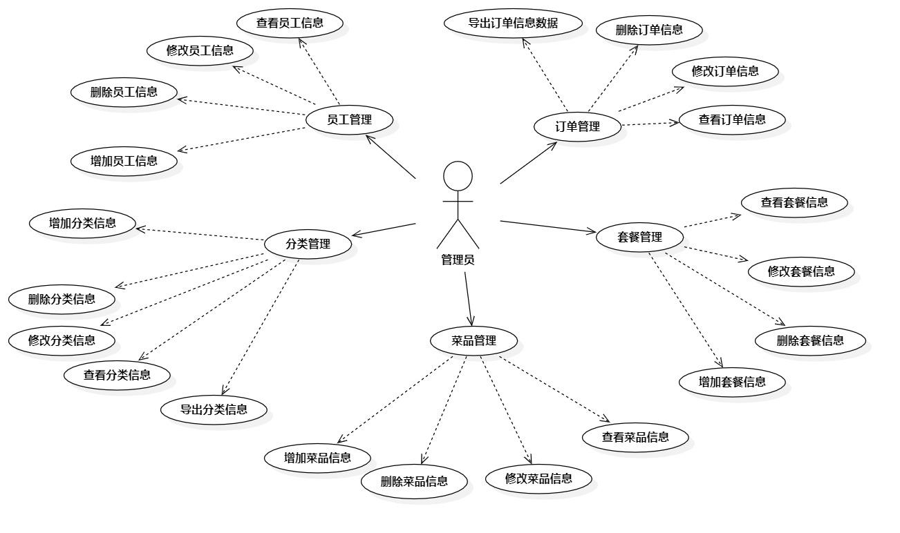

**图2.1 管理员用例图**

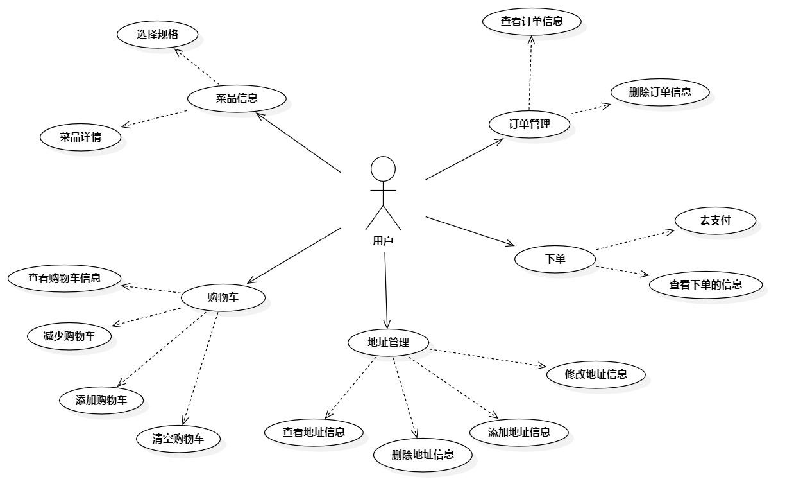

**图2.2 用户用例图**

## **2.3非功能性需求分析**

### **2.3.1系统性能需求**

易使用性：本系统开放所有用户，所以界面需要美观、简洁、大方。应尽量减少用户的学习成本（没有新手引导也知道怎么样使用），所以页面布局参考了国内知名外卖平台设计，整体布局合理。减少页面的跳转，能在当前页面完成就在当前页面完成，直观的让用户操作，一步到位。

安全性：由于用户下单时，需向系统平台提供个人的地址、手机号码等敏感信息，系统需方防止用户的信息泄露、丢失。

数据精确度：在用户在进行订单的时候，可以准确地对所选择的菜品的数量和规格进行反馈并产生结果，还可以准确地展示出订单时间和预期送达时间；员工对账目报表查询时要保证查全率，可以数据进行筛选呈现需要的数据。

可扩展性：本外卖订餐系统可以添加一些附加的功能，例如：用户在订单完成后可以对此次服务进行评价，该商家可以对顾客的评价进行回复；其次，还可以增加商家与用户之间可以进行即时的在线交流，方便用户对商家提出需求，商家也可即时查看并做出反馈。

可靠性：对输入进行提醒，对数据进行检验，避免出现异常情况。系统具有很好的健壮性，能够对系统操作中发生的诸如人为操作失误，输入非法数据，系统异常等问题做出相应反应，并适当规避。

### **2.3.2系统环境需求**

（1）开发环境：

① JDK（Java Development Kit）：Java开发工具包，包含了开发Java应用程序所需的全部工具和技术，包括Java编译器、JRE、Java API库、调试工具等。

② IntelliJ IDEA（Java开发工具）：集成开发环境，提供编辑器、代码提示、调试工具等一系列开发工具。

③ Tomcat（Web容器）：Web容器是JavaWeb应用程序运行的环境，Tomcat是最常用的JavaWeb容器之一。

（2）运行环境：

① Java运行环境（JRE）：Java运行环境是JavaWeb应用程序运行所需的基础环境，包含Java虚拟机和Java API库。

② Web容器：JavaWeb应用程序需要一个Web容器来运行，Tomcat是最常用的Web容器之一。

③ 操作系统：JavaWeb应用程序可以在各种操作系统上运行，如Windows、Linux等。

总体来说，JavaWeb系统的开发环境和运行环境需要的软件和工具比较复杂，但是它可以实现跨平台的应用程序开发和运行，具有很好的移植性和扩展性。

# **3 系统总体设计**

## **3.1 系统设计指导思想及原则**

（1）良好的用户体验

由于本系统是面向所有人的系统，系统需要有良好的操作性和体验性，所以系统采用Vue前端框架加AJAX异步通信技术增加体验感。模块分明，信息提示增加操作性，考虑当用户访问量过大时，数据库压力大，反应时间长，所以使用非关系型数据库Redis做缓存，可以快速返回数据给用户，更好的提高用户的体验。

## **3.2系统模块划分**

根据第2.2节的功能需求分析，系统主要有后台管理员和前台用户两种角色。

后台功能结构图如图3.1所示。

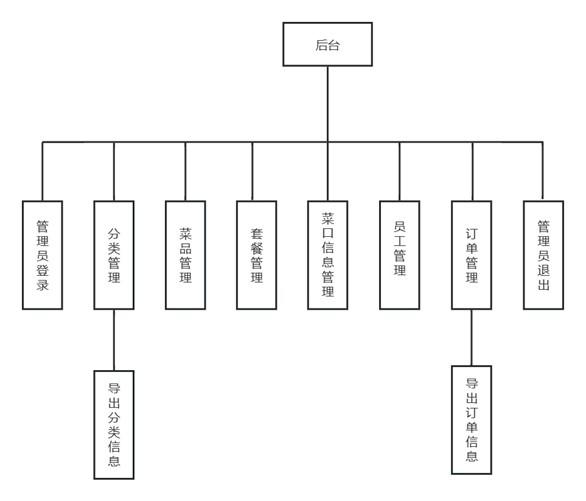

**图3.1 后台功能结构图**

前台功能结构图如图3.2所示。

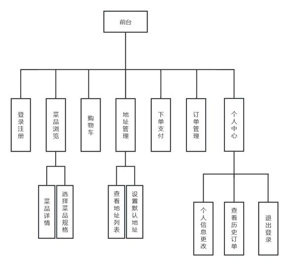

**图3.2 前台功能结构图**

## **3.3 系统各功能模块设计**

### **3.3.1 后台功能模块设计**

1. 登录

管理员通过账号和密码进行登录。

2. 员工信息管理

管理员可以查看员工信息，按关键字查询员工信息，添加员工信息、修改和禁用员工信息，删除员工信息。

3. 分类管理

管理员可以查看分类信息，添加分类信息，修改分类信息，删除分类信息，搜索分类信息，将分类信息数据导出Excel表格。

4. 菜品管理

管理员可以查看菜品列表，按关键字查询菜品信息，添加菜品信息，修改菜品信息，删除菜品信息，批量停售菜品，批量删除菜品信息，搜索菜品信息，将菜品信息数据导出Excel表格。

5. 套餐管理

管理员可以查看套餐列表，按关键字查询套餐信息，添加套餐信息，修改套餐信息，删除套餐信息，批量停售套餐，批量删除套餐信息，搜索套餐信息，将套餐信息数据导出Excel表格。

6. 订单明细管理

管理员可以查看订单列表，按关键字或者日期区间查询订单信息，添加订单信息，修改订单信息，删除订单信息，搜索订单信息，将订单信息数据导出Excel表格。

7. 管理员退出登录

管理员退出登录，跳转到登录页面。

### **3.3.2 前台功能模块设计**

（1）登录注册

为了方便用户登录，前台使用手机号和发送的手机短信验证码进行登录。首次登录时，系统自动为提供的手机号进行注册。

（2）菜品浏览

用户登录后，跳转到首页进行菜品浏览，数据展示由后台维护的菜品和套餐。

（3）购物车

用户登录后，用户可以在自己的购物车里加入一些菜品和套餐。对菜品而言，若已设定好的口味信息，在添加到购物车上之前，必须先选定相应的规范；至于套餐，你可以通过单击“+”键将目前的套餐添加到购物车中。您可以在购物车中更改菜品或套餐的数目，也可以将购物车中的物品全部清除。

（4）地址管理

用户登录后，用户可以对自己的收货地址进行管理，设置一个收货地址为下单默认地址。

（5）下单支付

用户登录后，当用户将菜品或套餐添加到购物车之后，只要点击购物车中的结算按钮，就会进入到订单确认页面，如果点击支付按钮，就可以完成下单支付操作。

（6）订单管理

用户登录后，可以在个人中心查看历史订单和最新订单。

（7）个人中心

用户登录后，在个人中心可以查看和修改个人信息，查看个人订单、查看订单状态、查看收货地址。

## **3.4 系统数据库设计**

本系统使用的是MySQL数据库，MySQL是关系型数据库管理系统，由于其速度快，成本低，灵活性强，常常被用于Web应用方面。也正是这些优点，我才选取MySQL作为本项目的数据库管理系统。

### **3.4.1 数据库总体设计**

根据外卖订餐系统的需求，本系统共设计了11张数据库表，分别如下：

1. 员工信息表(employee)：主要是存储后台员工信息的数据表；
2. 分类信息表(category)：主要是存储后台分类信息的数据表；
3. 菜品信息表(dish)：主要是存储后台菜品信息的数据表；
4. 菜品口味信息表(dish\_flavor)：主要是存储后台菜品的口味信息的数据表；
5. 套餐信息表(setmeal)：主要是存储后台套餐信息的数据表；
6. 套餐明细信息表(setmeal\_dish)：主要是存储后台套餐里包含的菜品信息的数据表；
7. 订单信息表(order)：主要是存储后台订单信息的数据表；
8. 订单明细表(order\_detail)：主要是存储后台订单明细信息的数据表；
9. 用户信息表(user)：主要是存储前台用户信息的数据表；
10. 地址信息表(address\_book)：主要是存储前台地址信息的数据表；
11. 购物车信息表(shopping\_cart)：主要是存储前台购物车信息的数据表；

### **3.4.2 数据库E-R图设计**

根据设计的数据表，分析实体与实体之间的联系，进行E-R图的绘制。

本系统绘制的E-R图如3.3所示。

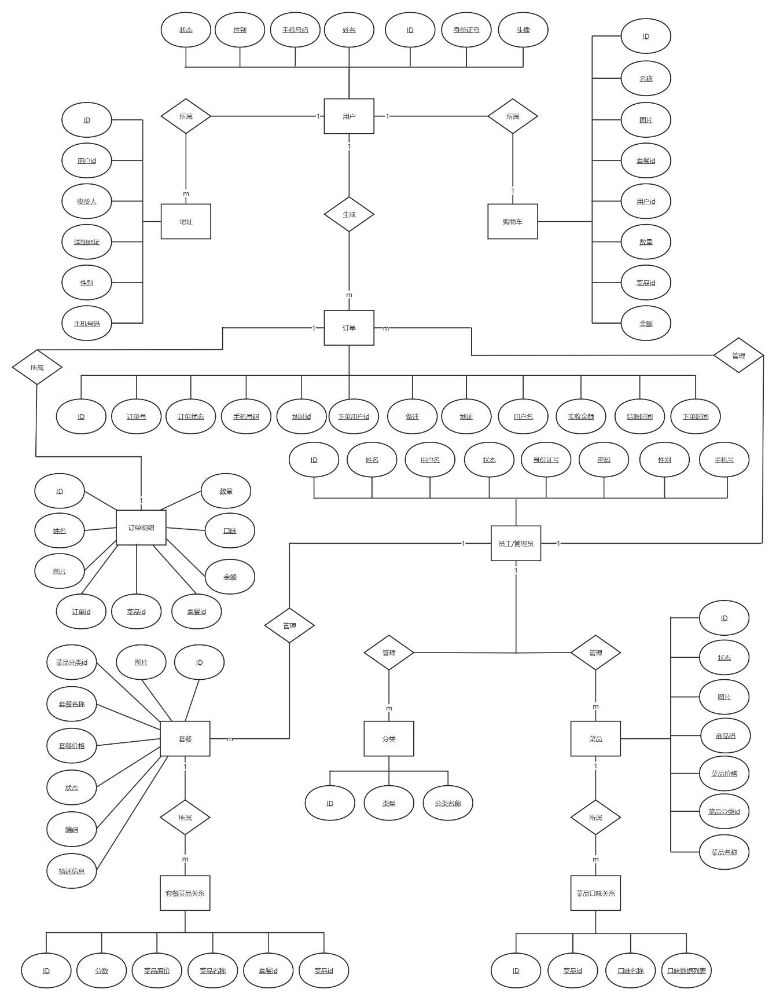

**图3.3数据库E-R设计图**

### **3.4.3 数据库表的设计**

数据库表的设计如下。

**表3.1 员工信息表**

<table><tr><td>
字段名
</td><td>
字段描述
</td><td>
数据类型
</td><td>
长度
</td><td>
是否主键
</td><td>
约束
</td><td>
说明
</td></tr><tr><td>
id
</td><td>
主键
</td><td>
bigint
</td><td>
-
</td><td>
是
</td><td>
not null
</td><td>
唯一约束
</td></tr><tr><td>
name
</td><td>
姓名
</td><td>
varchar
</td><td>
32
</td><td>
否
</td><td>
not null
</td><td>
-
</td></tr><tr><td>
username
</td><td>
用户名
</td><td>
varchar
</td><td>
32
</td><td>
否
</td><td>
not null
</td><td>
-
</td></tr><tr><td>
password
</td><td>
密码
</td><td>
varchar
</td><td>
64
</td><td>
否
</td><td>
not null
</td><td>
-
</td></tr><tr><td>
phone
</td><td>
手机号
</td><td>
varchar
</td><td>
11
</td><td>
否
</td><td>
not null
</td><td>
-
</td></tr><tr><td>
sex
</td><td>
性别
</td><td>
varchar
</td><td>
2
</td><td>
否
</td><td>
not null
</td><td>
-
</td></tr><tr><td>
id_number
</td><td>
身份证
</td><td>
varchar
</td><td>
18
</td><td>
否
</td><td>
not null
</td><td>
-
</td></tr><tr><td>
status
</td><td>
状态
</td><td>
int
</td><td>
-
</td><td>
否
</td><td>
not null
</td><td>
0:禁用

1:正常
</td></tr><tr><td>
create_time
</td><td>
创建时间
</td><td>
datetime
</td><td>
-
</td><td>
否
</td><td>
not null
</td><td>
-
</td></tr><tr><td>
update_time
</td><td>
更新时间
</td><td>
datetime
</td><td>
-
</td><td>
否
</td><td>
not null
</td><td>
-
</td></tr><tr><td>
create_user
</td><td>
创建人
</td><td>
bigint
</td><td>
-
</td><td>
否
</td><td>
not null
</td><td>
-
</td></tr><tr><td>
update_user
</td><td>
修改人
</td><td>
bigint
</td><td>
-
</td><td>
否
</td><td>
not null
</td><td>
-
</td></tr></table>

**表3.2 分类信息表**

<table><tr><td>
字段名
</td><td>
字段描述
</td><td>
数据类型
</td><td>
长度
</td><td>
是否主键
</td><td>
约束
</td><td>
说明
</td></tr><tr><td>
id
</td><td>
主键
</td><td>
bigint
</td><td>
-
</td><td>
是
</td><td>
not null
</td><td>
唯一约束
</td></tr><tr><td>
type
</td><td>
类型
</td><td>
int
</td><td>
-
</td><td>
否
</td><td>
-
</td><td>
1菜品分类，2 套餐分类
</td></tr><tr><td>
name
</td><td>
分类名称
</td><td>
varchar
</td><td>
64
</td><td>
否
</td><td>
not null
</td><td>
-
</td></tr><tr><td>
sore
</td><td>
顺序
</td><td>
int
</td><td>
-
</td><td>
否
</td><td>
not null
</td><td>
-
</td></tr><tr><td>
create_time
</td><td>
创建时间
</td><td>
datetime
</td><td>
-
</td><td>
否
</td><td>
not null
</td><td>
-
</td></tr><tr><td>
update_time
</td><td>
修改时间
</td><td>
datetime
</td><td>
-
</td><td>
否
</td><td>
not null
</td><td>
-
</td></tr><tr><td>
create_user
</td><td>
创建人
</td><td>
bigint
</td><td>
-
</td><td>
否
</td><td>
not null
</td><td>
-
</td></tr><tr><td>
update_user
</td><td>
修改人
</td><td>
bigint
</td><td>
-
</td><td>
否
</td><td>
not null
</td><td>
-
</td></tr></table>

**表3.3 菜品信息表**

<table><tr><td>
字段名
</td><td>
字段描述
</td><td>
数据类型
</td><td>
长度
</td><td>
是否主键
</td><td>
约束
</td><td>
说明
</td></tr><tr><td>
id
</td><td>
主键
</td><td>
bigint
</td><td>
-
</td><td>
是
</td><td>
not null
</td><td>
唯一约束
</td></tr><tr><td>
name
</td><td>
菜品名称
</td><td>
varchar
</td><td>
64
</td><td>
否
</td><td>
-
</td><td>
1菜品分类，2 套餐分类
</td></tr><tr><td>
category_id
</td><td>
菜品分类id
</td><td>
bigint
</td><td>
-
</td><td>
否
</td><td>
not null
</td><td>
-
</td></tr><tr><td>
price
</td><td>
菜品价格
</td><td>
decimal
</td><td>
10,2
</td><td>
否
</td><td>
-
</td><td>
-
</td></tr><tr><td>
code
</td><td>
商品码
</td><td>
varchar
</td><td>
64
</td><td>
否
</td><td>
not null
</td><td>
-
</td></tr><tr><td>
image
</td><td>
修改时间
</td><td>
varchar
</td><td>
200
</td><td>
否
</td><td>
not null
</td><td>
-
</td></tr><tr><td>
description
</td><td>
描述信息
</td><td>
varchar
</td><td>
400
</td><td>
否
</td><td>
-
</td><td>
-
</td></tr><tr><td>
status
</td><td>
状态
</td><td>
int
</td><td>
-
</td><td>
否
</td><td>
not null
</td><td>
0停售

1起售
</td></tr><tr><td>
sort
</td><td>
顺序
</td><td>
int
</td><td>
-
</td><td>
否
</td><td>
not null
</td><td></td></tr><tr><td>
create_time
</td><td>
创建时间
</td><td>
datetime
</td><td>
-
</td><td>
否
</td><td>
not null
</td><td></td></tr><tr><td>
update_time
</td><td>
修改时间
</td><td>
datetime
</td><td>
-
</td><td>
否
</td><td>
not null
</td><td></td></tr><tr><td>
create_user
</td><td>
创建人
</td><td>
bigint
</td><td>
-
</td><td>
否
</td><td>
not null
</td><td></td></tr><tr><td>
update_user
</td><td>
修改人
</td><td>
bigint
</td><td>
-
</td><td>
否
</td><td>
not null
</td><td></td></tr><tr><td>
is_deleted
</td><td>
是否删除
</td><td>
int
</td><td>
-
</td><td>
否
</td><td></td><td></td></tr></table>

**表3.4 菜品口味信息表**

<table><tr><td>
字段名
</td><td>
字段描述
</td><td>
数据类型
</td><td>
长度
</td><td>
是否主键
</td><td>
约束
</td><td>
说明
</td></tr><tr><td>
id
</td><td>
主键
</td><td>
bigint
</td><td>
-
</td><td>
是
</td><td>
not null
</td><td>
唯一约束
</td></tr><tr><td>
dish_id
</td><td>
菜品
</td><td>
bigint
</td><td>
-
</td><td>
否
</td><td>
not null
</td><td>
    -
</td></tr><tr><td>
name
</td><td>
口味名称
</td><td>
varchar
</td><td>
64
</td><td>
否
</td><td>
not null
</td><td>
-
</td></tr><tr><td>
value
</td><td>
口味数据list
</td><td>
varchar
</td><td>
500
</td><td>
否
</td><td>
-
</td><td>
-
</td></tr><tr><td>
create_time
</td><td>
创建时间
</td><td>
datetime
</td><td>
-
</td><td>
否
</td><td>
not null
</td><td>
-
</td></tr><tr><td>
update_time
</td><td>
修改时间
</td><td>
datetime
</td><td>
-
</td><td>
否
</td><td>
not null
</td><td>
-
</td></tr><tr><td>
create_user
</td><td>
创建人
</td><td>
bigint
</td><td>
-
</td><td>
否
</td><td>
not null
</td><td>
-
</td></tr><tr><td>
update_user
</td><td>
修改人
</td><td>
bigint
</td><td>
-
</td><td>
否
</td><td>
not null
</td><td>
-
</td></tr><tr><td>
is_deleted
</td><td>
是否删除
</td><td>
int
</td><td>
-
</td><td>
否
</td><td>
-
</td><td>
-
</td></tr></table>

**表3.5 套餐信息表**

<table><tr><td>
字段名
</td><td>
字段描述
</td><td>
数据类型
</td><td>
长度
</td><td>
是否主键
</td><td>
约束
</td><td>
说明
</td></tr><tr><td>
id
</td><td>
主键
</td><td>
bigint
</td><td>
-
</td><td>
是
</td><td>
not null
</td><td>
唯一约束
</td></tr><tr><td>
category_id
</td><td>
菜品分类id
</td><td>
bigint
</td><td>
-
</td><td>
否
</td><td>
not null
</td><td>
    -
</td></tr><tr><td>
name
</td><td>
套餐名称
</td><td>
varchar
</td><td>
64
</td><td>
否
</td><td>
not null
</td><td>
-
</td></tr><tr><td>
price
</td><td>
套餐价格
</td><td>
decimal
</td><td>
10,2
</td><td>
否
</td><td>
-
</td><td>
-
</td></tr><tr><td>
status
</td><td>
状态
</td><td>
int
</td><td>
-
</td><td>
否
</td><td>
-
</td><td>
0:停用

1:启用
</td></tr><tr><td>
code 
</td><td>
编码
</td><td>
varchar
</td><td>
32
</td><td>
否
</td><td>
-
</td><td>
-
</td></tr><tr><td>
description
</td><td>
描述信息
</td><td>
varchar
</td><td>
512
</td><td>
否
</td><td>
-
</td><td>
-
</td></tr><tr><td>
image
</td><td>
图片
</td><td>
varchar
</td><td>
255
</td><td>
否
</td><td>
-
</td><td>
-
</td></tr><tr><td>
create_time
</td><td>
创建时间
</td><td>
datetime
</td><td>
-
</td><td>
否
</td><td>
not null
</td><td>
-
</td></tr><tr><td>
update_time
</td><td>
修改时间
</td><td>
datetime
</td><td>
-
</td><td>
否
</td><td>
not null
</td><td>
-
</td></tr><tr><td>
create_user
</td><td>
创建人
</td><td>
bigint
</td><td>
-
</td><td>
否
</td><td>
not null
</td><td>
-
</td></tr><tr><td>
update_user
</td><td>
修改人
</td><td>
bigint
</td><td>
-
</td><td>
否
</td><td>
not null
</td><td>
-
</td></tr><tr><td>
is_deleted
</td><td>
是否删除
</td><td>
int
</td><td>
-
</td><td>
否
</td><td>
-
</td><td>
-
</td></tr></table>

**表3.6 套餐明细信息表**

<table><tr><td>
字段名
</td><td>
字段描述
</td><td>
数据类型
</td><td>
长度
</td><td>
是否主键
</td><td>
约束
</td><td>
说明
</td></tr><tr><td>
id
</td><td>
主键
</td><td>
bigint
</td><td>
-
</td><td>
是
</td><td>
not null
</td><td>
唯一约束
</td></tr><tr><td>
setmeal_id
</td><td>
套餐id
</td><td>
varchar
</td><td>
32
</td><td>
否
</td><td>
not null
</td><td>
    -
</td></tr><tr><td>
dish_id
</td><td>
菜品id
</td><td>
varchar
</td><td>
32
</td><td>
否
</td><td>
not null
</td><td>
-
</td></tr><tr><td>
name
</td><td>
菜品名称
</td><td>
varchar
</td><td>
32
</td><td>
否
</td><td>
-
</td><td>
-
</td></tr><tr><td>
price
</td><td>
菜品价格
</td><td>
decimal
</td><td>
10,2
</td><td>
否
</td><td>
-
</td><td>
    -
</td></tr><tr><td>
copies 
</td><td>
分数
</td><td>
int
</td><td>
-
</td><td>
否
</td><td>
not null
</td><td>
-
</td></tr><tr><td>
sort
</td><td>
排序
</td><td>
int
</td><td>
-
</td><td>
否
</td><td>
not null
</td><td>
-
</td></tr><tr><td>
create_time
</td><td>
创建时间
</td><td>
datetime
</td><td>
-
</td><td>
否
</td><td>
not null
</td><td>
-
</td></tr><tr><td>
update_time
</td><td>
修改时间
</td><td>
datetime
</td><td>
-
</td><td>
否
</td><td>
not null
</td><td>
-
</td></tr><tr><td>
create_user
</td><td>
创建人
</td><td>
bigint
</td><td>
-
</td><td>
否
</td><td>
not null
</td><td>
-
</td></tr><tr><td>
update_user
</td><td>
修改人
</td><td>
bigint
</td><td>
-
</td><td>
否
</td><td>
not null
</td><td>
-
</td></tr><tr><td>
is_deleted
</td><td>
是否删除
</td><td>
int
</td><td>
-
</td><td>
否
</td><td>
-
</td><td>
-
</td></tr></table>

**表3.7 订单信息表**

<table><tr><td>
字段名
</td><td>
字段描述
</td><td>
数据类型
</td><td>
长度
</td><td>
是否主键
</td><td>
约束
</td><td>
说明
</td></tr><tr><td>
id
</td><td>
主键
</td><td>
bigint
</td><td>
-
</td><td>
是
</td><td>
not null
</td><td>
唯一约束
</td></tr><tr><td>
number
</td><td>
订单号
</td><td>
varchar
</td><td>
50
</td><td>
否
</td><td>
-
</td><td>
    -
</td></tr><tr><td>
status
</td><td>
订单状态
</td><td>
int
</td><td>
-
</td><td>
否
</td><td>
not null
</td><td>
1待付款

2 待派送

3 已派送

4 已完成

5 已取消
</td></tr><tr><td>
user_id
</td><td>
下单用户
</td><td>
bigint
</td><td>
-
</td><td>
否
</td><td>
not null
</td><td>
-
</td></tr><tr><td>
address_book_id
</td><td>
地址id
</td><td>
bigint
</td><td>
-
</td><td>
否
</td><td>
not null
</td><td>
    -
</td></tr><tr><td>
order_time
</td><td>
下单时间
</td><td>
datetime
</td><td>
-
</td><td>
否
</td><td>
not null
</td><td>
-
</td></tr><tr><td>
checkout_time
</td><td>
结账时间
</td><td>
datetime
</td><td>
-
</td><td>
否
</td><td>
not null
</td><td>
-
</td></tr><tr><td>
pay_method
</td><td>
支付方式
</td><td>
int
</td><td>
-
</td><td>
否
</td><td>
not null
</td><td>
-
</td></tr><tr><td>
amount
</td><td>
实收金额
</td><td>
decimal
</td><td>
10,2
</td><td>
否
</td><td>
not null
</td><td>
-
</td></tr><tr><td>
remark
</td><td>
备注
</td><td>
varchar
</td><td>
100
</td><td>
否
</td><td>
-
</td><td>
-
</td></tr><tr><td>
phont
</td><td>
手机号
</td><td>
varchar
</td><td>
255
</td><td>
否
</td><td>
-
</td><td>
-
</td></tr><tr><td>
address
</td><td>
收货地址
</td><td>
varchar
</td><td>
255
</td><td>
否
</td><td>
-
</td><td>
-
</td></tr><tr><td>
user_name
</td><td>
收货姓名
</td><td>
varchar
</td><td>
255
</td><td>
否
</td><td>
-
</td><td>
-
</td></tr><tr><td>
consignee
</td><td>
昵称
</td><td>
varchar
</td><td>
255
</td><td>
否
</td><td>
-
</td><td>
-
</td></tr></table>

**表3.8 订单明细表**

<table><tr><td>
字段名
</td><td>
字段描述
</td><td>
数据类型
</td><td>
长度
</td><td>
是否主键
</td><td>
约束
</td><td>
说明
</td></tr><tr><td>
id
</td><td>
主键
</td><td>
bigint
</td><td>
-
</td><td>
是
</td><td>
not null
</td><td>
唯一约束
</td></tr><tr><td>
name
</td><td>
名字
</td><td>
varchar
</td><td>
50
</td><td>
否
</td><td>
-
</td><td>
-
</td></tr><tr><td>
image
</td><td>
图片
</td><td>
varchar
</td><td>
100
</td><td>
否
</td><td>
-
</td><td>
    -
</td></tr><tr><td>
order_id 
</td><td>
订单id
</td><td>
bigint
</td><td>
-
</td><td>
否
</td><td>
not null
</td><td>
-
</td></tr><tr><td>
dish_id
</td><td>
菜品id
</td><td>
bigint
</td><td>
-
</td><td>
否
</td><td>
-
</td><td>
-
</td></tr><tr><td>
setmeal_id
</td><td>
套餐id
</td><td>
bigint
</td><td>
-
</td><td>
否
</td><td>
-
</td><td>
-
</td></tr><tr><td>
dish_flavor
</td><td>
口味
</td><td>
varchar
</td><td>
-
</td><td>
否
</td><td>
-
</td><td>
-
</td></tr><tr><td>
number
</td><td>
数量
</td><td>
int
</td><td>
-
</td><td>
否
</td><td>
not null
</td><td>
-
</td></tr><tr><td>
amount
</td><td>
金额
</td><td>
decimal
</td><td>
-
</td><td>
否
</td><td>
not null
</td><td>
-
</td></tr></table>

**表3.9 用户信息表**

<table><tr><td>
字段名
</td><td>
字段描述
</td><td>
数据类型
</td><td>
长度
</td><td>
是否主键
</td><td>
约束
</td><td>
说明
</td></tr><tr><td>
id
</td><td>
主键
</td><td>
bigint
</td><td>
-
</td><td>
是
</td><td>
not null
</td><td>
唯一约束
</td></tr><tr><td>
name
</td><td>
名字
</td><td>
varchar
</td><td>
50
</td><td>
否
</td><td>
-
</td><td>
-
</td></tr><tr><td>
phone
</td><td>
手机号
</td><td>
varchar
</td><td>
100
</td><td>
否
</td><td>
not null
</td><td>
    -
</td></tr><tr><td>
sex
</td><td>
性别
</td><td>
varchar
</td><td>
2
</td><td>
否
</td><td>
-
</td><td>
-
</td></tr><tr><td>
id_number
</td><td>
身份证号
</td><td>
varchar
</td><td>
18
</td><td>
否
</td><td>
-
</td><td>
-
</td></tr><tr><td>
avatar
</td><td>
头像
</td><td>
varchar
</td><td>
500
</td><td>
否
</td><td>
-
</td><td>
-
</td></tr><tr><td>
status
</td><td>
状态
</td><td>
int
</td><td>
-
</td><td>
否
</td><td>
-
</td><td>
0:禁用

 1:正常
</td></tr></table>

**表3.10 地址信息表**

<table><tr><td>
字段名
</td><td>
字段描述
</td><td>
数据类型
</td><td>
长度
</td><td>
是否主键
</td><td>
约束
</td><td>
说明
</td></tr><tr><td>
id
</td><td>
主键
</td><td>
bigint
</td><td>
-
</td><td>
是
</td><td>
not null
</td><td>
唯一约束
</td></tr><tr><td>
user_id
</td><td>
用户id
</td><td>
bigint
</td><td>
-
</td><td>
否
</td><td>
not null
</td><td>
    -
</td></tr><tr><td>
consignee
</td><td>
收货人
</td><td>
varchar
</td><td>
50
</td><td>
否
</td><td>
not null
</td><td>
-
</td></tr><tr><td>
sex
</td><td>
性别
</td><td>
tinyint
</td><td>
-
</td><td>
否
</td><td>
-
</td><td>
0女

1男
</td></tr><tr><td>
phone
</td><td>
手机号
</td><td>
varchar
</td><td>
11
</td><td>
否
</td><td>
-
</td><td>
-
</td></tr><tr><td>
province_code
</td><td>
省级区划编号
</td><td>
varchar
</td><td>
12
</td><td>
否
</td><td>
-
</td><td>
-
</td></tr><tr><td>
province_name
</td><td>
省级名称
</td><td>
varchar
</td><td>
32
</td><td>
否
</td><td>
-
</td><td>
-
</td></tr><tr><td>
city_code
</td><td>
市级区划编号
</td><td>
varchar
</td><td>
12
</td><td>
否
</td><td>
-
</td><td>
-
</td></tr><tr><td>
city_name
</td><td>
市级名称
</td><td>
varchar
</td><td>
32
</td><td>
否
</td><td>
-
</td><td>
-
</td></tr><tr><td>
detail
</td><td>
详细地址
</td><td>
varchar
</td><td>
200
</td><td>
否
</td><td>
-
</td><td>
-
</td></tr><tr><td>
label
</td><td>
标签
</td><td>
varchar
</td><td>
100
</td><td>
否
</td><td>
-
</td><td>
-
</td></tr><tr><td>
is_default
</td><td>
默认
</td><td>
tinyint
</td><td>
-
</td><td>
否
</td><td>
not null
</td><td>
0否

1是
</td></tr><tr><td>
create_time
</td><td>
创建时间
</td><td>
datatime
</td><td>
-
</td><td>
否
</td><td>
not null
</td><td>
-
</td></tr><tr><td>
update_time
</td><td>
更新时间
</td><td>
datatime
</td><td>
-
</td><td>
否
</td><td>
not null
</td><td>
-
</td></tr><tr><td>
create_user
</td><td>
创建人
</td><td>
bigint
</td><td>
-
</td><td>
否
</td><td>
not null
</td><td>
-
</td></tr><tr><td>
update_user
</td><td>
更新人
</td><td>
bigint
</td><td>
-
</td><td>
否
</td><td>
not null
</td><td>
-
</td></tr><tr><td>
is_deleted
</td><td>
是否删除
</td><td>
int
</td><td>
-
</td><td>
否
</td><td>
not null
</td><td>
-
</td></tr></table>

**表3.11 购物车信息表**

<table><tr><td>
字段名
</td><td>
字段描述
</td><td>
数据类型
</td><td>
长度
</td><td>
是否主键
</td><td>
约束
</td><td>
说明
</td></tr><tr><td>
id
</td><td>
主键
</td><td>
bigint
</td><td>
-
</td><td>
是
</td><td>
not null
</td><td>
唯一约束
</td></tr><tr><td>
name
</td><td>
名称
</td><td>
varchar
</td><td>
50
</td><td>
否
</td><td>
-
</td><td>
-
</td></tr><tr><td>
image
</td><td>
图片
</td><td>
varchar
</td><td>
100
</td><td>
否
</td><td>
-
</td><td>
    -
</td></tr><tr><td>
user_id
</td><td>
用户id
</td><td>
bigint
</td><td>
-
</td><td>
否
</td><td>
not null
</td><td>
-
</td></tr><tr><td>
dish_id
</td><td>
菜品id
</td><td>
bigint
</td><td>
-
</td><td>
否
</td><td>
-
</td><td>
-
</td></tr><tr><td>
setmeal_id
</td><td>
套餐id
</td><td>
bigint
</td><td>
-
</td><td>
否
</td><td>
-
</td><td>
-
</td></tr><tr><td>
dish_flavor
</td><td>
口味
</td><td>
varchar
</td><td>
50
</td><td>
否
</td><td>
-
</td><td>
    -
</td></tr><tr><td>
number
</td><td>
数量
</td><td>
int 
</td><td>
-
</td><td>
否
</td><td>
not null
</td><td>
    -
</td></tr><tr><td>
amount
</td><td>
金额
</td><td>
decimal
</td><td>
10,2
</td><td>
否
</td><td>
not null
</td><td>
    -
</td></tr><tr><td>
create_time
</td><td>
创建时间
</td><td>
datetime
</td><td>
-
</td><td>
否
</td><td>
-
</td><td>
    -
</td></tr></table>

# **4 系统详细设计和实现**

## **4.1 后台模块设计**

### **4.1.1 登录模块**

（1）功能描述

后台管理员根据账号密码登录后台管理端。

（2）页面效果展示

管理员登录效果展示如图4.1所示。

**图4.1 管理员登录**

（3）详细设计和实现

点击登录按钮时，前端页面会发送请求并提交参数（username和password），后端接收到请求，调用controller层的login方法，构造一个查询条件构造器，将提交过来的参数作为条件，查询数据库中是否存在该账号密码，如果不存在则登录失败，如果存在则对比密码是否能匹配，不匹配则提示密码错误，如果密码匹配，再检查该管理员状态是否被禁用，被禁用则提示账号已被禁用，登录失败，最后账号存在，密码正确，账号没被禁用才可以登录成功，登录成功后跳转到后台主界面。

（4）关键代码

<table><tr><td>
      /**

     * 员工登录

     * @param request

     * @param employee

     * @return

     */

    @PostMapping("/login")

    public R&lt;Employee&gt; login(HttpServletRequest request, @RequestBody Employee employee){

        //1.将页面提交的密码进行md5加密处理

//        String password = employee.getPassword();

//        password = DigestUtils.md5DigestAsHex(password.getBytes());

        //2.根据页面提交的用户名查询数据库

        LambdaQueryWrapper&lt;Employee&gt; queryWrapper = new LambdaQueryWrapper&lt;&gt;();

        queryWrapper.eq(Employee::getUsername,employee.getUsername());

        Employee emp = employeeService.getOne(queryWrapper);

        BCryptPasswordEncoder encoder = new BCryptPasswordEncoder();

        //参数1：用户输入的密码，参数2：加密后密码

        Boolean matches = encoder.matches(employee.getPassword(), emp.getPassword());

        //3.如果没有查询到则返回登录失败结果

        if (emp == null) {

            return R.error("登录失败");

        }

        //如果不正确，则返回错误信息

        if(!matches) {

            return R.error("密码错误");

        }

        //5.查看员工状态，如果为已禁用状态，则返回员工已禁用结果

        if(emp.getStatus()==0){

            return R.error("账号已禁用");

        }

        //6.登录成功，将员工id存入Session并返回登录成功结果

        request.getSession().setAttribute("employee", emp.getId());

        return R.success(emp);

    }
</td></tr></table>

### **4.1.2 员工信息管理模块**

（1）功能描述

管理员可以查看员工信息，按关键字模糊查询，点击“新增员工”回调到新增员工页面，单击“编辑”按钮，进入编辑页面，在编辑页面回显的该员工资料，然后对其进行修改，然后再单击“保存”按钮即可进行编辑，点击“禁用”会弹出对话框是否确定禁用。

（2）页面效果展示

查看员工信息效果展示如图4.2所示。

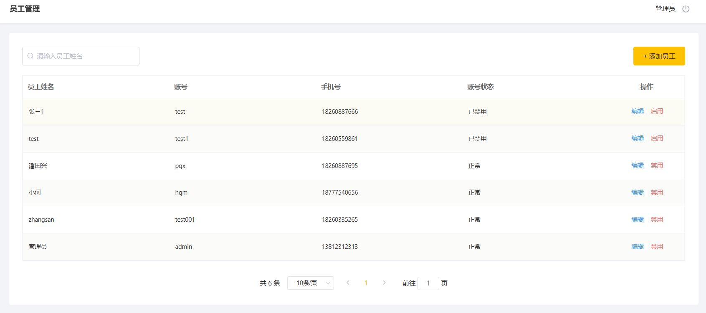

**图4.2 查看员工信息**

新增员工信息效果展示如图4.3所示。

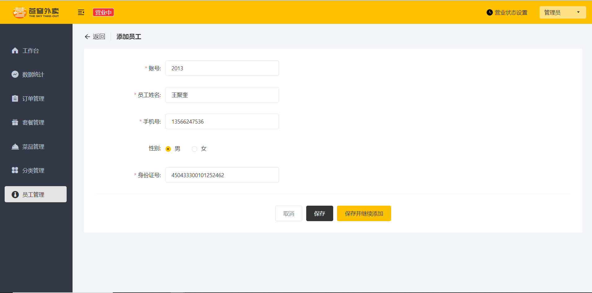

**图4.3 新增员工信息**

修改员工信息效果展示如图4.4所示。

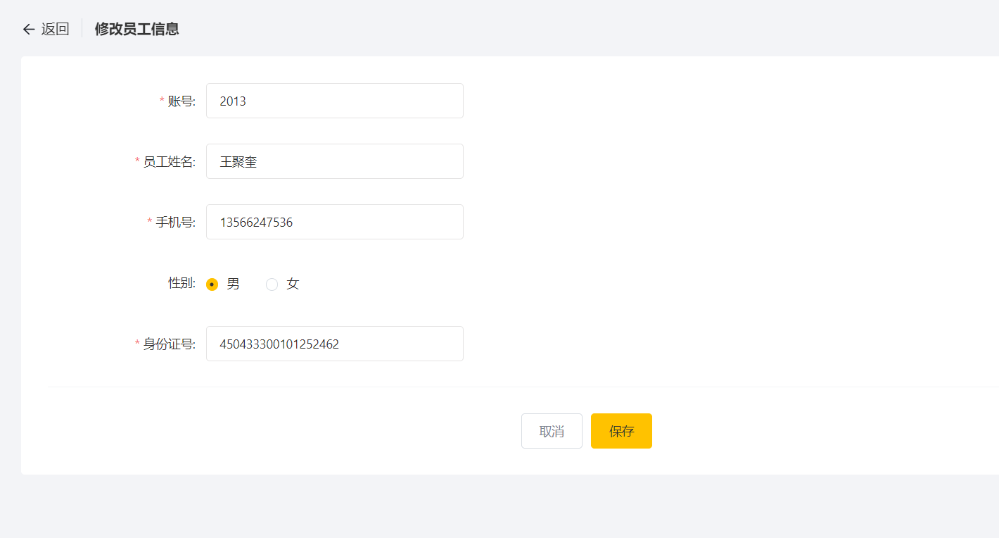

**图4.4 修改员工信息**

禁用员工效果展示如图4.5所示。

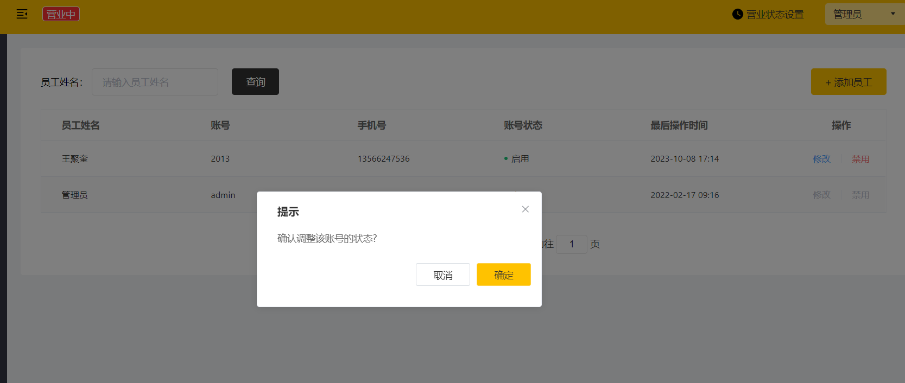

**图4.5 禁用员工**

（3）详细设计和实现

通过新增员工来添加后台系统用户。点击“添加员工”按钮跳转到新增页面，输入新的员工信息后点击“保存”按钮，前台发送ajax请求，将输入的数据以json的形式提交到后端，后端Controller接收页面提交的数据并调用Service将数据进行保存，Service调用Mapper操作数据库，保存数据。

通过分页方式显示员工信息列表的数据，页面向后端发出 ajax请求，向后端提交该分页的参数（page，pageSize，name），后端 Controller接收该页面提交的数据并调用Service查询数据，Service调用Mapper操作数据库，查询到分页数据并返回，Controller将查询到的分页数据响应给页面，页面接收到分页数据通过Element-UI的Table组件展示到页面上。

点击“编辑”按钮时，页面跳转到编辑页面，在向后端发出 ajax请求的时候，同时还需要将该员工id的参数进行递交，后端会收到这个要求，然后按照员工id对员工的信息进行查询，把员工的数据以json的方式反馈到页面上，页面会收到来自后端的回应json的数据，再用 Vue的数据绑定来对员工的数据进行回显，最后单击“保存”按钮，就会发出一个 ajax要求，把页面上的员工数据以 json的方式提交到后端，后端会收到员工的数据，然后对这些员工进行加工，最后再给页面出一个响应。

点击“禁用”按钮时，发送ajax请求，提交员工id参数，后端接收到请求，进行处理直接修改该账号的状态为禁用状态，完成后给页面响应。

（4）关键代码

<table><tr><td>
 /**

     * 新增员工

     * @param employee

     * @return

     */

    @PostMapping()

    public R&lt;String&gt; save(HttpServletRequest request,@RequestBody Employee employee){

        log.info("新增员工，员工信息：{}",employee.toString());

        //设置初始密码为123456，需要进行md5加密处理

//        employee.setPassword(DigestUtils.md5DigestAsHex("123456".getBytes()));

        //设置初始密码为123456，密码加盐加密

        BCryptPasswordEncoder encoder = new BCryptPasswordEncoder();

        String encode = encoder.encode("123456");

        employee.setPassword(encode);

//        employee.setCreateTime(LocalDateTime.now());

//        employee.setUpdateTime(LocalDateTime.now());

        //获取当前登录的id

//        Long empId = (Long) request.getSession().getAttribute("employee");

//        employee.setCreateUser(empId);

//        employee.setUpdateUser(empId);

        employeeService.save(employee);

        return R.success("新增员工成功");

    }

    /**

     * 员工信息的分页查询

     * @param page

     * @param pageSize

     * @param name

     * @return

     */

    @GetMapping("/page")

    public R&lt;Page&gt; page(int page,int pageSize,String name){

        log.info("page={},pageSize={},name={}",page,pageSize,name);

        //构造分页构造器

        Page pageInfo =new Page(page,pageSize);

        //构造条件构造器

        LambdaQueryWrapper&lt;Employee&gt; queryWrapper = new LambdaQueryWrapper&lt;&gt;();

        //添加过滤条件

        queryWrapper.like(StringUtils.isNotEmpty(name),Employee::getName,name);

        //添加排序条件

        queryWrapper.orderByDesc(Employee::getUpdateTime);

        //执行查询

        employeeService.page(pageInfo,queryWrapper);

        return R.success(pageInfo);

    }

    /**

     * 根据id修改员工信息

     * @param employee

     * @return

     */

    @PutMapping

    public R&lt;String&gt; update(HttpServletRequest request,@RequestBody Employee employee){

//        Long empId = (Long) request.getSession().getAttribute("employee");

//        employee.setUpdateTime(LocalDateTime.now());

//        employee.setUpdateUser(empId);

        employeeService.updateById(employee);

        return R.success("操作成功");

    }
</td></tr></table>

### **4.1.3 分类管理模块**

（1）功能描述

后台管理员登录后可以点击“分类管理”查看分类，添加菜品分类信息和套餐分类信息，可以修改和删除操作，还可以对分类信息导出Excel数据。

（2）页面效果展示

查看分类信息效果展示如图4.6所示。

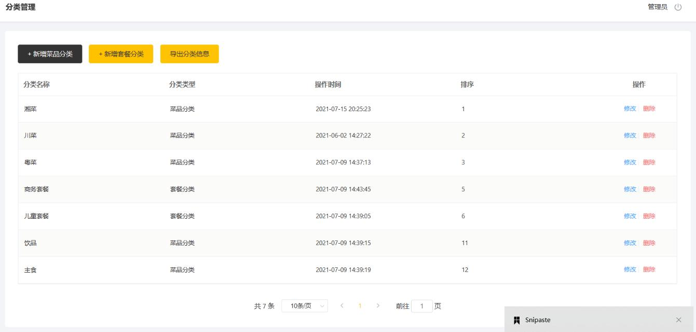

**图4.6 分类信息**

新增菜品分类信息效果展示如图4.7所示。

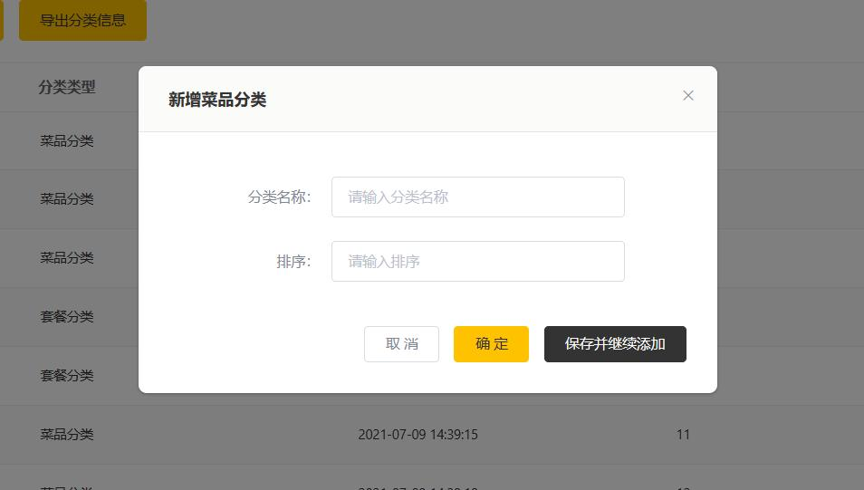

**图4.7 新增菜品分类**

新增套餐分类信息效果展示如图4.8所示。

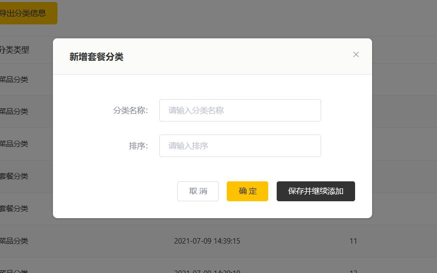

**图4.8 新增套餐分类**

修改分类信息效果展示如图4.9所示。

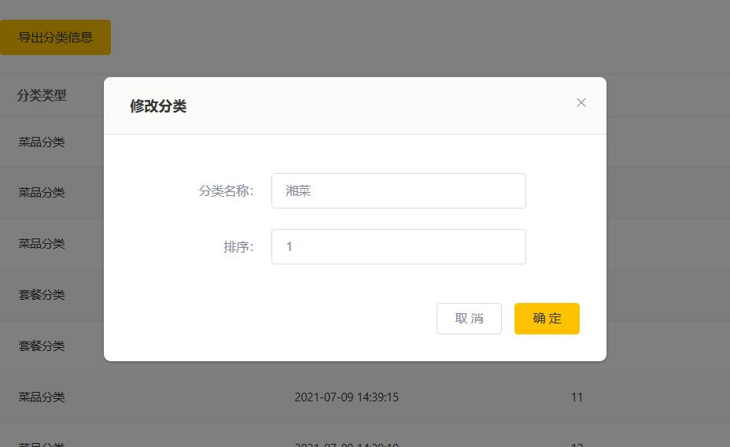

**图4.9 修改分类**

删除分类信息效果展示如图4.10所示。

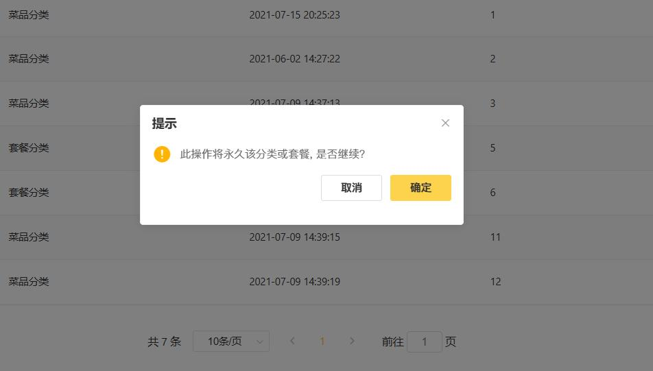

**图4.10 删除分类**

导出Excel分类信息效果展示如图4.11所示。

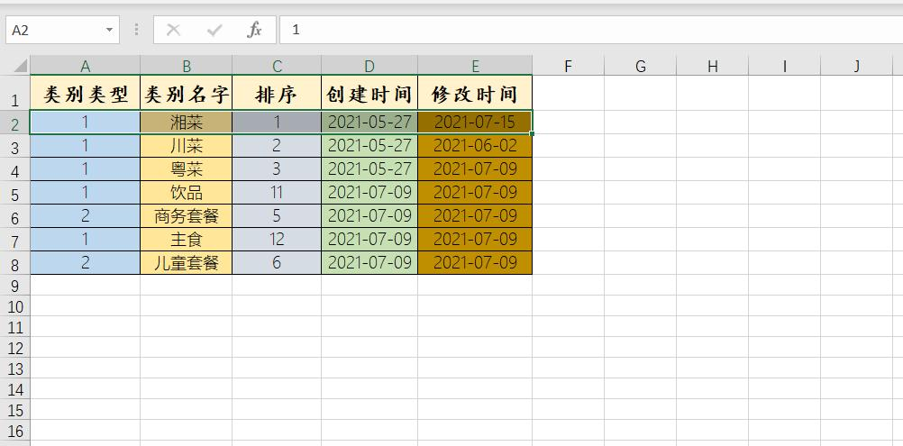

**图4.11 导出Excel分类信息**

（3）详细设计和实现

点击“分类管理”页面向后端发出 ajax要求，向后端提交分页的查询参数（page，pageSize），后端控制器收到页面所递交的数据并调用Service查询数据，Service调用Mapper操作数据库，查询到所需的分页数据并返回，Controller将查询到的分页数据响应给页面，当前端页面接收到所需的分页数据后通过Element-UI的Table组件进而展示到页面上。

在点击新增分类之后，页面会向后端发出 ajax请求，然后以 json格式将在新增分类窗口中输入的数据向后端提交，后端 Controller会收到页面中提交的数据，并且会调用 Service来存储这些数据，而 Service则会调用 Mapper来对数据库中的数据进行处理，从而将这些数据保存下来。

单击“删除”按钮后，会出现一个确认的窗口，然后，页面发送一个 ajax要求，向后端提交一个参数（id)，然后，后端控制器会收到该页面的数据，然后通过Service来进行删除，Service则会通过 Mapper来处理数据库。

当单击“修改”按钮时，会弹出一个修改框，并返回显示的数据，单击“确定”按钮，会发出一个 ajax请求，然后通过 json格式向后端提交已修改框中的分类信息，后端会收到分类信息并对其进行处理，最后，页面会收到来自于后端的响应，然后再由后端的响应来执行处理。

（4）关键代码

<table><tr><td>
/**

     * 新增分类

     * @param category

     * @return

     */

    @PostMapping

    public R&lt;String&gt; save(@RequestBody Category category){

        category.setIsDeleted(0);

        categoryService.save(category);

        return R.success("新增分类成功");

    }

    /**

     * 分类信息的分页查询

     * @param page

     * @param pageSize

     * @return

     */

    @GetMapping("/page")

    public R&lt;Page&gt; page(int page, int pageSize){

        //构造分页构造器

        Page&lt;Category&gt; pageInfo =new Page&lt;&gt;(page,pageSize);

        //构造条件构造器

        LambdaQueryWrapper&lt;Category&gt; queryWrapper = new LambdaQueryWrapper&lt;&gt;();

        //添加过滤条件

        queryWrapper.eq(Category::getIsDeleted, 0);//逻辑删除 ：1是删除，0是没删(na不等于，eq等于)

       //添加排序条件

        queryWrapper.orderByAsc(Category::getSort);

        //执行查询

        categoryService.page(pageInfo,queryWrapper);

        return R.success(pageInfo);

    }

    /**

     * 根据id删除分类

     * @param ids

     * @return

     */

    @DeleteMapping

    public R&lt;String&gt; delete(Long ids){

        Category category = new Category();

        category.setId(ids);

        category.setIsDeleted(1);

        categoryService.updateById(category);

        return R.success("分类信息删除成功");

    }

    /**

     * 根据id修改分类信息

     * @param category

     * @return

     */

    @PutMapping

    public R&lt;String&gt; update(@RequestBody Category category){

        categoryService.updateById(category);

        return R.success("修改分类信息成功");

    }
</td></tr></table>

### **4.1.4 菜品管理模块**

（1）功能描述

后台管理员登录后可以点击“菜品管理”查看菜品信息，添加菜品信息，按关键字模糊查询，修改和删除操作，还可以选择批量操作，如批量删除、批量停售和批量起售。

（2）页面效果展示

新增菜品信息效果展示如图4.12所示。

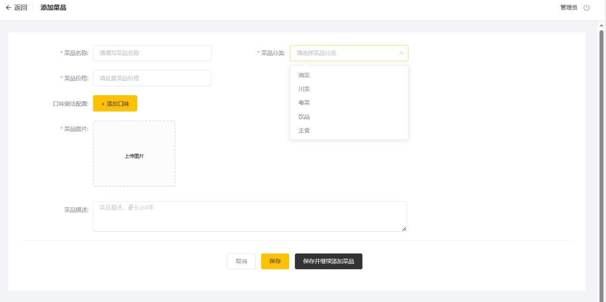

**图4.12 新增菜品信息**

查看菜品信息效果展示如图4.13所示。

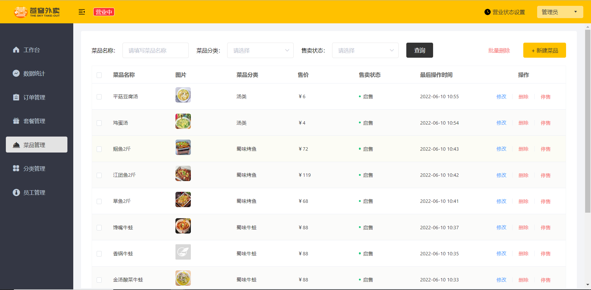

**图4.13 菜品信息**

修改菜品信息效果展示如图4.14所示。

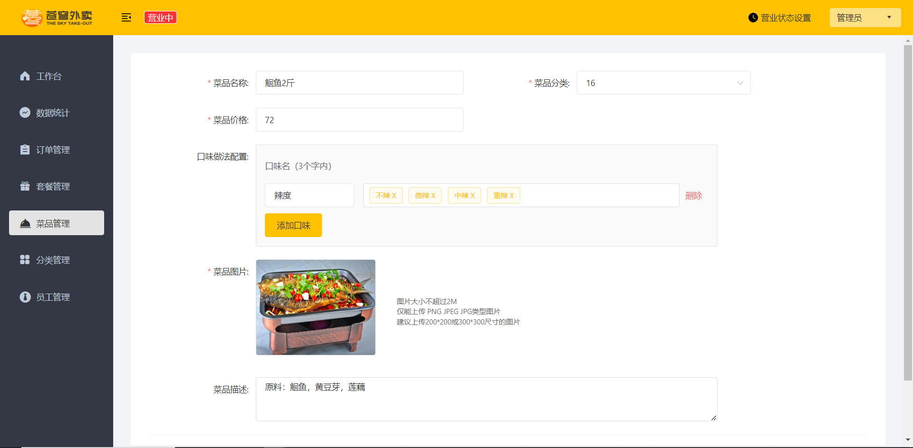

**图4.14 修改菜品信息**

选择停售或起售菜品效果展示如图4.15所示。

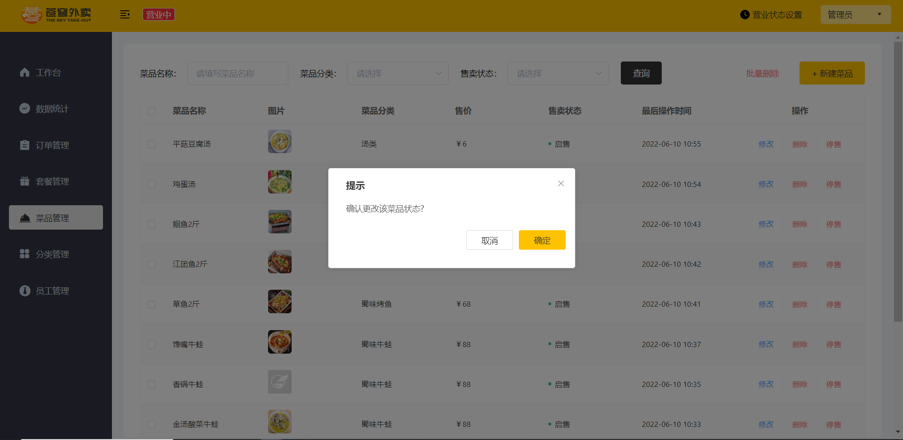

**图4.15 停售或起售菜品**

删除菜品信息效果展示如图4.16所示。

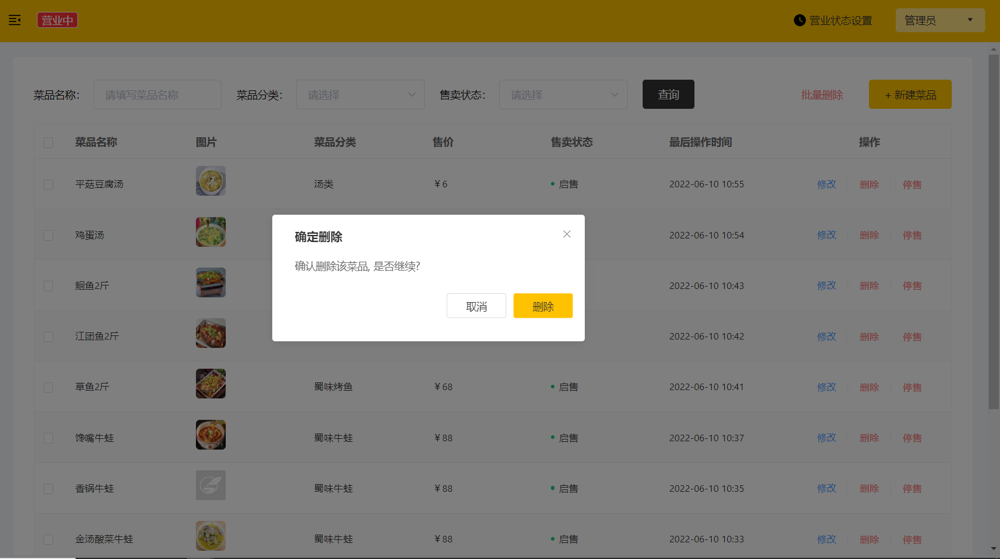

**图4.16 删除菜品信息**

（3）详细设计和实现

点击“新建菜品”按钮，页面发送ajax请求，请求后端获取菜品分类数据并展示到下拉框中，上传图片时页面还发送请求进行图片上传，请求后端将图片保存到服务器，页面再进行图片下载，将上传的图片进行回显，输入完数据点击“保存”按钮，发送ajax请求，将菜品相关数据以json形式提交给后端，后端接收到数据并进行处理，操作数据库保存数据。

查看菜品信息分页列表，页面向后端发出 ajax要求，向后端提交分页的查询参数（page，pageSize，菜品名称），后端控制器收到页面所递交的数据并调用Service查询数据，Service调用Mapper操作数据库，查询到所需的分页数据并返回，Controller将查询到的分页数据响应给页面，当前端页面接收到所需的分页数据后通过Element-UI的Table组件进而展示到页面上。

点击“修改”按钮时，页面会发出两次ajax要求，一次是请求后端获得分类数据，以便在菜品类别的下拉栏中进行数据的显示，另一次是要求后端以id来查看目前的菜品并回显，在单击“保存”按钮之后，页面会发出ajax请求，并以json格式将已更改过的菜品数据递交给后端。，后端接收数据并进行处理，操作数据库修改数据。

批量停售、批量起售和批量删除，页面发送ajax请求，将需要操作的id作为参数提交给后端，后端接收到数据并进行处理，全部正确的处理完毕后反馈给页面。

（4）关键代码

<table><tr><td>
/**

     * 新增菜品

     * @param dishDto

     * @return

     */

    @PostMapping

    @DeleteCache //清除redis缓存

    public R&lt;String&gt; save(@RequestBody DishDto dishDto){

        dishService.saveWithFlavor(dishDto);

        return R.success("新增菜品成功");

    }

    /**

     * 菜品信息分页查询

     * @param page

     * @param pageSize

     * @param name

     * @return

     */

    @GetMapping("/page")

    public R&lt;Page&gt; page(int page,int pageSize,String name){

        //构造分页构造器

        Page&lt;Dish&gt; pageInfo = new Page&lt;&gt;(page, pageSize);

        Page&lt;DishDto&gt; dishDtoPage = new Page&lt;&gt;();

        //条件构造器

        LambdaQueryWrapper&lt;Dish&gt; queryWrapper = new LambdaQueryWrapper&lt;&gt;();

        //添加过滤条件

        queryWrapper.ne(Dish::getIsDeleted, 1); //逻辑删除 ：1是删除，0是没删(na不等于，eq等于)

        queryWrapper.like(name!=null,Dish::getName,name);

        //添加排序条件

        queryWrapper.orderByDesc(Dish::getUpdateTime);

        //执行分页查询

        dishService.page(pageInfo,queryWrapper);

        //对象拷贝

        BeanUtils.copyProperties(pageInfo,dishDtoPage,"records");

        List&lt;Dish&gt; records = pageInfo.getRecords();

        List &lt;DishDto&gt; list= records.stream().map(item -&gt;{

            DishDto dishDto = new DishDto();

            BeanUtils.copyProperties(item,dishDto);

            Long categoryId = item.getCategoryId(); //分类id

            //根据id查询分类对象

            Category category = categoryService.getById(categoryId);

            if(category!=null){

                String categoryName = category.getName();

                dishDto.setCategoryName(categoryName);

            }

            return  dishDto;

        }).collect(Collectors.toList());

        dishDtoPage.setRecords(list);

        return R.success(dishDtoPage);

    }
</td></tr></table>

### **4.1.5 套餐管理模块**

（1）功能描述

后台管理员登录后可以点击“套餐管理”查看套餐信息，添加套餐信息，按关键字模糊查询，修改和删除操作，还可以选择批量删除、批量停售和批量起售。

（2）页面效果展示

查看套餐信息效果展示如图4.17所示。

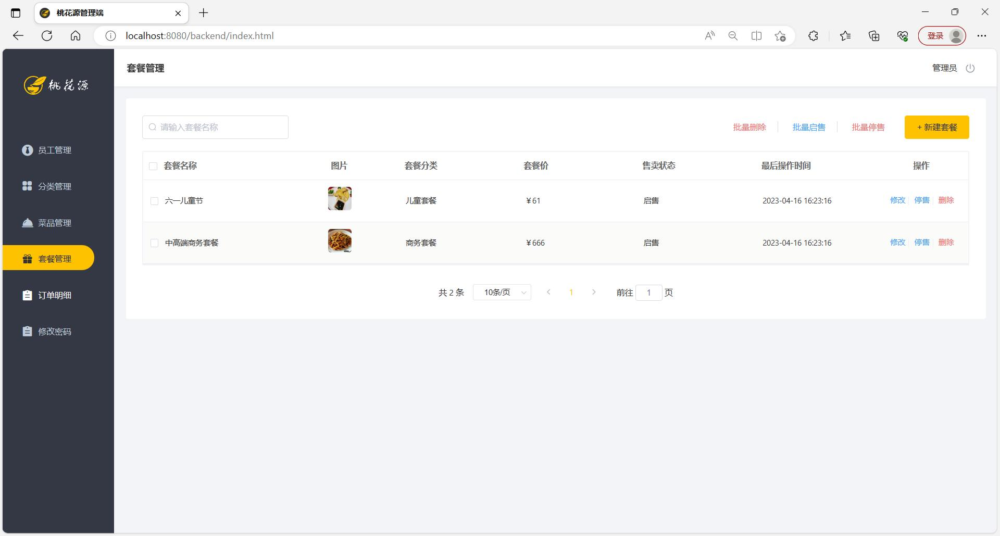

**图4.17 套餐信息**

新增套餐信息效果展示如图4.18所示。

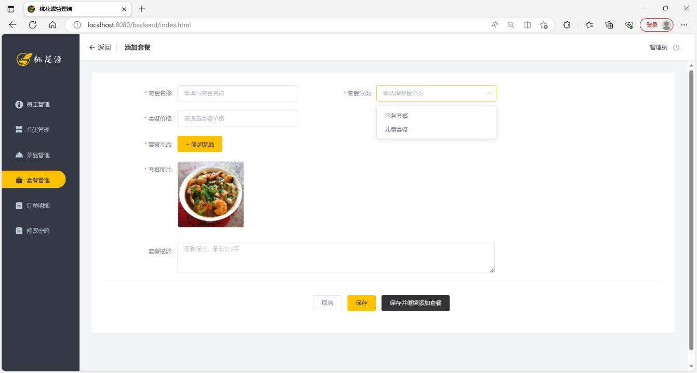

**图4.18 新增套餐信息**

修改套餐信息效果展示如图4.19所示。

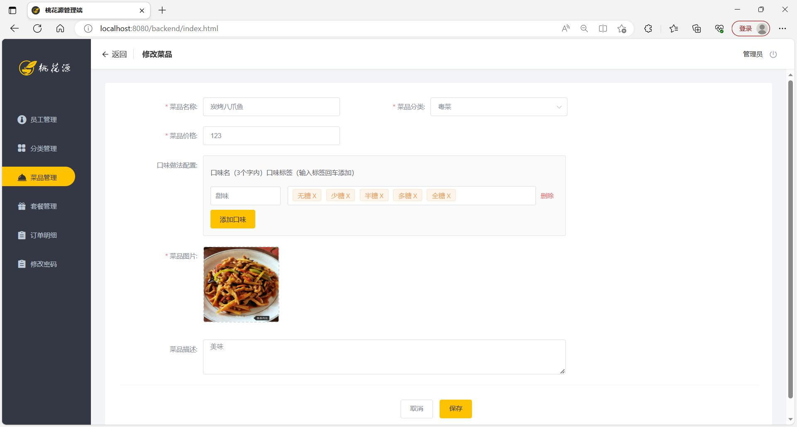

**图4.19 修改菜品信息**

删除套餐信息效果展示如图4.20所示。

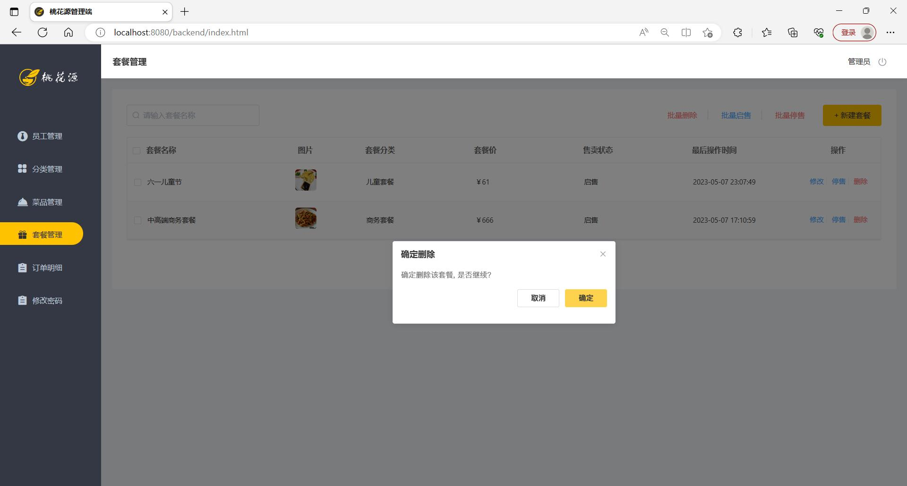

**图4.20 修改菜品信息**

（3）详细设计和实现

点击“新建套餐”按钮跳转到添加套餐页面，页面发送的是第一个ajax请求，它请求后端获得套餐分类数据，并将其显示在下拉框中。页面持续发出的是第二个ajax要求，它请求后端获得菜品分类数据，然后将其展示在添加菜品的窗口中。页面发出的是第三个ajax要求，要求后端按照菜品的分类，来查看相应的菜品，并将它展示在增加的菜品中。页面发送了第4个ajax要求，要求后端将其图片上传到服务器。页面发出了第5次ajax请求，要进行图片下载，并将上传的照片返回，单击“保存”，页面发出第6次ajax请求，以 json的方式将套餐有关数据提交给后端，后端接收到数据并将进行处理，最后正确操作数据库后反馈给前端。

查看套餐信息分页列表，页面向后端发出 ajax要求，向后端提交分页的查询参数（page，pageSize，套餐名称），后端控制器收到页面所递交的数据并调用Service查询数据，Service调用Mapper操作数据库，查询到所需的分页数据并返回，Controller将查询到的分页数据响应给页面，当前端页面接收到所需的分页数据后通过Element-UI的Table组件进而展示到页面上。

批量停售、批量起售和批量删除，页面发送ajax请求，将需要操作的id作为参数提交给后端，后端接收到数据并进行处理，全部正确的处理完毕后反馈给页面。

（4）关键代码

<table><tr><td>
  /**

     * 新增套餐

     * @param setmealDto

     * @return

     */

    @ApiOperation(value = "新增套餐接口")

    @PostMapping

    @CacheEvict(value = "setmealCache",allEntries = true)   //清除缓存是清除当前value值空间下的所有缓存数据

    public R&lt;String&gt; save(@RequestBody SetmealDto setmealDto){

        setmealService.saveWithDish(setmealDto);

        return R.success("新增套餐成功");

    }

    /**

     * 套餐分页查询

     * @param page

     * @param pageSize

     * @param name

     * @return

     */

    @GetMapping("/page")

    @ApiOperation(value = "套餐分页查询接口")

    @ApiImplicitParams({

            @ApiImplicitParam(name = "page",value = "页码",required = true),

            @ApiImplicitParam(name = "pageSize",value = "每页记录数",required = true),

            @ApiImplicitParam(name = "name",value = "查询套餐名称",required = false),

    })

    public R&lt;Page&gt; page(int page,int pageSize,String name){

        //分页构造器对象

        Page&lt;Setmeal&gt; pageInfo = new Page&lt;&gt;();

        Page&lt;SetmealDto&gt; dtoPage = new Page&lt;&gt;();

        //条件构造器

        LambdaQueryWrapper&lt;Setmeal&gt; queryWrapper = new LambdaQueryWrapper&lt;&gt;();

        //添加查询条件，根据name进行like模糊查询

        queryWrapper.like(name!=null,Setmeal::getName,name);

        //添加排序条件，根据更新时间降序排序

        queryWrapper.orderByDesc(Setmeal::getUpdateTime);

        setmealService.page(pageInfo,queryWrapper);

        //对象拷贝

        BeanUtils.copyProperties(pageInfo, dtoPage,"records");

        List&lt;Setmeal&gt; records = pageInfo.getRecords();

        List&lt;SetmealDto&gt; list = records.stream().map(item -&gt;{

            SetmealDto setmealDto = new SetmealDto();

            //对象拷贝

            BeanUtils.copyProperties(item,setmealDto);

            //分类id

            Long categoryId = item.getCategoryId();

            //根据分类id查询分类对象

            Category category = categoryService.getById(categoryId);

            if (category != null){

                //分类名称

                String categoryName = category.getName();

                setmealDto.setCategoryName(categoryName);

            }

            return setmealDto;

        }).collect(Collectors.toList());

        dtoPage.setRecords(list);

        return R.success(dtoPage);

    }

    /**

     * 根据id（批量）删除套餐

     * @param ids

     * @return

     */

    @DeleteMapping

    @CacheEvict(value = "setmealCache",allEntries = true)   //清除缓存是清除当前value值空间下的所有缓存数据

    public R&lt;String&gt; delete(@RequestParam List&lt;Long&gt; ids){

        setmealService.removeWithDish(ids);

        return R.success("套餐删除成功");

    }
</td></tr></table>

### **4.1.6 订单明细管理模块**

（1）功能描述

后台管理员登录后可以点击“订单明细”查看订单明细列表，按关键字模糊查询，按指定日期区间查询，查看指定订单明细，修改订单的状态（派送、完成）。

（2）页面效果展示

查看订单明细效果展示如图4.21所示。

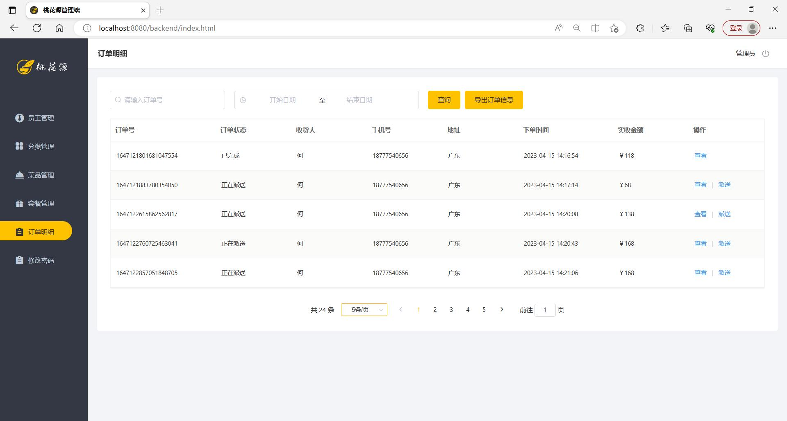

**图4.21 订单明细**

查看指定订单效果展示如图4.22所示。

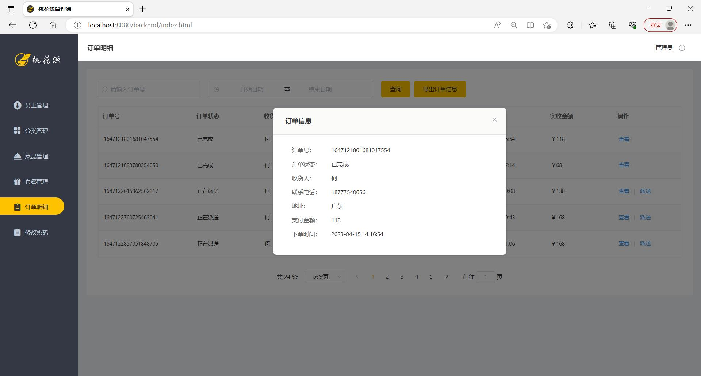

**图4.22 查看指定订单**

修改订单状态效果展示如图4.23所示。

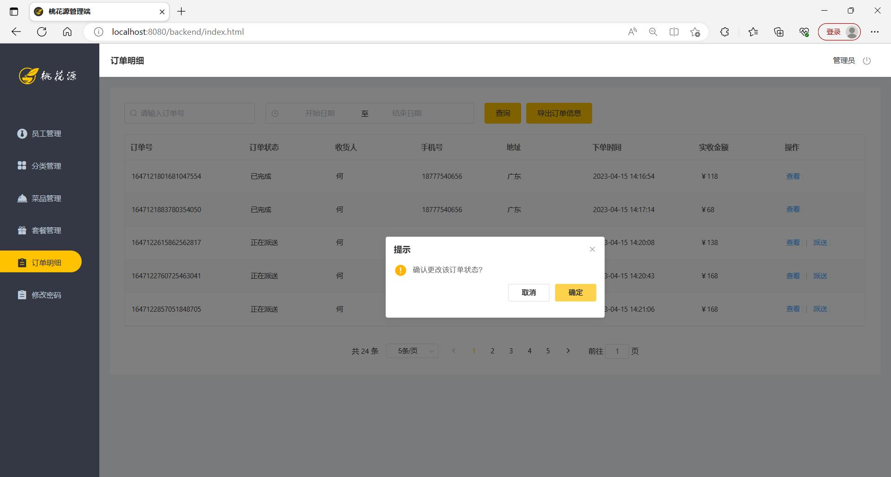

**图4.23 修改订单状态**

导出Excel订单数据效果展示如图4.24所示。

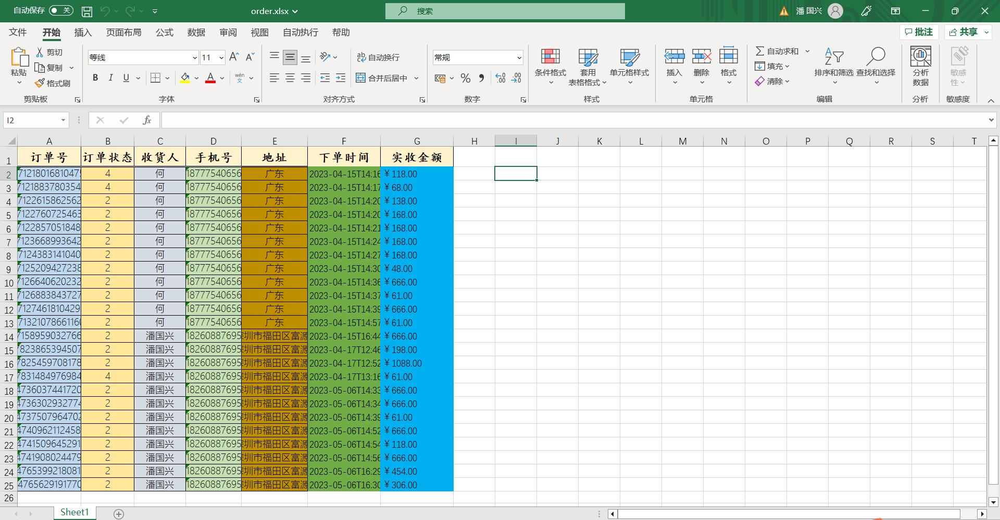

**图4.24 导出Excel订单数据**

（3）详细设计和实现

点击“查看”按钮，页面发送ajax请求，将参数订单id提交给后端，后端接收到参数并进行处理，返回指定订单数据给页面，页面弹出会话框并显示指定订单信息。

查看套餐信息分页列表，页面发送ajax请求，将分页查询参数（page、pageSize、订单号、起始日期、终止日期）提交到后端，参数订单号用于模糊查询，参数起始日期和终止日期用于对所选的日期区间的范围查询，后端控制器收到页面所递交的数据并调用Service查询数据，Service调用Mapper操作数据库，查询到所需的分页数据并返回，Controller将查询到的分页数据响应给页面，当前端页面接收到所需的分页数据后通过Element-UI的Table组件进而展示到页面上。

点击“派送”或者“完成”按钮时，页面发送ajax请求，将参数订单id和状态码到后端，后端接收到数据并进行处理，正确操作数据库并反馈给页面。

（4）关键代码

<table><tr><td>
/**

     * 订单明细 -&gt; 自动分页查询，也可以输入条件框带条件查询

     */

    @GetMapping("page")

    public R&lt;Page&gt; page(Integer page, Integer pageSize, String number, String beginTime, String endTime){

        //分页构造器

        Page&lt;Orders&gt; pageInfo = new Page&lt;&gt;(page, pageSize);

        log.info("订单id：{}，开始时间：{}，结束时间：{}",number,beginTime,endTime);

        //条件构造器

        LambdaQueryWrapper&lt;Orders&gt; queryWrapper = new LambdaQueryWrapper&lt;&gt;();

        queryWrapper.eq(number!=null,Orders::getNumber,number);

        queryWrapper.ge(beginTime!=null,Orders::getOrderTime, beginTime);

        queryWrapper.le(endTime!=null,Orders::getOrderTime, endTime);

        ordersService.page(pageInfo, queryWrapper);

        return R.success(pageInfo);

//        return null;

    }

    /**

     * 订单状态 2待派送，3已派送，4已完成 5取消

     * @param orders

     * @return

     */

    @PutMapping

    public R&lt;String&gt; ordersStatus(@RequestBody Orders orders){

        ordersService.updateById(orders);

        return R.success("操作成功");

    }
</td></tr></table>

### **4.1.7 退出登录模块**

（1）功能描述

点击关机标志按钮，可以退出当前登录的用户。

（2）页面效果展示

退出登录效果展示如图4.25所示。

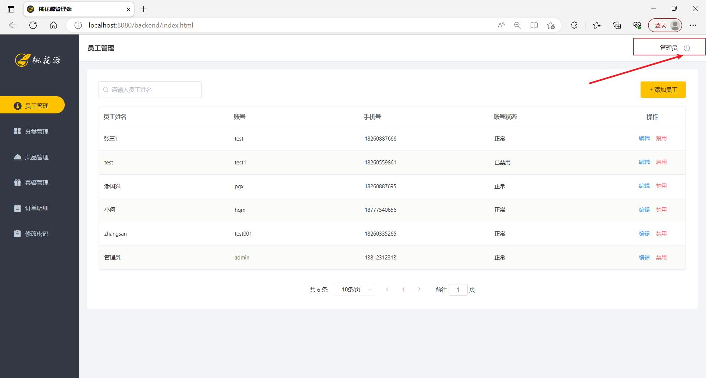

**图4.25 退出登录**

（3）详细设计和实现

点击按钮，直接销毁当前会话，清除Session中用户的id，然后直接跳转到登录界面。

（4）关键代码

<table><tr><td>
            logout() {

            logoutApi().then((res)=&gt;{

              if(res.code === 1){

                localStorage.removeItem('userInfo')

                window.location.href = '/backend/page/login/login.html'

              }

            })

          } 

 /**

     * 退出登录

     * @param request

     * @return

     */

    @PostMapping("/logout")

    public R&lt;String&gt; logout(HttpServletRequest request){

        //清楚Session中保存的当前登录员工的id

        request.getSession().removeAttribute("employee");

        return R.success("退出成功");

    }
</td></tr></table>

## **4.2 前台模块设计**

### **4.2.1 登录注册模块**

（1）功能描述

用户根据手机号码和短信验证码登录或注册前台系统。

（2）页面效果展示

用户登录效果展示如图4.26所示。

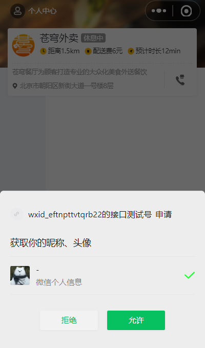

**图4.26 用户登录**

（3）详细设计和实现

使用js判断手机号码的是否是一个准确的号码格式，手机号码格式不准确在输入框下有提示，手机号码格式准确之后点击获取验证码，将用户输入的手机号码作为参数，使用AJAX发送请求，后端会将验证码以短信方式发送至用户手机，然后用户手机收到验证码短信之后输入正确的验证码，点击登录就可以进入系统，登录后判断当前手机号对应的用户是否为新用户，如果是新用户就自动完成注册，如果验证码输入错误，也会弹出验证码输入不正确的提示框提示给用户，手机号码登录使用到的技术是腾讯云短信服务接口。

（4）关键代码

<table><tr><td>
        //进行验证码的比对（页面提交的验证码和Session中保存的验证码比对）

        if(codeInSession != null &amp;&amp; codeInSession.equals(code)){

            //如果能够比对成功，说明登录成功

            LambdaQueryWrapper&lt;User&gt; queryWrapper = new LambdaQueryWrapper&lt;&gt;();

            queryWrapper.eq(User::getPhone,phone);

            User user = userService.getOne(queryWrapper);

            if(user == null){

                //判断当前手机号对应的用户是否为新用户，如果是新用户就自动完成注册(写入user表)

                user = new User();

                user.setPhone(phone);

                user.setStatus(1);

                userService.save(user);

            }

            //如果用户登录成功，删除redis中缓存的验证码

            stringRedisTemplate.delete(phone);

            return R.success(user);

        }

        if(!code.equalsIgnoreCase(codeInSession)){

            return R.error("验证码错误");

        }

        return R.error("登录失败");
</td></tr></table>

### **4.2.2 菜品浏览模块**

（1）功能描述

用户登录后跳转到系统首页，可以查看商家信息，菜品信息按照分类进行展示。

（2）页面效果展示

菜品浏览效果展示如图4.27所示。

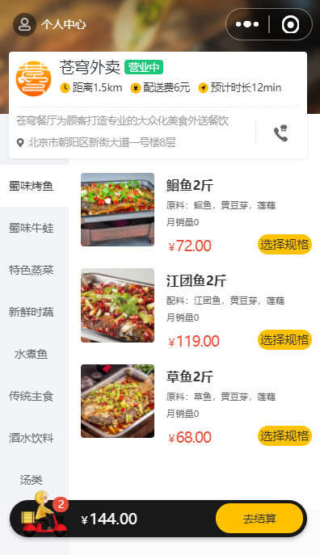

**图4.27 菜品浏览**

菜品详情效果展示如图4.28所示。

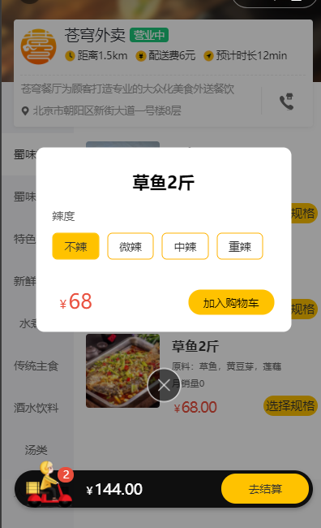

**图4.28 菜品详情**

（3）详细设计和实现

在前端，发出两次 ajax请求，其中一个请求获得分类数据（菜品分类和套餐分类），另一个请求是获得分类下的菜品或者套餐。

在后端，在controller层先从redis缓存中查询是否存在缓存数据，如果存在缓存数据直接将数据返回给前端页面，如果不存在缓存数据需要查询数据库，构造一个查询条件用分类id和起售状态(status)进行查询并添加了排序条件(sort)，之后将查询到的菜品数据缓存到redis中，还设置redis中缓存的过期时间，最后把查询到的数据返回给前端页面。

（4）关键代码

<table><tr><td>
@GetMapping("/list")

    public R&lt;List&lt;DishDto&gt;&gt; list(Dish dish){

        List &lt;DishDto&gt; dishDtoList=null;

        String key = "dish_"+dish.getCategoryId()+"_"+dish.getStatus();//示例：dish_1397844391040167938_1

        //先从redis中获取缓存数据

        dishDtoList = (List &lt;DishDto&gt;)redisTemplate.opsForValue().get(key);

        if (CollectionUtils.isNotEmpty(dishDtoList)) {

            //如果存在，直接返回，无需查询数据库

            return R.success(dishDtoList);

        }

        //如果不存在，需要查询数据库，并将查询到的菜品数据缓存到redis中

        //构造查询条件

        LambdaQueryWrapper&lt;Dish&gt; queryWrapper = new LambdaQueryWrapper&lt;&gt;();

        queryWrapper.eq(dish.getCategoryId()!=null, Dish::getCategoryId,dish.getCategoryId());

        queryWrapper.eq(Dish::getStatus, 1); //查询起售状态

        //添加排序条件

        queryWrapper.orderByAsc(Dish::getSort).orderByDesc(Dish::getUpdateTime);

        List&lt;Dish&gt; list = dishService.list(queryWrapper);

        dishDtoList=list.stream().map(item -&gt;{

            DishDto dishDto = new DishDto();

            BeanUtils.copyProperties(item,dishDto);

            Long categoryId = item.getCategoryId(); //分类id

            //根据id查询分类对象

            Category category = categoryService.getById(categoryId);

            if(category!=null){

                String categoryName = category.getName();

                dishDto.setCategoryName(categoryName);

            }

            //当前菜品id

            Long dishId = item.getId();

            LambdaQueryWrapper&lt;DishFlavor&gt; flavorLambdaQueryWrapper = new LambdaQueryWrapper&lt;&gt;();

            flavorLambdaQueryWrapper.eq(DishFlavor::getDishId,dishId);

            List&lt;DishFlavor&gt; dishFlavorList = dishFlavorService.list(flavorLambdaQueryWrapper);

            dishDto.setFlavors(dishFlavorList);

            return  dishDto;

        }).collect(Collectors.toList());

        //将菜品数据缓存到redis中

        redisTemplate.opsForValue().set(key,dishDtoList,60, TimeUnit.MINUTES); //60分钟过期

        return R.success(dishDtoList);

    }
</td></tr></table>

### **4.2.3 购物车模块**

（1）功能描述

用户选择好菜品或套餐加入购物车，并对购物车进行管理。

（2）页面效果展示

购物车效果展示如图4.29所示。

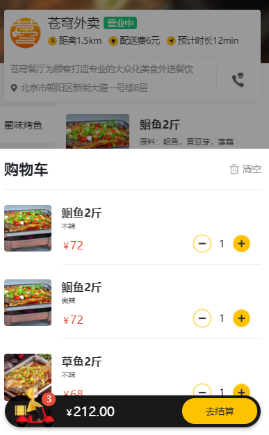

**图4.29 购物车**

（3）详细设计和实现

用户点击“加入购物车”或者“+”号按钮，页面发送ajax请求，请求后端，后端接收到请求，先设置用户的id，指定目前属于哪位用户的购物车数据，并对目前加入进来的菜品或套餐进行查询是否已经存在购物车中，若有，就会增加1，若没有，就会将其加入到购物车中，其数量为1。

用户点击购物车图标，页面发送ajax请求，请求后端查询购物车中的菜品和套餐，构造一个查询条件构造器，将当前用户的id和加入购物车的时间作为条件查询，查询到数据并返回给前端页面。

用户点击减少或清空，减少是对购物车内菜品或套餐数量减1，如果为0则该条菜品或套餐从购物车消失；清空是对购物车内所有的数据进行删除，全部消失。

（4）关键代码

<table><tr><td>
/**

     * 添加到购物车

     * @param shoppingCart

     * @return

     */

    @PostMapping("/add")

    public R&lt;ShoppingCart&gt; add(@RequestBody ShoppingCart shoppingCart) {

        //设置用户id，指定当前是哪个用户的购物车数据

        Long currentId = BaseContext.getCurrentId();

        shoppingCart.setUserId(currentId);

        //查询当前菜品或者套餐是否在购物车中

        Long dishId = shoppingCart.getDishId();

        LambdaQueryWrapper&lt;ShoppingCart&gt; queryWrapper = new LambdaQueryWrapper&lt;ShoppingCart&gt;();

        queryWrapper.eq(ShoppingCart::getUserId, currentId);

        if (dishId != null) {

            //添加到购物车的是菜品

            queryWrapper.eq(ShoppingCart::getDishId, dishId);

        } else {

            //添加到购物车的是套餐

            queryWrapper.eq(ShoppingCart::getSetmealId, shoppingCart.getSetmealId());

        }

        ShoppingCart cartServiceOne = shoppingCartService.getOne(queryWrapper);

        if (cartServiceOne != null) {

            //如果已经存在，就在原来的数量基础上加上1

            Integer number = cartServiceOne.getNumber();

            cartServiceOne.setNumber(number + 1);

            shoppingCartService.updateById(cartServiceOne);

        } else {

            //如果不存在，则添加到购物车，数量默认就是1

            shoppingCart.setNumber(1);

            shoppingCart.setCreateTime(LocalDateTime.now());

            shoppingCartService.save(shoppingCart);

            cartServiceOne = shoppingCart;

        }

        return R.success(cartServiceOne);

    }

    /**

     * 查看购物车

     *

     * @return

     */

    @GetMapping("list")

    public R&lt;List&lt;ShoppingCart&gt;&gt; list() {

        LambdaQueryWrapper&lt;ShoppingCart&gt; queryWrapper = new LambdaQueryWrapper&lt;&gt;();

        queryWrapper.eq(ShoppingCart::getUserId, BaseContext.getCurrentId());

        queryWrapper.orderByDesc(ShoppingCart::getCreateTime);

        List&lt;ShoppingCart&gt; list = shoppingCartService.list(queryWrapper);

        return R.success(list);

    }
</td></tr></table>

### **4.2.4 地址管理模块**

（1）功能描述

用户可以对自己的地址进行管理，点击书写按钮可以进行该地址的修改或删除，点击“设为默认地址”后下单时默认选择该地址，点击“添加收货地址”输入地址信息后保存可以新增收货地址。

（2）页面效果展示

地址管理效果展示如图4.30所示。

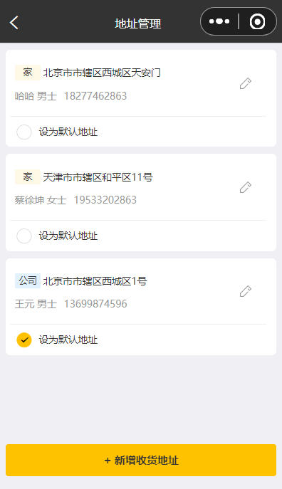

**图4.30 地址管理**

编辑地址信息效果展示如图4.31所示。

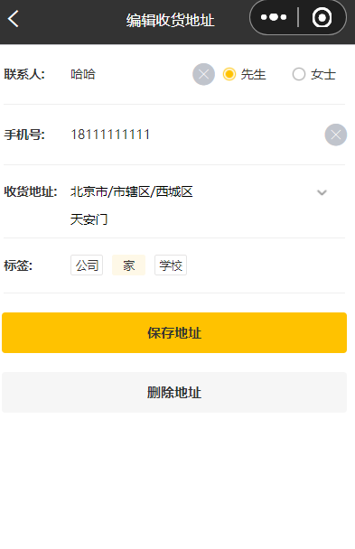

**图4.31地址管理**

（3）详细设计和实现

用户点击“地址管理”后，前端发送ajax请求，后端接收请求后查询该用户的地址信息，首先取出用户id，构造一个查询条件构造器，将用户id作为条件查询，并用修改时间作为排序条件，查询到数据后返回给前端页面。

用户点击“添加收货地址”，跳转到输入信息页面，提交后发送请求，后端接收到请求，处理数据将信息写入address\_book表中。

点击书写按钮，跳转到编辑地址页面，页面发送ajax请求，后端接收到请求后查询到该地址信息并进行回显，点击“保存地址”按钮，页面发送ajax请求，将数据以json的形式提交给后端，后端接收到数据并进行处理后响应给页面，点击“删除地址”按钮，页面发送ajax请求，将id作为参数提价给后端，后端接收到数据并进行处理后响应给页面。

（4）关键代码

<table><tr><td>
    /**

     * 新增

     */

    @PostMapping

    public R&lt;AddressBook&gt; save(@RequestBody AddressBook addressBook) {

        addressBook.setUserId(BaseContext.getCurrentId());

        log.info("addressBook:{}", addressBook);

        addressBookService.save(addressBook);

        return R.success(addressBook);

}

    /**

     * 查询指定用户的全部地址

     */

    @GetMapping("/list")

    public R&lt;List&lt;AddressBook&gt;&gt; list(AddressBook addressBook) {

        addressBook.setUserId(BaseContext.getCurrentId());

        log.info("addressBook:{}", addressBook);

        //条件构造器

        LambdaQueryWrapper&lt;AddressBook&gt; queryWrapper = new LambdaQueryWrapper&lt;&gt;();

        queryWrapper.eq(null != addressBook.getUserId(), AddressBook::getUserId, addressBook.getUserId());

        queryWrapper.orderByDesc(AddressBook::getUpdateTime);

        return R.success(addressBookService.list(queryWrapper));

    }
</td></tr></table>

### **4.2.5 下单支付模块**

（1）功能描述

用户将菜品或套餐加入购物车后，点击购物车中的“去结算”按钮，页面跳转到订单确认页面，再点击“去支付”跳转到支付宝支付。

（2）页面效果展示

下单支付效果展示如图4.32、图4.33和图4.34所示。

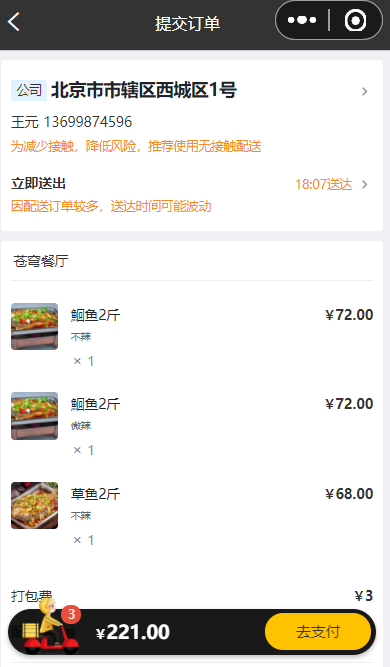

**图4.33 支付成功**

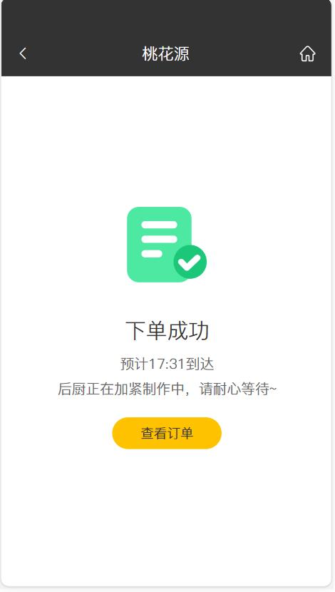

**图4.34 下单完成**

（3）详细设计和实现

在订单确认页面中，有两个 Ajax请求被发出，其中一个是后端获得目前已登陆的用户的默认地址，另一个是后端获得目前已登陆的用户的购物车数据，获取到这两个数据返回给订单确认页面并显示。

点击“去支付”，发送ajax请求将购物车金额发送给后端，后端接收到数居生成一条订单记录并调用支付宝沙盒环境接口使用沙盒账号完成支付，支付完成后修改订单的状态，最后回调到下单成功界面。

（4）关键代码

<table><tr><td>
/**

     * 用户下单

     * @param orders

     * @return

     */

    @PostMapping("/submit")

    public R&lt;Object&gt; aliPay(@RequestBody Orders orders){

        Orders submit = ordersService.submit(orders);

        long orderId = IdWorker.getId(); //生成支付订单号

        AlipayBean bean = ordersService.getBean(submit,orderId);

        //获得初始化的AlipayClient

        AlipayClient alipayClient = new DefaultAlipayClient(AliPayConfig.gatewayUrl, AliPayConfig.app_id, AliPayConfig.merchant_private_key, "json", AliPayConfig.charset, AliPayConfig.alipay_public_key, AliPayConfig.sign_type);

        //设置请求参数

        AlipayTradePagePayRequest aliPayRequest = new AlipayTradePagePayRequest();

        //商户订单号，后台可以写一个工具类生成一个订单号，必填

        String order_number = new String(bean.getOut_trade_no());

        //付款金额，从前台获取，必填

        String total_amount = new String(bean.getTotal_amount());

        //订单名称，必填

        String subject = new String(bean.getSubject());

        aliPayRequest.setNotifyUrl(AliPayConfig.notify_url);

        aliPayRequest.setReturnUrl(AliPayConfig.return_url);

        aliPayRequest.setBizContent("{\"out_trade_no\":\"" + order_number + "\","

                + "\"total_amount\":\"" + total_amount + "\","

                + "\"subject\":\"" + subject + "\","

                + "\"product_code\":\"FAST_INSTANT_TRADE_PAY\"}");

        //请求

        String result = null;

        try {

            result = alipayClient.pageExecute(aliPayRequest).getBody();

        } catch (AlipayApiException e) {

            e.printStackTrace();

        }

 //回调地址

  returnUrl: http://localhost:8080/front/page/pay-success.html
</td></tr></table>

### **4.2.6 订单管理模块**

（1）功能描述

用户可以查看自己的历史订单和最新订单。

（2）页面效果展示

下单支付效果展示如图4.35所示。

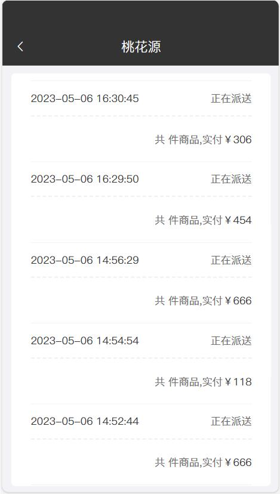

**图4.35 订单管理**

（3）详细设计和实现

点击“历史订单”可以查看用户的历史订单，前端发送ajax请求，后端接收到请求，构造一个查询条件构造器，将用户的id作为条件进行查询，并将下单时间为排序条件，将最新的订单排在前面。

（4）关键代码

<table><tr><td>
/**

     * 用户的最新订单

     * @param page

     * @param pageSize

     * @return

     */

    @GetMapping("/userPage")

    public R&lt;Page&gt; userPage(Integer page, Integer pageSize){

        //分页构造器

        Page pageInfo = new Page&lt;&gt;(page,pageSize);

        //获取当前用户id

        Long userId = BaseContext.getCurrentId();

        LambdaQueryWrapper&lt;Orders&gt; queryWrapper = new LambdaQueryWrapper&lt;&gt;();

        queryWrapper.eq(Orders::getUserId, userId);

        queryWrapper.orderByDesc(Orders::getOrderTime);

        ordersService.page(pageInfo, queryWrapper);

        return R.success(pageInfo);

    }
</td></tr></table>

### **4.2.7 个人中心模块**

（1）功能描述

用户可以查看个人信息，展示最新的一条订单，退出当前用户。

（2）页面效果展示

下单支付效果展示如图4.36所示。

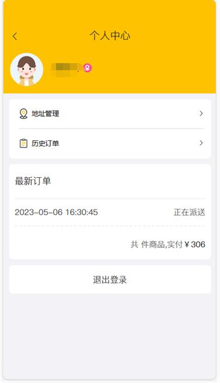

**图4.36个人中心**

（3）详细设计和实现

用户进入个人中心，前端页面发送第两个ajax请求，第一个请求后端接收到请求，查询该用户的最新一条订单数据返回给前端显示，第二个请求后端获取用户的个人信息并返回给前端页面显示，点击“退出登录”后端接收到请求销毁当前会话，并跳转到登录页面。

（4）关键代码

<table><tr><td>
    /**

     * 退出登录

     */

    @PostMapping("loginout")

    public R&lt;String&gt; loginout(HttpSession session){

        session.invalidate();

        return R.success("用户退出");

    }
</td></tr></table>

# **5 总结与展望**

## **5.1总结**

我国外卖餐饮订餐的方式是电话订餐和互联网订餐，发展至今，我国的外卖订餐系统已经慢慢完善起来，通过对普通餐饮行业的调查发现，把餐饮和网络应用结合起来并不多，由此提出区域性餐饮网络营销的想法。以城区中小型餐厅为主体服务对象，结合城区周边住宅和学校园区的特点，开发出开放型餐饮服务平台。

本系统所设计和实现的外卖订餐系统最主要实现网上订餐，用户可以使用前台系统浏览菜品、加入购物车、编辑个人信息和收货地址、结算购物车、下单支付，管理员可以在后台系统维护菜品信息和套餐信息，供前台用户挑选下单，还可以查看所有订单，对订单进行操作。

## **5.2展望**

本系统相对于其他各大外卖订餐系统，本系统还需完善以下三个方面：

1. 系统流程简单，功能没有创新。后期设计在线秒杀活动、某节日享折扣活动、团购活动等。
2. 系统的安全性，系统可能存在未知的安全隐患，系统一旦遭到黑客攻击，盗取用户隐私信息，对系统进行破坏以致无法使用。后期会执行全面的安全审计，确保数据安全加密，遵循正确的日志记录实践，定期漏洞扫描及更新。
3. 高并发性的完善，系统开发所有用户，当同时访问量多的时候，系统容易瘫痪。后期会采用优化算法和代码、数据库优化和分布式技术解决高并发问题。

# **参考文献**

1. 李敏儿. 餐饮企业外卖订餐系统的设计与实现[D].华南理工大学,2016.
2. 佟亚超.计算机软件Java编程特点及技术探析[J].技术与市场,2021,28(12):86-87+89.
3. 连政. 基于HTML5技术的移动Web前端设计与开发[D].浙江工业大学,2014.
4. 方生.基于“Vue.js”前端框架技术的研究[J].电脑知识与技术,2021,17(19):59-60+64.DOI:10.14004/j.cnki.ckt.2021.1863.
5. [熊永平.基于Spring Boot框架应用开发技术的分析与研究[J].电脑知识与技术,2019,15(36):76-77.DOI:10.14004/j.cnki.ckt.2019.4290.
6. 王艳梅.jQuery在AJAX技术框架中页面加载的应用分析[J].电脑知识与技术,2020,16(36):210-212.DOI:10.14004/j.cnki.ckt.2020.3743.
7. 蒋睿.MySQL数据库安全研究[J].电脑知识与技术,2020,16(09):3-4+21.

**致谢**

在此，我衷心感谢所有在我大四论文写作过程中给予我帮助、支持和鼓励的老师、同学和亲友。

首先，我要对我的

指导老师xxx表示由衷的感激。您的专业素养、严谨治学的精神深深感染和鼓舞了我，使我在写作本论文过程中受益匪浅。在论文创作的初期，您为我提供了诸多宝贵的建议和深刻的见解；在论文完成阶段，您不厌其烦地为我修改润色。您的聪明才智、独到见解、耐心指导对我论文的完成起到了至关重要的作用，使我在学术研究的道路上成长颇多。

最后，我要感谢我的父母，感谢您们多年来对我无私的奉献和关爱。您们严谨而不失亲切的教诲，使我能在个人品性和学业上不断成长。感谢您们在我面临困难时的支持和包容，您们是我最坚实的后盾。

在这充满回忆和感慨的时光，我感叹时间的流逝，岁月的无情。借此机会，为所有人献上我最真挚的感谢！谢谢！

祝愿我们母校越办越好，祝愿教育事业蒸蒸日上！

**广西民族师范学院本科毕业论文(设计)诚信保证书**

（学生用）

对于毕业论文（设计）《 外卖订餐系统的设计与实现 》，本人郑重承诺：其内容真实、可靠，系本人在<u>___闫新宝____</u>教师的指导下独立完成；如果被查出有弄虚作假、抄袭剽窃行为，本人愿承担全部责任。

承诺者（签名）：

年 　 月 　 日